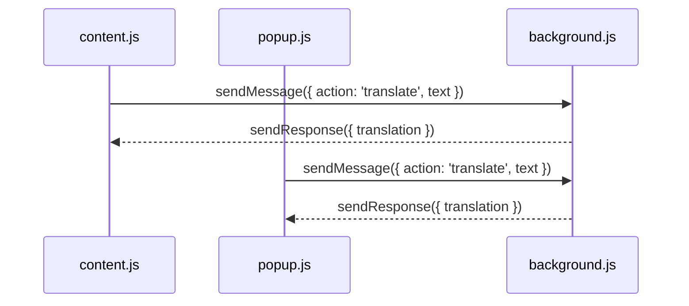

# 第 4 课：消息传递

Chrome 插件开发指南 · 实战课程 · runtime.sendMessage 与异步 sendResponse

本课配套开源 Demo [**04-message-passing**](https://github.com/davidapp/chrome-extension-demos/tree/main/04-message-passing)：「划词翻译助手」——Content Script、Popup、Service Worker 通过 **消息总线** 协作，并掌握异步响应时 **`return true`** 的要点。


_▲ Popup 与 Service Worker 消息往返后渲染出的译文（真实消息通信结果）_

::: info
本文讲解原理与关键片段；**完整 HTML/CSS/JS 及逐步操作**见仓库 [`04-message-passing`](https://github.com/davidapp/chrome-extension-demos/tree/main/04-message-passing) 目录内的 README。
:::

## 本课目标

- 使用 `chrome.runtime.sendMessage` / `onMessage`
- 声明式注入 `content_scripts`（http/https 自动加载）
- 网页划词 → 悬浮卡片 → 后台翻译 → 回显
- Popup 手动输入走同一后台 handler

## 为什么需要消息

Popup、Content Script、Service Worker **三个隔离世界**，不能直接共享变量。数据交换靠：

| API | 方向 |
| --- | ---- |
| `chrome.runtime.sendMessage` | 任意上下文 → 扩展内部（通常到 SW） |
| `chrome.tabs.sendMessage` | 扩展 → 指定 tab 的 Content Script |
| `chrome.runtime.onMessage` | 监听入站消息 |

## manifest.json

```json
{
  "manifest_version": 3,
  "name": "划词翻译助手",
  "version": "1.0.0",
  "background": {
    "service_worker": "background.js"
  },
  "content_scripts": [
    {
      "matches": ["http://*/*", "https://*/*"],
      "js": ["content.js"]
    }
  ],
  "action": {
    "default_popup": "popup.html"
  }
}
```

本 Demo **零 permissions**——声明式 content_scripts + background 即可。

## 消息流（Mermaid）



## background.js：异步必须 return true

```javascript
chrome.runtime.onMessage.addListener((request, _sender, sendResponse) => {
  if (request.action === 'translate') {
    setTimeout(() => {
      sendResponse({
        success: true,
        translation: mockTranslate(request.text),
      });
    }, 500);
    return true; // 保持通道，等待异步 sendResponse
  }
});
```

不写 `return true` 会报错：`The message port closed before a response was received`。

## content.js：划词 + 悬浮窗

```javascript
document.addEventListener('mouseup', () => {
  const selectedText = window.getSelection().toString().trim();
  if (!selectedText) return removeTooltip();
  // 创建 position:absolute 悬浮 div，z-index: 2147483647
  chrome.runtime.sendMessage(
    { action: 'translate', text: selectedText },
    (response) => {
      if (chrome.runtime.lastError) { /* … */ return; }
      updateResult(response.translation);
    },
  );
});
```

悬浮层用**内联样式 + `!important`**，降低被宿主 CSS 覆盖的概率。

## popup.js

```javascript
chrome.runtime.sendMessage({ action: 'translate', text }, (response) => {
  translatedTextEl.textContent = response?.translation ?? '失败';
});
```

## 获取源码

```bash
git clone https://github.com/davidapp/chrome-extension-demos.git
cd chrome-extension-demos/04-message-passing
```

也可 [Download ZIP](https://github.com/davidapp/chrome-extension-demos/archive/refs/heads/main.zip) 解压后进入 `04-message-passing` 目录。

## 体验步骤

1. 打开 `chrome://extensions` → 开发者模式 → **加载已解压的扩展程序** → 选择 `04-message-passing` 目录
2. **刷新**已打开网页（让 content.js 注入）
3. 网页选中英文 → 悬浮译文
4. Popup 输入文字 → 点击翻译

调试：网页 Console 看 content 日志；`chrome://extensions` 看 SW 日志。

## 课后练习

1. `background.js` 用 `fetch` 接真实翻译 API（见 [网络与 CORS](/manual/computer-programming/chrome-extension/network-and-cors)）
2. Popup 按钮 `chrome.tabs.sendMessage` 改网页背景色

## 延伸阅读

- [完整源码：`04-message-passing`](https://github.com/davidapp/chrome-extension-demos/tree/main/04-message-passing) — 可运行项目与 README 逐步说明
- [消息传递](/manual/computer-programming/chrome-extension/messaging)
- [Content Scripts](/manual/computer-programming/chrome-extension/content-scripts)

## 小结

扩展各上下文靠消息协作；异步 `sendResponse` 必须 `return true`。下一课系统学习 `chrome.storage`。

→ 下一课：[第 5 课：Storage API](/manual/computer-programming/chrome-extension/lesson-05-storage-api)
