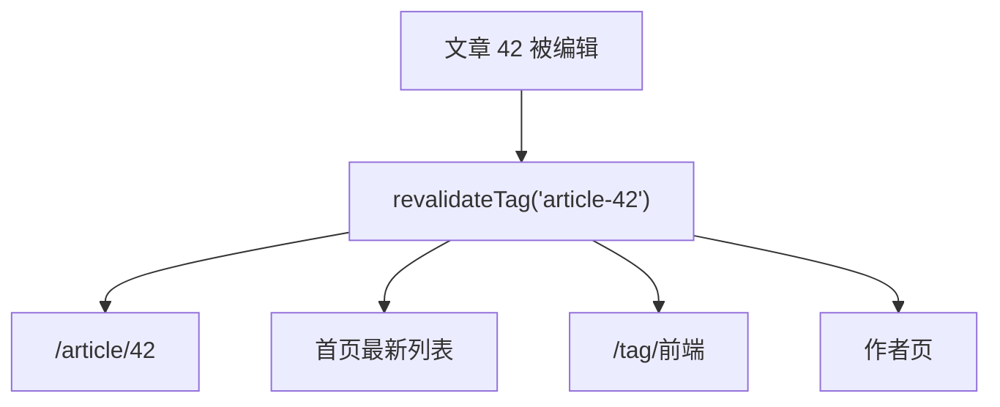

# 缓存失效 · TTL、按路径、按标签、按需

「计算机科学只有两件难事：缓存失效和命名。」数据变了、缓存却还旧着，怎么让它精准更新？这一章讲清基于时间(TTL)与按需（事件驱动）两大流派，以及按路径、按标签失效——尤其是标签如何破解「哪些页面依赖这份数据」的难题。

有句在程序员圈流传甚广的话：

> **「计算机科学里只有两件难事：缓存失效，和给东西起名字。」**——Phil Karlton

缓存本身不难，难的是**失效**：数据已经变了，可缓存里还是旧的，怎么让它**在恰当的时机、精准地**更新？这一章就攻这件「两大难事」之一。

## 两大流派：被动过期 vs 主动失效

缓存失效的所有做法，归根到底就两派：

- **基于时间（被动）**：给缓存设个 TTL，时间一到自动过期——就是前面的 `max-age`、[SWR](/manual/computer-programming/ssr/swr)、[ISR 的 `revalidate`](/manual/computer-programming/ssr/isr)。**简单、零维护**，但永远有个「最长陈旧窗口」，而且**你没法在数据一变就立刻刷新**——只能等它自己过期。
- **按需（主动 / 事件驱动）**：数据一发生变化，就**主动去把受影响的缓存清掉 / 重新生成**。**精准、即时**，但你得**知道该清哪些**，还得在**每一处写数据的地方**都记得触发失效。

::: info
**最佳实践通常是两者叠用：TTL 兜底 + 按需精修。** 用一个较长的 TTL（比如 1 小时）当**安全网**——就算你哪次忘了主动失效，内容最多旧一小时也会自愈；同时在关键的写路径上做**按需失效**，让重要变更**秒级生效**。被动保正确性下限，主动保新鲜度上限。**只靠按需，漏一处就永久旧；只靠 TTL，新鲜度永远差一截。**
:::

## 按需失效的粒度：路径 vs 标签

主动失效最核心的问题是：**「清哪些」**。有两种指定方式，难度天差地别。

**按路径(by path)** —— 直接点名要清的 URL：

```js
revalidatePath('/article/42');
```

直观，但有个致命短板：**你得自己想全「这份数据出现在哪些页面上」。** 文章 42 改了，受影响的不只是 `/article/42`——还有首页的最新列表、`/tag/xxx` 标签页、作者页、RSS……**漏掉任何一个，那页就永久显示旧数据。** 依赖关系一复杂，按路径失效就极易出错。

**按标签(by tag)** —— 这才是破局的关键。给**数据**打标签，渲染用到该数据的**每个页面**都自动带上这个标签；数据一变，**按标签一键清掉所有带它的页面**，不管它们在哪个路径：

```js
// 取数时打标签(或在 Next.js 16 的 'use cache' 函数中调用 cacheTag('article-42'))
await fetch('/api/article/42', { next: { tags: ['article-42'] } });

// 文章 42 一改,清掉所有用到它的页面——不用你去想有哪些
revalidateTag('article-42');
```



::: info
**标签解决的，正是失效里最难的那部分——依赖图。** 「哪些页面依赖这份数据」这个问题，人脑很难维护周全；标签把它**反过来**：不是你去追踪「数据 → 页面」，而是每个页面在渲染时**自己声明**「我用了带这个标签的数据」。于是失效时只需喊一声标签，框架自动找齐所有相关页面。**能用标签，就别用手写路径清单。**
:::

## CDN 层的失效：purge 与传播延迟

上面是框架层。到了 [CDN 层](/manual/computer-programming/ssr/cdn-caching)，主动失效叫 **purge（清除）**，同样有几种粒度：

- **按 URL purge**：清单个页面，最精准。
- **按标签 / surrogate key purge**：CDN 也支持缓存标签（Fastly 的 surrogate key、Cloudflare 的 cache tag），一次清一批，和框架标签是同一个思路。
- **purge everything（清空）**：核弹级，清掉整站缓存。**慎用**——清空后所有请求瞬间全部未命中、一起回源，等于自己制造一次[缓存击穿](/manual/computer-programming/ssr/cdn-caching)。

::: warning
**CDN 的 purge 不是瞬间全球生效的。** CDN 有全球几百个节点，一次 purge 要**传播**到所有节点，通常是**秒级**（偶尔更久）。所以「点了保存，线上却还没变」有时不是 bug，是 purge 还在传播。设计时要接受这个**最终一致**的现实：失效是「很快」，不是「瞬间」。真要求「写完立刻一定看到最新」，得绕过缓存直接回源读那一次。
:::

## 触发时机：webhook 串起来

按需失效怎么被触发？最常见的是 **webhook**：内容源（CMS、数据库、后台）在数据变更时，**主动打一个 HTTP 请求**到你的站点的失效接口，带上「变的是什么」，你的接口据此 `revalidateTag` / purge。

```text
编辑在 CMS 点「保存」
      → CMS 发 webhook:POST /api/revalidate { tag: "article-42" }
      → 你的接口:revalidateTag('article-42') + CDN purge tag
      → 秒级,线上更新
```

这条链把「数据变更」和「缓存失效」自动焊在一起——编辑不必懂缓存，点保存就行。

## 小结与下一章

缓存失效分**被动过期（TTL，简单但有陈旧窗口）** 和**按需失效（精准但要接线）**，最佳实践是两者叠用。按需失效的粒度里，**按标签**远胜按路径——它把「哪些页面依赖这份数据」这个最难的依赖图问题，交给页面自己声明。CDN 层对应 purge，注意它是最终一致、有传播延迟。

现在，缓存这一站只剩最后、也是最硬的一块骨头了：**个性化内容**。「你好，张三」这种每人不同的页面，天生和「共享缓存」水火不容——可我们又想要 CDN 的速度。这个两难怎么破？下一章，缓存的压轴。👉 [个性化与缓存：每人不同的页面怎么缓存](/manual/computer-programming/ssr/personalization)。

## 参考文献

- [1] Next.js 文档.「revalidateTag / revalidatePath.」https://nextjs.org/docs/app/api-reference/functions/revalidateTag —— 按标签 / 按路径失效。
- [2] Fastly.「Purging with surrogate keys.」https://docs.fastly.com/en/guides/working-with-surrogate-keys —— 标签式 CDN purge。
- [3] Cloudflare.「Purge cache by cache-tag / URL.」https://developers.cloudflare.com/cache/how-to/purge-cache/ —— CDN 失效与传播。
