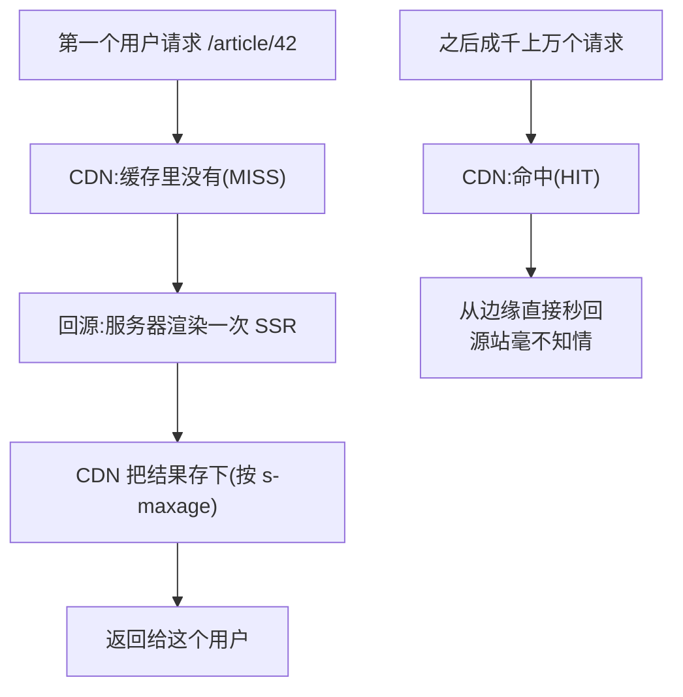

# CDN / 边缘缓存 · SSR 的 HTML 怎么被缓存

CDN 缓存是保护 SSR 源站最关键的一层：第一个请求触发一次渲染，之后成千上万个请求全从边缘秒回，源站再也碰不到。这一章讲清缓存键、命中状态、源站屏蔽，以及最凶险的「缓存击穿」。

在[缓存分层](/manual/computer-programming/ssr/why-cache) 里，CDN 是**最关键的一层**——因为它是**唯一能让请求「根本到不了你服务器」的缓存**。浏览器缓存只保护单个用户，CDN 缓存保护的是**你的源站**。对 SSR 来说，这层几乎决定生死。

## 一次渲染，服务所有人

CDN（内容分发网络）是一张遍布全球的边缘节点网。它缓存 SSR 页面的逻辑，就是[上一章](/manual/computer-programming/ssr/http-caching) `Cache-Control` 的直接应用：



关键就在最后两步：**只有第一个（缓存未命中的）请求真的触发了渲染；在 `s-maxage` 有效期内，后续所有请求都由 CDN 从边缘直接返回，你的源站一次都没被碰到。** 这叫**源站屏蔽(origin shielding)**。一个 `s-maxage=60` 的热门页，哪怕每秒一万次访问，源站每 60 秒也只渲染**一次**——扛量能力天差地别。

## 缓存键：CDN 怎么判断「是不是同一个」

CDN 用**缓存键(cache key)** 来判断一个请求能不能命中已有缓存。默认的键就是 **URL**（方法 + 主机 + 路径 + 查询串），再加上响应里 [`Vary`](/manual/computer-programming/ssr/http-caching) 声明的那些请求头。

这带来两个实战要点：

- **查询参数会切分缓存**：`/list?page=1` 和 `/list?page=2` 是两个键，各存各的。但要小心**无意义的参数**（如营销追踪的 `?utm_source=...`）——它们会让同一个页面产生无数缓存键、命中率暴跌。通常要配置 CDN **忽略**这类参数。
- **`Vary` 会成倍切分**：上一章说过，`Vary: Cookie` 会按用户切分，基本等于关缓存。

## 看懂命中状态

CDN 通常会在响应头里告诉你这次是命中还是未命中，排查缓存问题时第一个要看它：

```text
CF-Cache-Status: HIT       # Cloudflare:命中
X-Cache: HIT from ...      # 通用:命中
```

常见状态：**`HIT`**（命中，边缘直接给）、**`MISS`**（未命中，回源了）、**`EXPIRED`**（过期后回源）、**`STALE`**（给了旧的，见[下一章](/manual/computer-programming/ssr/swr)）、**`BYPASS`**（被判定不可缓存，直接回源）。**上线后第一件事，就是确认你想缓存的页面真的是 `HIT`**——很多「缓存没生效」的问题，一看状态头就水落石出。

## 什么会让 CDN «不缓存»

一个常见的困惑是「我设了 `s-maxage`，怎么还是 `BYPASS`？」。CDN 出于安全，默认会**跳过缓存**若干情况：

::: warning
**响应里带 `Set-Cookie`，多数 CDN 会拒绝缓存这个响应**——因为 Cookie 通常是给某个用户设的会话，缓存下来发给别人就危险了。这是个高频坑：你的 SSR 框架 / 中间件可能**不知不觉给每个响应都带上了 `Set-Cookie`**（比如某个分析、会话中间件），结果整站缓存全部失效、`BYPASS` 满天飞。**排查缓存不生效，第二件事就是看响应有没有多余的 `Set-Cookie`。** 其它默认不缓存的：非 `GET` 请求、`Cache-Control: private/no-store`、带 `Authorization` 头的请求。
:::

## 最凶险的坑：缓存击穿

CDN 缓存有个经典的失效瞬间，叫**缓存击穿 / 惊群(cache stampede / thundering herd)**:

> 一个超热门页面的缓存**刚好过期**的那一刻，成百上千个并发请求**同时**发现「缓存没了」，于是**同时回源**——源站在一瞬间被灌入海量渲染请求，可能直接被打挂。

明明有缓存，却在过期的刹那被瞬间流量击穿。缓解办法有几个，都值得知道：

- **请求合并(request coalescing / dedup)**：好的 CDN 在缓存未命中时，会把「同一个键的并发回源请求」**合并成一个**发给源站，其余的等这一个的结果。多数主流 CDN 默认就做这个——但要确认你用的开了。
- **`stale-while-revalidate`**：过期后**先拿旧的顶着**、后台再更新，压根不产生「同时回源」的尖峰。这个解法相当优雅，正是[下一章](/manual/computer-programming/ssr/swr)的主题。
- **错开过期时间**：给 TTL 加一点随机抖动，别让大批页面在同一秒集体过期。

## 小结与下一章

CDN 缓存是保护 SSR 源站的命门：一次渲染经边缘服务所有人，源站屏蔽让扛量能力质变。用好它要懂**缓存键**（别被查询参数 / `Vary` 切碎）、会看**命中状态**、警惕 **`Set-Cookie` 导致的 `BYPASS`**，以及防住**缓存击穿**。

刚才反复提到的那个「过期后先给旧的、后台再更新」——它太重要，值得单独讲透。它既是防击穿的利器，也是理解 ISR 的钥匙，更是「又快又不太旧」这个看似矛盾目标的答案。👉 [stale-while-revalidate：又快，又不太旧](/manual/computer-programming/ssr/swr)。

## 参考文献

- [1] Cloudflare.「How CDN caching works / Cache keys.」https://developers.cloudflare.com/cache/ —— CDN 缓存、缓存键、命中状态。
- [2] MDN.「HTTP caching — shared caches.」https://developer.mozilla.org/en-US/docs/Web/HTTP/Caching —— 共享缓存与回源。
- [3] Nginx.「Mitigating thundering herd / proxy_cache_lock.」https://www.nginx.com/blog/ —— 缓存击穿与请求合并。
