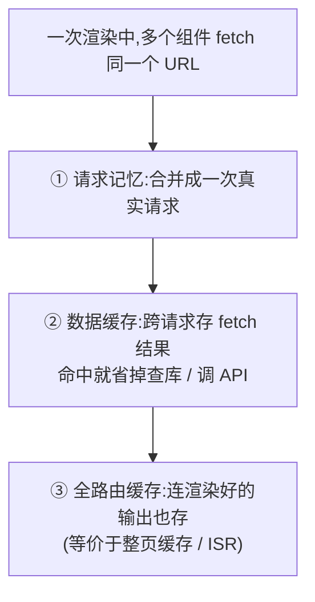

# 数据层缓存 · 缓存数据，而不是 HTML

有些页面 HTML 因人而异、没法整页缓存，但它底层用的数据是共享且昂贵的。这时该缓存的是数据，不是 HTML。这一章讲清请求记忆、跨请求数据缓存、全路由缓存三层，以及「HTML 缓存 vs 数据缓存」的分工。

前面几章缓存的都是**整页 HTML**——一次渲染的成果，大家共享。但有一大类页面**没法整页缓存**：个人中心、带「你好，张三」的首页、按用户权限过滤的列表……它们的 HTML **因人而异**。

难道这些页面就只能每请求从头现算、一点缓存都沾不上？不。**它们的 HTML 虽然因人而异，底下用的数据却常常是共享的、而且很贵。** 一个个性化首页可能 90% 的开销花在「查那个所有人都一样的热门商品榜」上，只有 10% 是「这个用户的名字」。**那就缓存那 90%——缓存数据，而不是 HTML。**

::: info
**两把刀，分工明确：**「整页 HTML 缓存」跳过的是**渲染**（命中就直接吐 HTML）；「数据缓存」跳过的是**取数**（命中就省掉查库 / 调 API，但**仍要渲染**）。个性化页面没法省渲染（每人不同），但完全可以省掉那些**共享且昂贵**的取数——这就是数据缓存的主场。
:::

## 数据缓存的三层

现代框架（以 Next.js 的模型最典型）把数据缓存分成三层，各管一段：



**① 请求记忆(Request Memoization)** —— 作用范围是**单次渲染内**。同一次渲染里，好几个组件都 `fetch('/api/user')`，框架**自动合并成一次真实请求**，其余的复用结果。它解决的是「组件树里重复取数」，渲染一结束就失效。**这层让你可以在需要数据的每个组件里放心地各自 `fetch`，不必费劲把数据从顶层一路传下去。**

**② 数据缓存(Data Cache)** —— 这才是**持久**的那层，**跨请求、跨用户**存取数或计算的结果。这是数据缓存的核心。例如在 Next.js 中（注：Next.js 15+ 起 `fetch` 默认不再自动缓存，需显式声明缓存策略；Next.js 16 的 Cache Components 则进一步提供了 `'use cache'` 指令，配合 `cacheLife` / `cacheTag` 可直接缓存任意异步函数或数据库查询，不再局限于 `fetch`）：

```js
// 缓存这次取数的结果,60 秒内所有请求(不论哪个用户)都复用它
const res = await fetch('https://api/hot-products', {
  next: { revalidate: 60, tags: ['hot-products'] },
});
```

一个个性化页面渲染时，「查用户名」不缓存（每人不同），但「查热门榜」命中数据缓存——**渲染照跑，但那次最贵的查询被省了**。

**③ 全路由缓存(Full Route Cache)** —— 最外层，连**渲染好的路由输出**都缓存下来。这其实就是我们前面讲的[整页缓存 / ISR](/manual/computer-programming/ssr/isr)，只对「能整页缓存」的页面生效。

## 经典手写版：check-cache 模式

不用框架的魔法 `fetch`，数据缓存的本质是个人人都写过的老模式——**先查缓存，没有再查库，查完存回缓存**：

```js
async function getHotProducts() {
  const cached = await redis.get('hot-products');
  if (cached) return JSON.parse(cached);          // 命中:省掉查库

  const data = await db.query('SELECT ...');        // 未命中:查库
  await redis.set('hot-products', JSON.stringify(data), 'EX', 60);  // 存 60 秒
  return data;
}
```

框架的数据缓存，本质就是把这段「check → miss → query → store」自动化、并加上失效管理。理解了这个手写版，框架那套 `fetch` 选项就一目了然了：`revalidate` 是那个 `EX 60`，`tags` 是为了[按需失效](/manual/computer-programming/ssr/cache-invalidation)。

## 缓存放哪儿：内存 vs 共享存储

数据缓存存在哪，有个绕不开的取舍：

::: warning
**进程内存缓存快，但不跨实例、不持久。** 如果你把数据缓存放在单个服务器的内存里，那么：① 你有 N 台服务器，就有 N 份**各自为政**的缓存，命中率打折、还可能互相不一致；② 实例一重启，缓存全没（冷启动要重新灌满，俗称「缓存预热」）。所以生产环境的数据缓存通常放在**共享存储**（Redis、Memcached，或边缘的 KV）里，让所有实例共用一份。**这也呼应了[边缘渲染](/manual/computer-programming/ssr/edge-rendering)那章的数据局部性**：边缘节点最好读**就近的**共享缓存，而不是回中心查库。代价是「共享存储」本身多了一跳网络——但它仍远比查库便宜。
:::

## 什么该进数据缓存

判断标准很简单，两个条件同时满足才值得：

- **贵**：这次取数 / 计算开销大（复杂查询、慢 API、重计算）。缓存便宜的东西没意义。
- **共享 + 能容忍陈旧**：结果对多个请求 / 用户是一样的，且短暂旧一点没关系。

「热门商品榜」「站点配置」「汇率」「某个用户的资料（按用户键缓存）」都符合。而「当前时间」「一次性 token」这种，要么不该缓存、要么缓存了也没用。

## 小结与下一章

数据层缓存缓存的是**数据**而非 HTML，专治「HTML 因人而异、但底层数据共享且昂贵」的页面——省掉取数，渲染照跑。它分请求记忆（单次渲染内去重）、数据缓存（跨请求持久，核心）、全路由缓存（等价整页缓存）三层；生产环境通常放共享存储。

无论是整页缓存、ISR 还是数据缓存，都有一个共同的、公认相当难的问题：**存进去的东西，什么时候、怎么让它失效？** 数据变了，缓存却还是旧的——这就是「缓存失效」。下一章专门攻它。👉 [缓存失效：TTL、按路径、按标签、按需](/manual/computer-programming/ssr/cache-invalidation)。

## 参考文献

- [1] Next.js 文档.「Caching in Next.js（四层缓存）.」https://nextjs.org/docs/app/building-your-application/caching —— 请求记忆 / 数据缓存 / 全路由缓存 / 路由缓存。
- [2] AWS.「Caching best practices.」https://aws.amazon.com/caching/best-practices/ —— 数据缓存模式与共享存储。
- [3] Redis.「Caching patterns — cache-aside.」https://redis.io/docs/latest/develop/ —— check → miss → query → store 模式。
