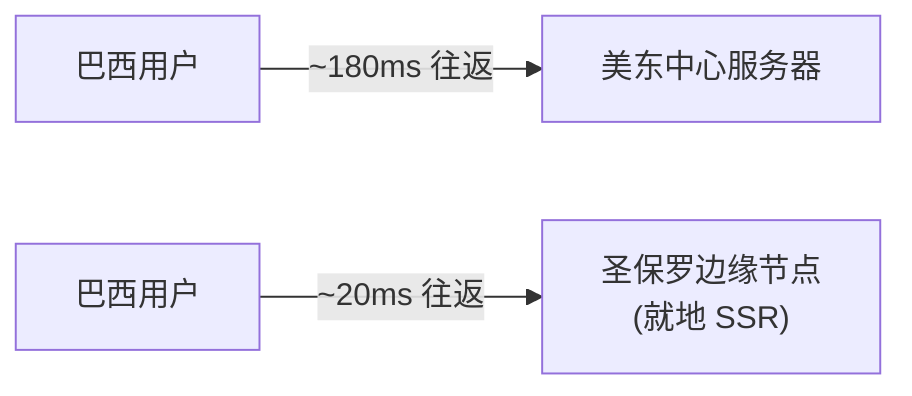

# 边缘渲染 · 把服务端搬到离用户最近的地方

传统 SSR 跑在一台（或一处）中心服务器上，离用户远、延迟高。边缘渲染把 SSR 搬到遍布全球的 CDN 边缘节点上运行，离用户只有几十毫秒。但边缘运行时受限、且「离用户近」往往意味着「离数据库远」——这是它最核心的取舍。

前两章让 SSR 在「**什么时候发**」（流式）和「**发多少 JS**」（服务端组件）上变聪明了。这一章换个维度：**在哪里渲染。**

传统 SSR 跑在一台中心服务器上（比如某个机房）。一个巴西用户访问部署在美国东部的站点，每个请求光是**网络往返**就要一两百毫秒——SSR 渲染得再快，也架不住物理距离。**边缘渲染(edge rendering)** 的答案是：把渲染代码**部署到遍布全球的 CDN 边缘节点**上，让它在**离用户最近的那个节点**执行。

同样一段 SSR 代码，从「一处运行、全球来访」变成「就近运行」，延迟直接砍掉一大截。

## 边缘平台与「受限的运行时」

跑边缘渲染的平台有 Cloudflare Workers、Vercel Edge Functions、Deno Deploy、Netlify Edge 等。它们靠的多是 **V8 isolate**（轻量隔离，而非每请求起一个完整容器），所以**冷启动极快、能瞬间弹到全球**。

但天下没有免费的午餐——**边缘运行时是「阉割版」的**：

::: warning
边缘不是完整的 Node.js。常见限制：**没有完整的 Node API**（文件系统、部分原生模块用不了，只有 `nodejs_compat` 之类的兼容层能补一部分）；**CPU 时间有限**（单请求几十毫秒量级，跑不了重计算）；**包体积有上限**；**没有长驻进程 / 常驻连接**。所以「把现有 Node SSR 原样搬上边缘」经常行不通，得挑选依赖、避开重活。**边缘适合「轻量渲染」，不适合「在请求里跑一大坨 CPU 密集或依赖 Node 原生能力的活」。**
:::

## 最核心的取舍：离用户近 = 离数据库远

边缘渲染有个绕不开、也最容易被忽略的坑：

::: warning
**你把渲染搬到了离用户最近的地方，但你的数据库，通常还在某一处中心机房。**

于是尴尬的一幕出现了：边缘节点在圣保罗，离用户 20ms；可它要渲染页面得查数据，而数据库在美东——边缘节点**回头去查那个远端数据库**，又是 180ms。你在网络这头省下的，在数据那头又还回去了，甚至更糟（因为一个页面可能查好几次库）。这叫**数据局部性(data locality)问题**。
:::

破解它有几条路：

- **让数据也「上边缘」**：用边缘分布式存储——Cloudflare KV / D1 / R2、边缘 Redis、全球复制的数据库（如 Turso、PlanetScale 的边缘读），让边缘节点就近读到数据。
- **让边缘只读缓存**：边缘节点不直接查库，而是读**就近的缓存**（下一站的主题）——命中缓存就是本地读取，~0 延迟。这也是为什么**边缘渲染和缓存是天生一对**。
- **分工**：强数据依赖、重计算的页面留在中心服务器(origin)SSR；轻量、数据可缓存的页面上边缘。同一个站点混着来。

## 为什么边缘和缓存是一对

这一点值得单独点破，它是通往下一站的桥：**CDN 的边缘节点，本来就是缓存住的地方。** 当你的渲染逻辑也运行在边缘，它就能以**近乎零延迟**读取同一节点上的缓存数据、甚至直接命中缓存好的整页 HTML——不必回中心、不必查远端库。

::: info
换句话说：**边缘渲染真正发力，靠的往往不是「在边缘现算」，而是「在边缘命中缓存」。** 一个理想的边缘页面：大部分请求直接吃边缘缓存（极快），只有缓存未命中时才就近渲染一次、并把结果缓存回边缘。渲染在边缘、缓存在边缘、数据尽量在边缘——三者合一，才是边缘渲染的完全体。这就自然把我们带到了整个专栏的重点。
:::

## 小结与下一章

边缘渲染把 SSR 搬到离用户最近的节点，大幅降低网络延迟；代价是运行时受限，以及那个核心取舍——**离用户近往往离数据库远（数据局部性问题）**。它的完全体，离不开「在边缘命中缓存」。

到这里，「更聪明地渲染」三招（流式、服务端组件、边缘）讲完了。它们都在缓解 SSR 的性能短板，但都没触及那个最根本的事实：**SSR 每次请求都要现算，不缓存就扛不住。** 从下一章起，我们进入本专栏的重点——**缓存**，先回答那个最本质的问题：为什么 SSR 一定要缓存？👉 [为什么 SSR 必须缓存](/manual/computer-programming/ssr/why-cache)。

## 参考文献

- [1] Cloudflare.「What is edge computing? / Workers.」https://developers.cloudflare.com/workers/ —— 边缘运行时(V8 isolate)与限制。
- [2] Vercel.「Edge Functions.」https://vercel.com/docs/functions/edge-functions —— 边缘渲染平台与约束。
- [3] web.dev / Next.js 文档.「Edge Runtime.」https://nextjs.org/docs/app/api-reference/edge —— 边缘运行时的 API 子集。
