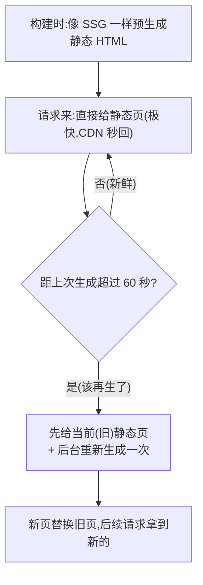

# 增量静态再生 · SSG 与 SSR 的中间态

ISR 把 stale-while-revalidate 从 CDN 层上升到框架层：页面像 SSG 一样预生成、由 CDN 秒回，又能按时间或按需在后台重新生成——不必重新构建整站。这一章讲清它的再生机制、按需失效和 fallback。

[渲染光谱](/manual/computer-programming/ssr/rendering-spectrum) 里，SSG 最快但内容冻在构建时，SSR 最新鲜但每请求现算。**ISR（Incremental Static Regeneration，增量静态再生）** 就是这两者之间那个甜蜜的中间态。

而它的内核，你[上一章](/manual/computer-programming/ssr/swr)已经学过了：**ISR 本质就是把 `stale-while-revalidate` 从「CDN 的 HTTP 缓存层」上升到「框架的页面生成层」。** 理解了 SWR，ISR 就是一层窗户纸。

## 它怎么工作

以 Next.js 的写法为例，一个页面加一句 `revalidate`：

```jsx
// 这个页面:预生成为静态,但每 60 秒可在后台再生一次
export const revalidate = 60;

export default async function Page() {
  const data = await getData();   // 构建时取一次,之后按 revalidate 再生
  return <Article data={data} />;
}
```

它的一生：



看出来了吗？这和 SWR 的三段式**一模一样**：新鲜期直接给、过期后先给旧的再后台更新。区别只在于：SWR 更新的是「CDN 里那份缓存的 HTML」，ISR 更新的是「框架预生成的那个静态页」——但用户体验完全一致：**永远拿静态页那么快，内容又在后台按时自我更新，而且不必重新构建整个站点。**

::: info
**ISR 相对纯 SSG 的杀手锏：免全站重建。** 纯 SSG 里，内容一变就得**重新构建、重新部署整个站点**——十万篇文章的站，改一个错别字要重建十万页，慢到没法用。ISR 让你**只再生变了的那一页**，秒级生效，其余页纹丝不动。这就是为什么大型内容站（电商、新闻、文档）几乎都靠 ISR 而非纯 SSG。
:::

## 按需再生：数据一变就精准刷新

「每 60 秒再生」是**基于时间**的，总有个最长 60 秒的陈旧窗口。但有时你想要**「数据一变，立刻刷新对应页面」**——比如后台编辑了一篇文章，希望它马上更新，而不是等 60 秒。这就是**按需再生(on-demand revalidation)**:

```js
// CMS 编辑保存后,调用一个接口,精准刷新受影响的页面
revalidatePath('/article/42');       // 按路径:刷这一页
revalidatePath('/articles');         // 顺带刷列表页
// 或按标签(见「缓存失效」一章):
revalidateTag('article-42');
```

典型用法：CMS 里内容一保存，就发个 **webhook** 打到你的站点，触发 `revalidatePath`——**编辑点保存的瞬间，线上页面就更新了**，既有静态页的速度，又有近乎实时的新鲜度。「按路径 / 按标签」这套失效方式，是[下一章](/manual/computer-programming/ssr/cache-invalidation)的主题。

## fallback：没预生成的页怎么办

还有个现实问题：一个有**十万个商品**的站，构建时**全部预生成**太慢。ISR 允许你**只预生成一部分**（比如热门的前 1000 个），其余的用 **fallback** 处理——**第一个访问到「没预生成」页面的请求，即时渲染一次（像 SSR），渲染完存为静态页，之后就都走缓存了**。

- **阻塞式 fallback**(`blocking`)：第一个访客等这一次渲染完（稍慢一下），之后所有人都快。体验干净，SEO 友好。
- **非阻塞式 fallback**(`true`)：第一个访客先看到一个 loading 骨架，渲染好了再填充。首字节更快，但有个占位闪烁。

::: info
fallback 的意义：**「预生成」和「按需生成」可以混着来。** 热门页构建时就生成好（首访即快），长尾页留给「谁第一个访问、谁触发一次生成」——既不必在构建时啃完十万页，又保证每个页面最终都会被缓存成静态。这让 ISR 能从容应对「海量页面 + 长尾访问」的站点。
:::

## 它的边界

ISR 不是万能中间态，它有明确的适用面：

::: warning
**ISR 的前提和 SWR 一样：内容对「所有人相同」且「能容忍短暂陈旧」。** 它生成的是**一份大家共享的静态页**——所以**强个性化的页面（每个人不一样）用不了 ISR**（你没法为每个用户都预生成一版）。个性化内容的缓存是另一套打法，[个性化那章](/manual/computer-programming/ssr/personalization)专门讲。此外，再生是有成本的（每次再生 = 一次渲染），`revalidate` 设得过短会让「后台再生」过于频繁，失去意义——它应该匹配「内容真实的变化频率」。
:::

## 小结与下一章

ISR 是把 SWR 搬到框架层：页面像 SSG 一样预生成、CDN 秒回，又能**按时间**或**按需**在后台再生，还免去了全站重建；fallback 让「预生成 + 按需生成」自由混搭。它适合「对所有人相同、能容忍短暂陈旧」的海量内容。

到这里，我们缓存的都是**整页 HTML**。但还有一大类场景：HTML 因人而异、没法整页缓存，可它底下用的**数据**其实是共享的、且很贵。这时该缓存的不是 HTML，而是数据。下一章转向**数据层缓存**。👉 [数据层缓存：请求记忆、数据缓存与全路由缓存](/manual/computer-programming/ssr/data-cache)。

## 参考文献

- [1] Vercel.「Incremental Static Regeneration (ISR).」https://vercel.com/docs/incremental-static-regeneration —— ISR 机制与 fallback。
- [2] Next.js 文档.「revalidatePath / revalidateTag / revalidate.」https://nextjs.org/docs/app/building-your-application/data-fetching/incremental-static-regeneration —— 按时间与按需再生。
- [3] Nuxt / SvelteKit.「Route Rules / prerender + ISR.」https://nuxt.com/docs/guide/concepts/rendering —— 其它框架的等价机制。
