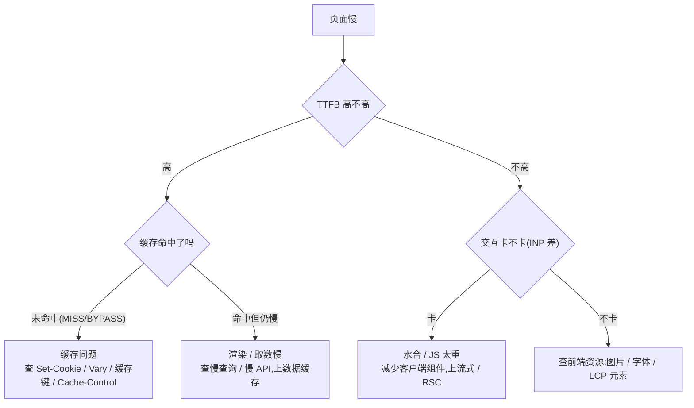

# 量化与排查 · TTFB、LCP 与缓存命中率

SSR 上了生产，该盯哪些指标、怎么排查慢？这一章讲清 TTFB、FCP、LCP、INP 各测什么，以及 SSR 独有的健康指标——缓存命中率；再给一套「页面慢，是服务端还是水合的锅」的排查流程。

前面把 SSR 的渲染与缓存讲透了。最后一站落地：这些东西上了生产，**你该盯哪些数字，慢了又该怎么排查。** 不会量化，再多理论也落不了地。

## 该盯的几个指标

SSR 的性能，拆在一条「从请求到可交互」的时间线上，各有各的表：

| 指标 | 全称 | 测什么 | 主要受什么影响 |
| --- | --- | --- | --- |
| **TTFB** | Time To First Byte | 请求发出到收到第一个字节 | **服务端渲染 + 缓存**（SSR 的核心） |
| **FCP** | First Contentful Paint | 首次画出内容 | TTFB + 关键资源 |
| **LCP** | Largest Contentful Paint | 主内容画出来 | FCP + 图片 / 字体 |
| **INP** | Interaction to Next Paint | 交互的响应快慢 | **[水合](/manual/computer-programming/ssr/hydration) / JS 量** |

::: info
**对 SSR，TTFB 和 INP 是最能暴露问题的两头。** TTFB 高 → 服务端渲染慢**或缓存没命中**（这是本专栏关注的核心）；INP 差 → JS 太多、[水合](/manual/computer-programming/ssr/hydration)太重（这是[流式 / 服务端组件](/manual/computer-programming/ssr/server-components)要治的）。中间的 FCP / LCP 是「用户看到内容多快」，是最终体感，但它俩很大程度上被 TTFB 决定——**TTFB 慢，后面全慢**。所以盯 SSR，先盯 TTFB。
:::

## SSR 独有的健康指标：缓存命中率

通用性能指标之外，SSR 有一个**别的渲染模式没有、但对你生死攸关**的指标——**缓存命中率(cache hit ratio)**。

[为什么缓存那章](/manual/computer-programming/ssr/why-cache) 说过：命中率决定了多少请求真的触发了昂贵的渲染。所以它是 SSR 的**头号健康指标**：

- **命中率高（如 95%+）**：绝大多数请求走缓存，源站轻松，TTFB 低而稳。健康。
- **命中率突然掉**：几乎一定出事了——可能是[误带了 `Set-Cookie`](/manual/computer-programming/ssr/cdn-caching)、[`Vary` 太碎](/manual/computer-programming/ssr/http-caching)、缓存键被查询参数炸开、或某次 `purge everything`。**命中率是 SSR 的体温计，要有监控和告警。**

命中率从哪看？CDN 的分析面板会给（按 `HIT` / `MISS` 状态聚合），或者你自己统计响应里的 [`CF-Cache-Status` 之类的状态头](/manual/computer-programming/ssr/cdn-caching)。

## 排查：慢，是服务端还是客户端的锅

用户说「页面慢」，第一步是**定位慢在哪一段**。一个屡试不爽的分诊流程：

这套分诊把「慢」精准劈成几类：**TTFB 高且没命中缓存** → 缓存问题（本专栏第三站的排查清单全用得上）；**TTFB 高但命中了** → 渲染 / 取数本身慢（上[数据缓存](/manual/computer-programming/ssr/data-cache)、优化查询）；**TTFB 正常但点着卡** → [水合](/manual/computer-programming/ssr/hydration)太重（减客户端 JS）；**都正常但 LCP 慢** → 前端资源（图片、字体）的锅。**先分清是「服务端 / 缓存」还是「客户端 / 水合」，再对症下药**，别一上来乱优化。

## 实验室 vs 真实用户

测性能有两种数据，别只看一种：

- **实验室(lab)**：Lighthouse、WebPageTest——在受控环境跑一遍。方便、可复现，适合开发时调优；但它是**一台机器、一种网络**，不代表真实用户的千差万别。
- **真实用户(field / RUM)**：从真实访客采集（Real User Monitoring，或 Google 的 CrUX / Core Web Vitals 报告）。这才是**用户实际体验**——各种设备、各种网络、各种地域（想想[边缘渲染](/manual/computer-programming/ssr/edge-rendering)要解决的延迟）。

::: warning
**别只信实验室数据。** 你在高端开发机 + 千兆网上 Lighthouse 满分，不代表用户的千元机 + 弱网上不卡。SSR 的很多价值（首屏、缓存命中带来的低 TTFB）恰恰在**弱网、远地域、冷缓存**这些真实场景里才显现——而这些实验室默认测不到。**以真实用户数据（尤其 TTFB 和 INP 的分布，不只看均值，要看 p75 / p95）为准。**
:::

## 小结与下一章

SSR 上生产，盯四个通用指标(TTFB / FCP / LCP / INP)+ 一个专属的头号健康指标（**缓存命中率**）；排查先用「TTFB 高不高 / 命中没 / 交互卡不卡」分诊，把「服务端·缓存」和「客户端·水合」两类问题劈清；数据以**真实用户**为准，别只信实验室。

到这里，从 CSR 的痛，到 SSR、水合、流式、RSC、边缘，再到整整八章的缓存，最后到量化排查——SSR 的全貌走完了。最后一章，我们用一张「什么页面选什么策略」的决策树，和一份「新手最常踩的坑」清单，把整个专栏收拢。👉 [收尾：决策树与常见坑](/manual/computer-programming/ssr/recap)。

## 参考文献

- [1] web.dev.「Core Web Vitals — LCP / INP / TTFB.」https://web.dev/articles/vitals —— 指标定义与阈值。
- [2] Google.「Lab and field data / CrUX.」https://web.dev/articles/lab-and-field-data-differences —— 实验室 vs 真实用户。
- [3] Cloudflare.「Analytics — cache hit ratio.」https://developers.cloudflare.com/analytics/ —— 缓存命中率监控。
