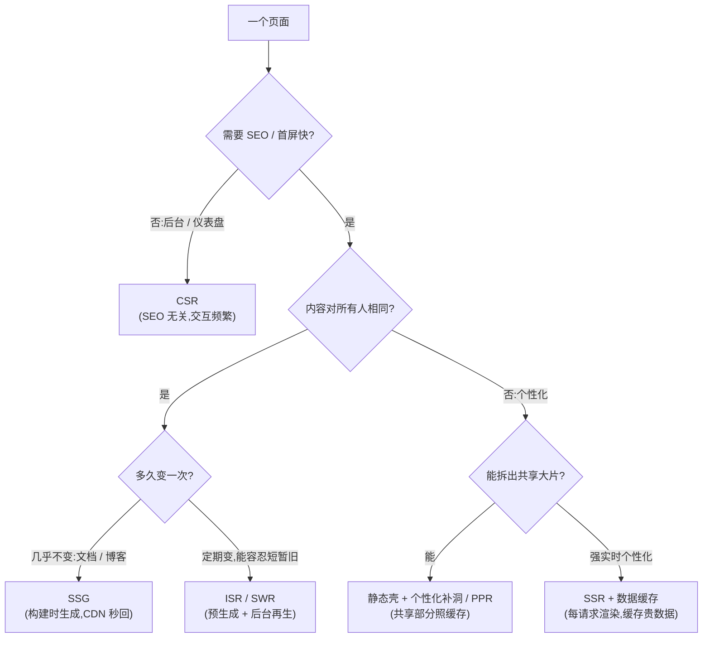

# 收尾 · 决策树与常见坑

用一张「什么页面选什么渲染 + 缓存策略」的决策树，和一份贯穿全专栏的「新手十大坑」清单，把 SSR 从入门到精通的全貌收拢。

走完这一路——CSR 的痛、SSR、水合、流式、服务端组件、边缘，再到整整八章缓存，最后到量化排查——是时候把一切收拢成两样能随手取用的东西：一张**决策树**，一份**避坑清单**。

## 一张决策树：这个页面该怎么渲染 + 缓存

「精通 SSR」的核心，不是记住某个 API，而是**为每个页面挑对策略**。面对一个页面，顺着问下去：

这张树把整个专栏的取舍串成了一条可操作的路径。**同一个站点的不同页面，落在不同的叶子上，是最优解、也是常态。**

## 缓存分层速查

再把[缓存的四层关卡](/manual/computer-programming/ssr/why-cache)按「离用户由近到远」收成一张表——排查和设计时对照着看：

| 层 | 手段 | 关键旋钮 | 治什么 |
| --- | --- | --- | --- |
| 浏览器 | HTTP 缓存 | `max-age`、ETag | 单用户重复访问 |
| CDN / 边缘 | 共享缓存 | `s-maxage`、SWR、purge | **保护源站**（最关键） |
| 应用 | 数据缓存 | Redis、`revalidate`、tags | 省掉贵的取数 |
| 源站 | 渲染本身 | 流式、RSC、优化查询 | 未命中时的兜底成本 |

## 新手十大坑

这十个坑，几乎每个上手 SSR 的人都踩过。记住它们，能省下大量深夜排查。

**① 水合失配。** 渲染里用了 `Date.now()`、`window`、本地时区——服务端和客户端算出不一样，水合就炸。→ [水合](/manual/computer-programming/ssr/hydration)

**② `Set-Cookie` 悄悄关掉整站缓存。** 某个中间件给每个响应都带上 `Set-Cookie`，CDN 于是全部 `BYPASS`，缓存形同虚设。排查缓存不生效，先看有没有多余的 `Set-Cookie`。→ [CDN 缓存](/manual/computer-programming/ssr/cdn-caching)

**③ `public` / `private` 用反。** 个性化页错标 `public`，CDN 把「张三的页面」缓存下来发给李四——信息泄露。个性化必须 `private` / `no-store`。→ [HTTP 缓存](/manual/computer-programming/ssr/http-caching)

**④ `Vary: Cookie` 让命中率归零。** 按 Cookie 分缓存 = 按用户分 = 无穷多份。→ [HTTP 缓存](/manual/computer-programming/ssr/http-caching)

**⑤ 缓存击穿。** 热门页过期的刹那，千军万马同时回源打挂源站。→ 上 [SWR](/manual/computer-programming/ssr/swr) / 请求合并。

**⑥ 忘了缓存失效。** 数据早变了，页面还是旧的。→ [按标签失效](/manual/computer-programming/ssr/cache-invalidation) + 长 TTL 兜底。

**⑦ TTL 和内容变化频率不匹配。** 秒级变的数据缓存一小时（用户看到严重过期），或几乎不变的内容缓存 5 秒（白白频繁回源）。→ TTL 应匹配「内容真实的变化频率」。

**⑧ 无意义查询参数炸开缓存键。** `?utm_source=...` 让同一页产生无数缓存键、命中率暴跌。→ 配 CDN 忽略追踪参数。→ [CDN 缓存](/manual/computer-programming/ssr/cdn-caching)

**⑨ 个性化过度，什么都缓存不了。** 明明大部分内容共享，却因为一个「你好张三」把整页判成不可缓存。→ 拆共享 / 私有，或[按人群段](/manual/computer-programming/ssr/personalization)降基数。

**⑩ 边缘离用户近，却离数据库远。** 把渲染搬上边缘，却让它回中心查库，延迟又还回去了。→ 数据也上边缘 / 就近读缓存。→ [边缘渲染](/manual/computer-programming/ssr/edge-rendering)

## 结语

回到开篇那句话：**SSR 的成败，九成在缓存。** 走完这个专栏，你应该能体会到它的分量了——渲染本身（SSR、流式、RSC、边缘）决定了「能不能快、能不能被搜到」，而缓存（HTTP 头、CDN、SWR、ISR、数据缓存、失效、个性化）决定了「能不能扛、能不能省」。前者让 SSR **可用**，后者让 SSR **可扩展**。

更重要的是那套贯穿始终的思维方式：**几乎没有银弹，每个方案都是一组权衡**——新鲜度换扛量、速度换复杂度、缓存换一点点陈旧。「精通 SSR」不是背熟某个框架的 API，而是**面对一个具体页面，能说清它该落在决策树的哪片叶子上、为什么、代价是什么**。

框架会换，API 会变，但「何时渲染、在哪渲染、缓存哪一层、容忍多旧」这几个根本问题不会变。抓住它们，你就能看穿任何新框架的新名词——它们十有八九，只是这几个老问题的新答案。

## 参考文献

- [1] web.dev.「Rendering on the Web.」https://web.dev/articles/rendering-on-the-web —— 渲染策略决策的权威综述。
- [2] Next.js 文档.「Rendering & Caching.」https://nextjs.org/docs/app/building-your-application/rendering —— 各策略与缓存的框架实现。
- [3] MDN.「HTTP Caching.」https://developer.mozilla.org/en-US/docs/Web/HTTP/Caching —— 缓存机制的权威参考。
