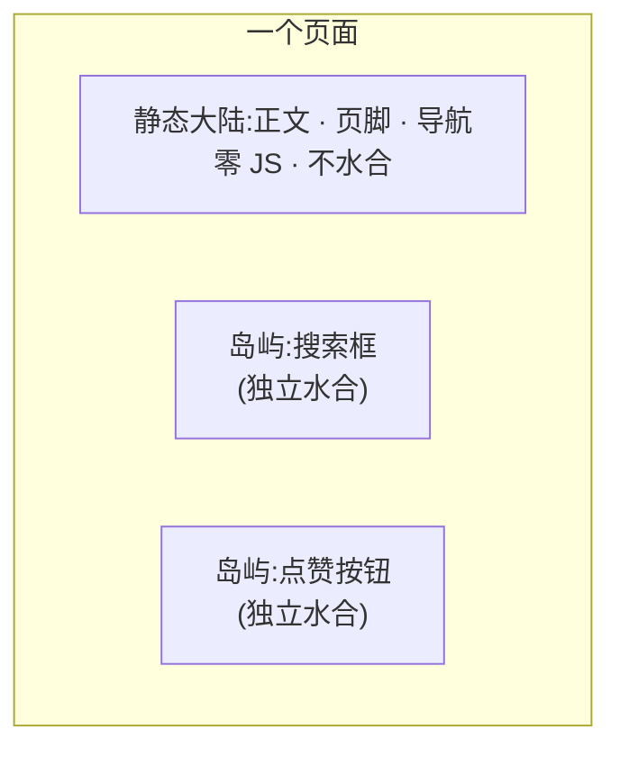

# 服务端组件 · 只在服务端跑的那部分

水合要把所有组件在客户端重跑一遍、把所有组件 JS 都发过去——但页面上大半内容其实不需要交互。岛屿架构和 React 服务端组件(RSC)让这部分「只在服务端跑、根本不下发、根本不水合」，把 JS 和水合开销砍到最少。

[水合那章](/manual/computer-programming/ssr/hydration)留了个尾巴：水合要把**所有**组件在客户端再跑一遍，还要把**所有**组件的 JS 都发给浏览器。可你回头看看任何一个页面——文章正文、页脚、导航链接、商品描述……**大半内容根本不需要交互**。为这些「纯展示」的部分下发 JS、再水合一遍，纯属浪费。

这一章的主角，就是回答一个问题：**能不能让那些不需要交互的组件，只在服务端跑、根本不下发到客户端、根本不水合？**

## 岛屿架构：大陆是静态的，只有岛屿要交互

最直观的答案是**岛屿架构(Islands Architecture)**，Astro 是代表。它的心智模型是：

- 整个页面默认是**一片静态 HTML 的「大陆」**——零 JavaScript，不水合。
- 只有少数真正需要交互的组件（搜索框、点赞按钮、轮播图）是**「岛屿」**——它们各自是一小块独立水合的交互区。



结果：一个内容站可能 **90% 的区域零 JS**，只为那几个岛屿下发和水合极少量代码。JS 体积和水合开销，双双砍到最低。

## RSC：把「组件」本身分成两种

React 的答案更进一步——**React 服务端组件(React Server Components，RSC)**。它把组件本身分成两类：

- **服务端组件（默认）** —— **只在服务端运行**。它可以直接 `await` 查数据库、读文件，渲染出结果；但它的**代码不会打包进客户端 bundle，也永远不会水合**。发给浏览器的只是它渲染出的「结果」（一种序列化的 UI 描述），不是它的代码。
- **客户端组件(`'use client'`)** —— 这才是需要交互的「岛屿」，会下发 JS、会水合。

```jsx
// 服务端组件(默认):直接取数,代码不下发、不水合
async function Article({ id }) {
  const article = await db.article.find(id);   // 直接查库
  return <div>{article.body}</div>;
}

// 客户端组件:显式标记,这块要交互
'use client';
function LikeButton() {
  const [liked, setLiked] = useState(false);   // 有状态 → 要水合
  return <button onClick={() => setLiked(!liked)}>...</button>;
}
```

::: info
RSC 和岛屿是**同一个洞见的两种表达**：**把「需要交互的」和「纯展示的」在架构层面分开**，只为前者付出 JS + 水合的代价。区别在于粒度和心智——岛屿是「默认静态，手动点亮岛屿」，RSC 是「默认服务端组件，手动标 `'use client'` 切出客户端」。Next.js App Router、Astro、Deno Fresh 走的都是这条路。
:::

## 顺带干掉了请求瀑布

服务端组件还白捡一个好处：**它能直接在服务端取数**。回想 [CSR 的请求瀑布](/manual/computer-programming/ssr/csr-pain)——「下载 JS → 执行 → 才发数据请求」。服务端组件里，取数就是一句 `await db.query(...)`，**在服务端、离数据源最近的地方完成**，没有「先到浏览器再回头请求」的往返。数据和渲染在同一处发生，瀑布自然就没了。

## 更激进的一支：Qwik 的可恢复性

还有一条更极端的路线值得知道——**Qwik 的可恢复性(resumability)**。它的主张是：**干脆别水合。**

传统水合要「在客户端把整个应用重新跑一遍来接管」；Qwik 则把应用的状态和「哪个元素绑了哪个事件」**全序列化进 HTML**，客户端**不预先执行任何东西**，直到用户真的点了某个按钮，才**按需**加载那一小段处理逻辑并「恢复」执行。于是首屏几乎零 JS 执行——把[水合的代价](/manual/computer-programming/ssr/hydration)压到了理论下限。

::: warning
别被这些名词的新潮劝退，也别盲目追新。RSC、岛屿、可恢复性都还年轻，各有复杂度和坑（RSC 的 `'use client'` 边界、序列化限制；岛屿的跨岛通信；Qwik 的生态成熟度）。**它们要解决的问题是清晰且真实的——少下发 JS、少水合——但落地时是一组新的取舍，不是免费升级。** 理解「它们在优化什么」，比记住谁家 API 怎么写更重要。
:::

## 小结与下一章

服务端组件 / 岛屿架构的核心洞见是：**把「要交互的」和「纯展示的」分开，只为前者付 JS + 水合的代价。** 纯展示的部分只在服务端跑、不下发、不水合，顺带还消灭了请求瀑布。Qwik 的可恢复性则更激进地试图绕过水合本身。

渲染「变聪明」的第三招，是换个**地点**渲染：不在遥远的中心服务器，而在**离用户最近的边缘节点**上跑 SSR。这既能降延迟，又和我们即将深入的缓存天然是一对。👉 [边缘渲染：把服务端搬到离用户最近的地方](/manual/computer-programming/ssr/edge-rendering)。

## 参考文献

- [1] React 官方文档.「Server Components.」https://react.dev/reference/rsc/server-components —— RSC 模型与 `'use client'` 边界。
- [2] Astro 文档.「Islands Architecture.」https://docs.astro.build/en/concepts/islands/ —— 岛屿架构。
- [3] Qwik 文档.「Resumability vs. Hydration.」https://qwik.dev/docs/concepts/resumable/ —— 可恢复性。
