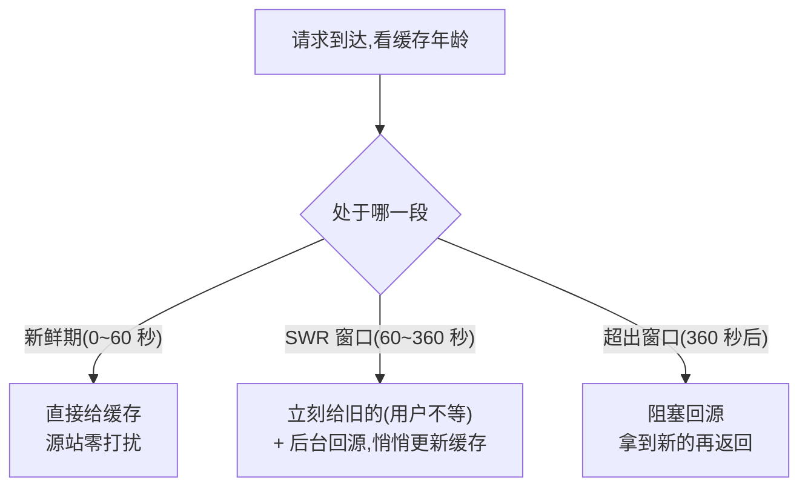

# stale-while-revalidate · 又快，又不太旧

缓存 TTL 有个两难：设短了新鲜但常回源（慢），设长了快但容易旧。stale-while-revalidate 打破它——过期后先把旧的秒回给用户，同时后台悄悄更新。用户永远不等，缓存自动保鲜。这是 ISR 背后的核心机制。

[缓存的核心权衡](/manual/computer-programming/ssr/why-cache) 落到 TTL 上，是个让人纠结的两难：

- **TTL 设短**（比如 5 秒）：内容新鲜，但缓存**频繁过期**，过期就得回源渲染——命中率低、慢、还容易[击穿](/manual/computer-programming/ssr/cdn-caching)。
- **TTL 设长**（比如 1 小时）：命中率高、快、扛量强，但用户可能看到**一小时前的旧数据**。

有没有办法**两头都要**？有——这就是 **`stale-while-revalidate`**（简称 SWR）。它是本专栏最该记牢的一个机制。

## 核心思想：先给旧的，后台更新

SWR 的洞见极其朴素：**当缓存过期时，与其让用户干等着「重新渲染」，不如先把手边的旧版本给他（他几乎不在乎差这几秒），同时在后台悄悄地把缓存更新掉。**

于是**用户永远拿的是缓存（快），而缓存永远在后台自我保鲜（不太旧）**。回源渲染这件慢事，被挪到了「后台」，不再挡在用户和响应之间。

## 三个阶段

`Cache-Control: max-age=60, stale-while-revalidate=300` 把缓存的一生分成三段：



- **0~60 秒（新鲜）**：直接给缓存，连「变了没」都不问。最理想。
- **60~360 秒（SWR 窗口）**：缓存过期了，但还在 `stale-while-revalidate` 的宽限期内。**立刻把旧的返回给用户**（用户体验和命中一样快），**同时**触发一次后台回源更新缓存。下一个请求就能拿到新的。
- **360 秒之后（太旧）**：超出宽限期，旧的不能再用了，只能**老老实实阻塞回源**——这个请求要等渲染完（慢的那种）。

::: info
**关键在中间那段：用户拿到旧内容的速度，和命中缓存一样快——他完全不必等待那次后台更新。** 更新是「顺便」发生的，发生在别人（或后台）身上，不挡这个用户的路。于是绝大多数请求都落在「新鲜」或「SWR 窗口」里，几乎**永远不触发那个慢的阻塞回源**。你既拿到了接近长 TTL 的速度与扛量，又拿到了「最多旧几分钟、且在自动变新」的新鲜度。
:::

## 它顺手治了缓存击穿

回想[上一章](/manual/computer-programming/ssr/cdn-caching) 那个「过期瞬间千军万马同时回源」的**缓存击穿**。SWR 天然免疫它：过期后大家拿的是**旧缓存**（不回源），后台只需**一个**更新请求去回源。**尖峰被抹平了**——没有「同时回源」这回事。这是 SWR 除了「快 + 新鲜」之外的第三个好处。

## 搭档：stale-if-error

和 SWR 成对的还有 **`stale-if-error`**：**当源站出错(5xx)或挂掉时，拿旧缓存顶上，别给用户报错。**

```text
Cache-Control: max-age=60, stale-while-revalidate=300, stale-if-error=86400
```

这一句给了你一天（86400 秒）的「灾备缓冲」：哪怕源站彻底宕机，只要 CDN 里还有一天内的旧版本，用户看到的仍是**能用的旧页面**，而不是 502。对可用性来说，这是一层极其廉价的保险。

::: warning
**SWR 不是万能——它的前提是「用户能容忍看到旧内容」。** 对博客、商品详情、榜单这类，旧几分钟无所谓，SWR 完美。但对**必须实时**的东西（账户余额、库存精确到件、下单确认），「先给旧的」可能是错的——用户不能接受看到已经不对的余额。**SWR 用「一点点陈旧」换「快 + 扛量 + 抗击穿」，所以只适合能付这个学费的内容。** 实时性要求高的，要么不缓存，要么用[按需失效](/manual/computer-programming/ssr/cache-invalidation)在数据一变就精准刷新。
:::

## 小结与下一章

`stale-while-revalidate` 用「过期后先给旧的、后台再更新」破解了 TTL 两难：用户永远快（拿缓存），缓存永远在自我保鲜（后台更新），还顺手免疫了缓存击穿；配 `stale-if-error` 更添一层灾备。前提是内容能容忍短暂陈旧。

这个「先返回预生成的旧版本、后台按需重新生成」的机制，如果把它从「CDN 层的 HTTP 缓存」上升到「框架层的页面生成策略」，就变成了一个响当当的名字——**增量静态再生(ISR)**。它是 SSG 和 SSR 之间那个甜蜜的中间态。下一章讲透。👉 [增量静态再生：SSG 与 SSR 的中间态](/manual/computer-programming/ssr/isr)。

## 参考文献

- [1] RFC 5861.「HTTP Cache-Control Extensions for Stale Content.」https://datatracker.ietf.org/doc/html/rfc5861 —— `stale-while-revalidate` / `stale-if-error` 的规范。
- [2] web.dev.「Keeping things fresh with stale-while-revalidate.」https://web.dev/articles/stale-while-revalidate —— SWR 实战。
- [3] MDN.「Cache-Control — stale-while-revalidate.」https://developer.mozilla.org/en-US/docs/Web/HTTP/Headers/Cache-Control —— 指令定义。
