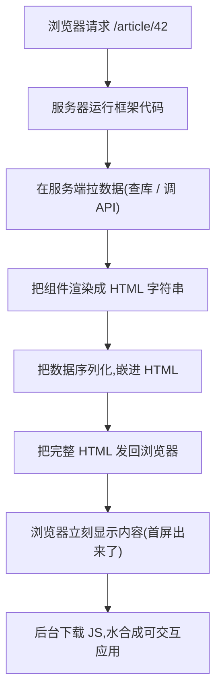

# SSR 是什么 · 一次请求的服务端旅程

SSR 让服务器在收到请求时，就地把组件渲染成完整 HTML 再发给浏览器——首屏立刻可见、爬虫能读到内容。这一章走一遍这段服务端旅程，并点破它的代价：每次请求都要现算，很贵。

SSR（Server-Side Rendering，服务端渲染）的定义，一句话就够：**在服务器上把页面渲染成完整的 HTML 字符串，再连同数据一起发给浏览器。** 浏览器一拿到就能显示内容——不必再等一大包 JS 跑完。

关键在于**同一套组件代码，既在服务端跑、也在客户端跑**（这叫「同构 / isomorphic」）。服务端跑一遍产出首屏 HTML，客户端再跑一遍把它「接管」过来（下一章的[水合](/manual/computer-programming/ssr/hydration)）。

## 一次 SSR 请求走了哪些路

用户点开一个 SSR 页面，服务器这一侧发生了这些事：



对比上一章 CSR 那条「拿到空壳才开始干活」的瀑布，差别一目了然：**SSR 在服务端就把数据拉好、把内容画好了**，浏览器拿到的第一份 HTML 里就有真东西。

## 服务端这一步到底在干嘛

核心是把组件树**渲染成 HTML 字符串**。React 里是 `renderToString`（或更现代的 `renderToPipeableStream`，见[流式渲染](/manual/computer-programming/ssr/streaming)），Vue 里是 `renderToString`，原理都一样：**在没有浏览器、没有 DOM 的 Node 环境里，把组件「跑」成一段 HTML 文本。**

```js
// 服务端(示意):把 React 组件渲染成 HTML 字符串
import { renderToString } from 'react-dom/server';

const html = renderToString(<App data={data} />);
res.send(`<!DOCTYPE html><div id="root">${html}</div>...`);
```

各框架把这套包了不同的「壳」，但底下是同一件事：

| 框架 | 在服务端取数 / 渲染的入口 |
| --- | --- |
| Next.js(Pages) | `getServerSideProps` |
| Next.js(App Router) | 异步 Server Component（默认） |
| Nuxt | `asyncData` / `useFetch` |
| SvelteKit | `load`(server) |
| Remix / React Router | `loader` |

API 名字不同，你在服务端「拉数据 + 渲染」的这段活是一样的。**理解了这段旅程，换框架只是换语法。**

## 藏在 HTML 里的数据

有个容易忽略但很关键的细节：服务端渲染完 HTML，还会把**这次渲染用到的数据序列化成 JSON，一起塞进 HTML**。你在 SSR 页面右键「查看源代码」，常能看到一大坨这样的东西：

```html
<script id="__NEXT_DATA__" type="application/json">
  {"props":{"article":{"id":42,"title":"..."}}}
</script>
```

为什么要带上？因为客户端**水合**时需要**和服务端一模一样的数据**，才能把 HTML 正确接管（否则会「水合失配」，见下一章）。带上这份数据，客户端就**不用再请求一次**——直接复用，省一趟往返。

## SSR 顺手解决的两件事

回头看上一章 CSR 的痛点，SSR 一并解决了：

- **首屏快**：HTML 里就有内容，浏览器立刻能画出来，FCP / LCP 大幅提前——不必等 JS。
- **SEO 与分享卡片**：内容、`<title>`、`og:` 元数据**都在初始 HTML 里**，爬虫直接读得到。搜索引擎能索引，微信 / Twitter 能形成分享卡片。

## 但 SSR 的代价：每次请求都要现算

天下没有免费的午餐。SSR 把渲染搬回服务端，代价是——

::: warning
**每一个请求，服务器都要重新跑一遍「取数 + 渲染」。** CSR 里服务器只发个静态壳（几乎零成本）；SSR 里服务器每次都要查库、调 API、把组件渲染成字符串——这是**实打实的 CPU 和 I/O 开销**。一个页面被访问一万次，服务器就渲染一万次。

这带来两个后果：① **TTFB（首字节时间）变长**——服务器得先渲染完才能发第一个字节；② **扛不住流量**——渲染很贵，并发一高，服务器就被自己的渲染开销压垮。

**这就是为什么本专栏要花一半篇幅讲缓存**：让「渲染好的结果」被复用，而不是每次都现算。缓存，是 SSR 从「能用」到「能扛」的关键。这条线我们从[「为什么 SSR 必须缓存」](/manual/computer-programming/ssr/why-cache) 开始展开。
:::

## 小结与下一章

SSR 让服务器在请求到来时就地渲染出完整 HTML，换来了首屏快、SEO 好、分享成卡片；代价是每次请求都要现算，贵且慢（TTFB 长、难扛并发）。这个「代价」贯穿整个专栏，而缓存是它的解药。

但在讲缓存之前，还有个绕不开的概念：服务器发来的 HTML 是「死」的——它能显示，却还不能点击、不能交互。把它**唤醒**成一个活的应用，靠的是**水合(hydration)**。下一章讲透它。👉 [水合：把死的 HTML 救活](/manual/computer-programming/ssr/hydration)。

## 参考文献

- [1] web.dev.「Rendering on the Web.」https://web.dev/articles/rendering-on-the-web —— SSR 定义与权衡。
- [2] React 官方文档.「renderToPipeableStream / server APIs.」https://react.dev/reference/react-dom/server —— 服务端渲染 API。
- [3] Next.js 文档.「Rendering: Server Components / getServerSideProps.」https://nextjs.org/docs —— 框架层的 SSR 实现。
