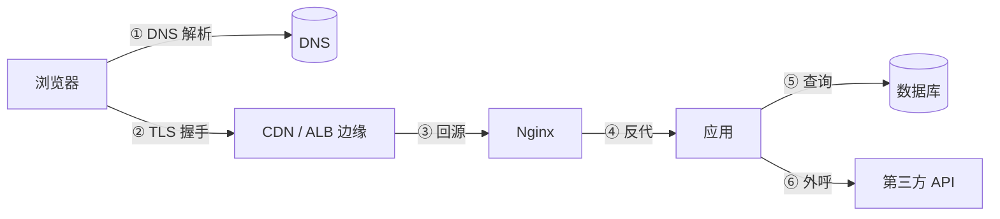

# 一次请求的旅程

用户在地址栏敲下回车到页面渲染，中间经过 DNS、CDN、负载均衡、Nginx、应用、数据库六道关卡——每一道都能被做手脚。这一章画出完整攻击面地图，后面每一章各拆一段。

跟着一次 `https://example.com/profile` 走完全程。**每一站都标出「这里能被做什么手脚」**，这就是你的攻击面地图。

## 全程六站



## ① DNS 解析：还没连上就可能被劫持

浏览器先问「example.com 的 IP 是多少」。这一步出问题，**后面全部作废**——用户连的根本不是你的服务器。

| 手法 | 怎么发生 |
| --- | --- |
| 注册商账号被撞 | 攻击者登录你的域名后台，直接改 NS 记录 |
| DNS 投毒 | 污染递归解析器缓存，返回假 IP |
| 子域名接管 | `blog.example.com` 的 CNAME 指向一个你已删除的云服务，攻击者去把那个名字注册回来 |

**这一站的可怕之处在于：你的服务器日志里什么都看不到。** 流量根本没到你这儿。

对应章节：[注册商](/manual/computer-programming/web-security/registrar-security)、[DNS 加固](/manual/computer-programming/web-security/dns-hardening)、[子域名接管](/manual/computer-programming/web-security/subdomain-takeover)。

## ② TLS 握手：证书是谁签的

拿到 IP 后建立 TLS 连接。风险点：

- **证书错发**：某个 CA 给你的域名签了证书给别人（历史上真实发生过多次）。用 **CAA 记录**限定只有指定 CA 能签，用 **CT 日志监控**发现错发。
- **协议与套件过时**：还开着 TLS 1.0、支持 RC4，中间人可降级。
- **证书过期**：不是安全事故，但是可用性事故——而且非常常见。

对应章节：[TLS 与证书](/manual/computer-programming/web-security/tls-and-certs)。

## ③ 边缘（CDN / ALB）：挡住的和挡不住的

请求到达边缘节点。这里通常做 TLS 终止、缓存、限流、WAF。

**最常见的失效方式不是 WAF 规则不够好，而是攻击者根本不走边缘**——他直接连你的源站 IP。你所有的边缘防护瞬间归零。

| 风险 | 说明 |
| --- | --- |
| 源站 IP 泄露 | 历史 DNS 记录、邮件头、证书 CT 日志、`/phpinfo` 全都能泄 |
| 缓存投毒 | 让 CDN 缓存一个被污染的响应，分发给所有人 |
| 限流缺失 | 登录接口被撞库、短信接口被刷 |

对应章节：[源站暴露](/manual/computer-programming/web-security/origin-exposure)、[DDoS 与限流](/manual/computer-programming/web-security/ddos-and-ratelimit)、[WAF](/manual/computer-programming/web-security/waf)。

## ④ Nginx：配置比软件更容易出事

回源到你的 Nginx。这一层的漏洞**绝大多数不是 Nginx 的锅，是配置写错了**：

```nginx
# 少一个斜杠 —— 经典的路径穿越
location /static {
    alias /var/www/static/;
}
# 攻击者请求 /static../etc/passwd 就能跳出目录
```

还有请求走私：当 Nginx 和后端对「这个请求到哪结束」理解不一致时，攻击者可以把一个请求藏在另一个里面，绕过所有前置检查。

对应章节：[Nginx 基线](/manual/computer-programming/web-security/nginx-baseline)、[配置陷阱](/manual/computer-programming/web-security/nginx-pitfalls)、[请求走私](/manual/computer-programming/web-security/request-smuggling)。

## ⑤ 应用：输入变成指令的地方

请求进入你的代码。这一层的问题可以归成两大类：

**第一类：数据被当成了代码。**

| 送到哪 | 变成什么 | 叫什么 |
| --- | --- | --- |
| 数据库 | SQL 语句 | SQL 注入 |
| 系统 shell | 命令 | 命令注入 |
| 模板引擎 | 模板表达式 | SSTI |
| 浏览器 | HTML / JS | XSS |
| LDAP / XML / 正则 | 各自的语法 | 各类注入 |

**同一个根因**：把不可信数据拼进了某种语法结构里。所以防御手段也同源——**参数化，而不是转义**。

**第二类：该拦的没拦。**

- 没验身份（认证缺陷）
- 验了身份没验权限（**越权 / IDOR，实战命中率最高的一类**）
- 让服务器替攻击者发请求（SSRF）
- 让攻击者传了个能执行的文件（上传）

对应章节：[注入](/manual/computer-programming/web-security/injection)、[认证](/manual/computer-programming/web-security/authn)、[授权](/manual/computer-programming/web-security/authz)、[SSRF](/manual/computer-programming/web-security/ssrf)、[文件上传](/manual/computer-programming/web-security/file-upload)。

## ⑥ 数据与外呼：横向移动的起点

应用查数据库、调第三方 API。攻破应用之后，攻击者关心的是**还能摸到什么**：

- 数据库账号是不是超级用户？能不能读别的库？
- 服务器上有没有云厂商的元数据服务（`169.254.169.254`）？拿到临时凭据就能横向到整个云账号。
- 环境变量里有没有其它系统的密钥？

这就是[最小权限](/manual/computer-programming/web-security/defense-in-depth)存在的意义：**假设应用一定会被攻破，那时它手上的权限决定了损失范围**。

## 回程：响应也是攻击面

请求打完了，响应回来的路上同样有风险，而且更容易被忽略：

| 响应侧问题 | 后果 |
| --- | --- |
| 缺 `Content-Security-Policy` | XSS 无成本利用 |
| 缺 `X-Frame-Options` / `frame-ancestors` | 点击劫持 |
| Cookie 缺 `HttpOnly` / `Secure` / `SameSite` | 会话被盗、CSRF |
| 错误页把堆栈吐出来 | 泄露路径、版本、SQL 结构 |
| `Server: nginx/1.18.0` | 直接告诉扫描器该用哪个 exp |

对应章节：[安全响应头](/manual/computer-programming/web-security/security-headers)、[CSP](/manual/computer-programming/web-security/csp)。

## 用一条命令看看你自己的站

在读后面的章节前，先对自己的站跑一遍，看看暴露了什么：

```bash
curl -sSI https://你的域名/ | grep -iE "server|x-powered-by|strict-transport|content-security|x-frame|x-content-type|referrer-policy|permissions-policy"
```

理想结果是：**看不到 `Server` 的具体版本、看不到 `X-Powered-By`，而后面那几个安全头都在**。如果输出寥寥无几，那这个专栏对你就很值。

## 小结

- 攻击面远不止「表单输入」，它沿着请求路径分布在六站上。
- **越靠前的层被打穿，后面的防御越是白做**——所以专栏从域名开始，不从 XSS 开始。
- 应用层的问题可归成两类：数据被当成代码、该拦的没拦。
- 响应侧同样是攻击面，而且是投入产出比最高的一块（加几个头就能挡掉一批攻击）。

下一部分从最前面那一站开始。👉 [注册商与域名账号安全](/manual/computer-programming/web-security/registrar-security)
