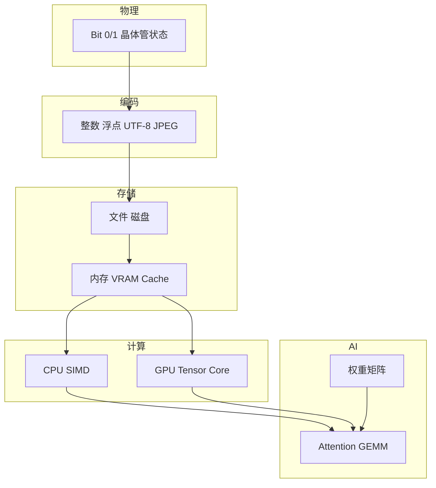

# 第一章总结

> 比特、字节、内存与矩阵——第一章知识地图与第二章衔接。

第一章从不讲 AI 模型公式开始，而是回答一个更底层的问题：**智能应用在计算机里到底是什么**？答案是——与其它软件无异，全是 **0 和 1**，按规则解释成整数、浮点、指令、像素、UTF-8 字符；AI 的特殊性在于**规模和运算类型**（巨大矩阵 + 高带宽），不在于 metaphysics。

## 你应带走的核心图景

## 分篇要点速查

| 主题 | 关键数字/结论 |
| ---- | ------------- |
| AI 即比特 | 8B FP16 ≈ **16 GB** 权重；推理 = 矩阵运算 + 程序 |
| 0 与 1 | $n$ bit → $2^n$ 状态；足够长串编码有限信息 |
| CPU 理解世界 | 取指-执行；同一 bit 可作数据或指令 |
| 整数 | int32 补码；溢出模 $2^n$；token ID 是整数 |
| 浮点 | IEEE 754；0.1+0.2≠0.3；FP16/BF16/INT8 省体积 |
| 图像压缩 | 1024² RGB raw **3 MB** → JPEG **~300 KB** |
| 视频压缩 | 帧间预测；1080p30 raw **186 MB/s** → 流媒体 **~6 Mbps** |
| 音频数字化 | 奈奎斯特；CD **44.1 kHz×16 bit×2**；Whisper **16 kHz** |
| UTF-8 | 中文常 **3 B/字**；LLM 按 token 计费 |
| 文件 | inode + 字节流；safetensors **mmap** 加载 |
| 内存 | DRAM **~100 ns**；KV Cache 随序列线性涨 |
| Cache | 64 B cache line；行优先 **5–15×** 于列优先 |
| GPU | **TFLOPS + TB/s**；适合 GEMM，怕小 batch/分支 |
| SIMD | AVX 一次 **8×float32**；NumPy 快的原因 |
| 矩阵连续 | row-major stride；`contiguous()` 可能 copy |
| AI 爱矩阵 | Attention/FFN = GEMM；7B ≈ **10¹¹–10¹² FLOPs/forward** |
| 字节寻址 | 8 bit = 1 B；64 位指针 **8 B** |
| 大小端 | x86 **小端**；网络 **大端** |
| 程序 | 编译链接加载；PyTorch = Python + **libtorch/CUDA** |

## 贯穿第一章的三条主线

**1. 表示**：一切媒体与数字都是 bit 模式 + 解释规则（整数/浮点/编码/压缩）。

**2. 搬运**：性能常 bound 在 **内存带宽与 Cache**，不是峰值 FLOPS。矩阵要连续存，权重太大放不进 Cache 就流式读 HBM。

**3. 运算**：AI 把问题改写成 **大规模矩阵乘**，对接 GPU/Tensor Core/SIMD 几十年优化成果。

## 与后续章节的衔接

- **[第二章：数学](/manual/llm/bit-to-agi/02-math)**：向量、矩阵乘法、梯度——在「矩阵即比特数组」之上补线性代数语言。
- **第六章 Tokenizer**：UTF-8 字节如何变成 token ID，中文为何更费 token。
- **第八章推理 / 第九章 GPU**：本章 roofline、KV 体积、带宽瓶颈的定量延伸。
- **第十章训练你的 LLM**：checkpoint 文件、混合精度、显存规划都假设你已会 **bytes × params** 心算。

## 自测清单

读完第一章，你应能回答（不看笔记）：

1. 8B 模型 FP16 和 INT4 权重大概各多少 GB？
2. 为什么列优先遍历 NumPy 二维数组更慢？
3. float 误差从哪来？训练为何仍可用 FP16？
4. KV Cache 随什么量线性增长？
5. GPU 相对 CPU 快在哪、慢在哪？
6. 「模型文件」在磁盘和进程内存里分别是什么形态？

若有任一模糊，回到对应篇章复习链接目录。

## 常见误区（本章总复习）

- 把 AI 当成「非比特的智能实体」——错；它是统计模型 + 数值计算。
- 忽视 **字节序、对齐、contiguous**——错；跨平台与性能坑在这里。
- 只数 FLOPs 不算 **带宽与显存**——错；LLM 推理常 memory bound。

## 下一步

进入 **[第二章：数学（Math）](/manual/llm/bit-to-agi/02-math)**，从「矩阵是一堆 float 比特」过渡到「矩阵乘法的几何意义与梯度如何更新这些比特」。

若你正在实践：用本章公式估算手头模型的 **权重 + KV + 激活** 显存，并与 `nvidia-smi` 对照——是最好的第一章结业作业。
