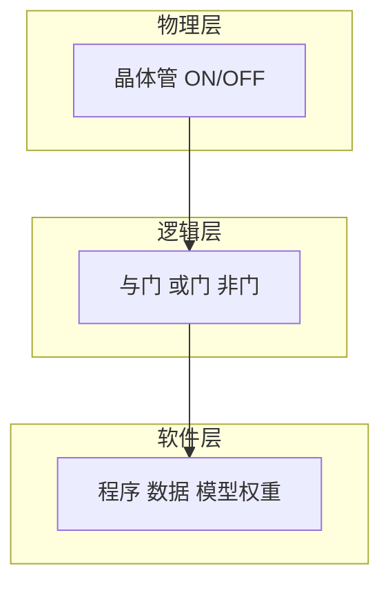

# 为什么世界只有 0 和 1

> 从晶体管开关到全部数字信息——为什么两个符号就够表示一切。

手机里的 4K 视频、银行余额、大模型权重，看起来千差万别，但在硅片里它们共享同一种「字母表」：**只有 0 和 1**。这不是工程师偷懒，而是物理、数学与工程在几十年里收敛出的最优解。

本篇解释：为什么两个状态就够？「一切」是如何从 0/1 堆出来的？

## 直觉：电灯开关与摩尔斯电码

一个物理开关只有两种稳定状态：通或断。早期电报用长短脉冲（点划）编码字母——本质仍是二元序列。现代 CPU 里，数十亿个纳米级开关（晶体管）以每秒 **GHz**（十亿次）级别翻转，组合成加法、比较、跳转；再往上，操作系统、浏览器、AI 推理栈，全是开关游戏的层层叠加。



## 定义：比特与二进制

- **比特（bit）**：信息单位，取值 $\{0, 1\}$。
- **$n$ 位二进制数**：可表示 $2^n$ 种不同状态。例如 8 bit = 1 byte，可表示 $2^8 = 256$ 种模式（无符号整数 0–255）。
- **香农信息论**：在噪声信道上可靠通信，二元编码是 fundamental 的选择；实际信道也常用「两种可区分状态」作为物理载体（高/低电压、磁化方向 N/S、光有无）。

## 例子一：用 4 bit 表示 16 种颜色

早期 VGA 调色板用 4 bit 索引，$2^4 = 16$ 种颜色。若扩展到 24 bit（真彩色），每像素 $2^{24} \approx 1670$ 万种组合——三个 8 bit 通道（R、G、B）各 256 级。一张 1920×1080 图未压缩约 $1920 \times 1080 \times 3 \approx 6.2$ **MB**，即约 **4960 万 bit** 的排列。

## 例子二：从 bit 到整数

十进制 42 的二进制是 `00101010`（8 bit 示意）：

| 位权 | $2^7$ | $2^6$ | $2^5$ | $2^4$ | $2^3$ | $2^2$ | $2^1$ | $2^0$ |
| ---- | ----- | ----- | ----- | ----- | ----- | ----- | ----- | ----- |
| 值   | 0     | 0     | 1     | 0     | 1     | 0     | 1     | 0     |

计算：$32 + 8 + 2 = 42$。CPU 不「认识」十进制，加法器只对 bit 做进位逻辑。

```python
# Python 内置就是二进制 ↔ 十进制转换
print(bin(42))      # 0b101010
print(int('101010', 2))  # 42
print((42).to_bytes(1, 'big'))  # b'*'，存成 1 字节无符号
```

## 量化：需要多少 bit 表示「世界」？

| 对象 | 粗算 bit 数 |
| ---- | ----------- |
| 一个 ASCII 字符 | 8 bit |
| 一首 3 分钟 CD 音质音频（44.1 kHz × 16 bit × 2 声道） | ≈ 254 Mb |
| 1 GB 文件 | $8 \times 10^9$ bit |
| 人类 DNA 全序列（约 30 亿碱基对，每碱基 ~2 bit 编码） | ≈ 6 Gb |

**关键结论**：复杂度来自**序列长度与解释规则**，不是来自符号种类多。用 0/1 足够，因为我们可以用足够长的串编码任意有限信息（哥德尔、图灵机的基础思想）。

## 为什么不是三进制、十进制？

- **物理**：两种稳定态最容易在纳米尺度做快、省、可靠；多态电路噪声容限差。
- **逻辑**：布尔代数（与、或、非）在二元域上完备且实现简单。
- **存储**：三进制每个「位」存 $\log_2 3 \approx 1.58$ bit 信息，但硬件成本远高于 1.58 倍——历史上「三进制计算机」未成为主流。

## 从开关到逻辑门

非门（NOT）：输入 0 输出 1，输入 1 输出 0——一条指令翻转 bit。与非门（NAND）是通用逻辑门：仅用 NAND 可拼出任意布尔函数。现代 CPU 里 **数十亿晶体管** 本质是 NAND/NOR 的组合；Intel Core i9 量级 **~100–200 亿** 晶体管，其中大部分做 Cache 与互连，运算核心仍是 bit 级逻辑。

**时钟**把连续时间切成离散 tick：3 GHz 即每秒 **30 亿** 个周期，每个周期完成流水线中的一步。AI 芯片 H100 核心频率较低（~1.5 GHz）但并行线程数 **10⁵** 量级，总吞吐靠宽度而非单核频率。

## 信息论视角：两个符号为何够用

香农 1948 年证明：二元信道上的编码效率可达信道容量。莫尔斯码、霍夫曼编码、算术编码、现代 LZ77，底层全是 0/1 序列。**柯尔莫哥洛夫复杂度**：字符串的最短描述长度；随机 noise 不可压缩，自然语言因冗余可压到原长 **1/3–1/5**（gzip 文本经验值）。

DNA 四碱基（A/T/G/C）可视为 **2 bit/碱基**；人类基因组 ~30 亿碱基对 ≈ **6 Gb** 信息——与一张 Blu-ray 电影（25–50 GB 压缩视频）同量级，说明「生命蓝图」在信息论意义上并不比一部高清电影「更大」。

## 动手扩展：比特串表示任意有限对象

JSON `{"name":"模","v":42}` UTF-8 编码后是一串确定 bit；同一对象 canonical JSON（键排序固定）得到确定字节序列——**哈希 SHA-256 的是比特，不是「意义」**。Git commit、区块链、模型 weight checksum 都建立在此：改一个 bit，哈希雪崩变半。

这解释为何 **模型权重 bit-identical 才 guaranteed 同行为**；FP16 非结合律累加可能导致不同 GPU 上微差，但同一 checkpoint 文件 byte-for-byte 相同则 deterministic（不含随机采样）。

## 常见误区

1. **「0 和 1 是数字本身」**——在电路里它们是**电压区间**的约定（例如 0 V 附近 = 0，1 V 附近 = 1），不是哲学上的空无与存在。
2. **「模拟世界无法数字化」**——可以**近似**数字化：采样率越高、量化 bit 越多，误差越小，但永远有上限（奈奎斯特、量化噪声）。
3. **「量子比特也是 0/1」**——量子比特是叠加态，测量后才坍缩为 0 或 1；与经典 bit 不同，本篇讨论的是经典计算机。

## 动手试一试

数一数一段文本占多少 bit（UTF-8 下中文通常 3 byte/字）：

```python
text = "从 Bit 到 AGI"
raw = text.encode("utf-8")
print(f"字节数: {len(raw)}, bit 数: {len(raw) * 8}")
for i, b in enumerate(raw):
    print(f"  '{text[i] if i < len(text) else '?'}' -> {b:08b}")
```

想直接看一段文字在不同编码下逐字节长什么样？可以用这个在线小工具试试：[文本编码查看器](https://handapp.com/tools/text-encoding)。

## 小结

世界在计算机里「只有 0 和 1」，是因为物理开关是二元的，而足够长的二元串可以编码一切有限离散信息。AI 模型、你的照片、操作系统，都是同一套字母表的不同「句子」。

下一篇：[CPU 如何理解世界](/manual/llm/bit-to-agi/01-bits/how-cpu-understands-world)——硬件怎样把这些 bit 当成数字和指令来运算。
