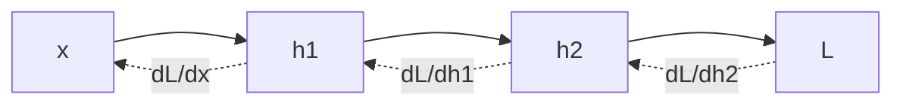

# 链式法则是什么

> 从 Bit 到 AGI · 第二章：数学（Math） · 链式法则是什么

神经网络是函数嵌套：$\mathcal{L} = \mathcal{L}(\mathbf{h}_3(\mathbf{h}_2(\mathbf{h}_1(\mathbf{x}))))$。**链式法则**把最终 loss 对每个中间层、每个权重的梯度，逐层乘回去——这是**反向传播**的数学核心。本篇给出公式、小网络手算例子，并量化深层网络的梯度连乘效应；读 `loss.backward()` 时，本章是语义层。

## 直觉：责任逐级分摊

工厂流水线：原料 → 工序 A → 工序 B → 成品质量分（loss）。成品差了，要追究每道工序「负多少责」——从最后一环往回，每环乘上本环对输出的敏感度。这就是链式法则。

## 定义

**一元链式法则**：$y = f(g(x))$，则

$$
\frac{dy}{dx} = \frac{dy}{dg} \cdot \frac{dg}{dx}
$$

**多元链式法则**：$z = f(u, v)$，$u = u(x)$，$v = v(x)$，则

$$
\frac{dz}{dx} = \frac{\partial z}{\partial u}\frac{du}{dx} + \frac{\partial z}{\partial v}\frac{dv}{dx}
$$

**向量形式**（反向传播本质）：设 $\mathbf{y} = f(\mathbf{z})$，$\mathbf{z} = g(\mathbf{x})$，

$$
\frac{\partial \mathcal{L}}{\partial \mathbf{x}} = \left(\frac{\partial \mathbf{z}}{\partial \mathbf{x}}\right)^\top \frac{\partial \mathcal{L}}{\partial \mathbf{z}}
$$

雅可比转置乘上游梯度。PyTorch autograd 对每个 op 注册 `backward`，自动完成这一乘法。



## 例子

**例 1：两层网络手算**

$$
\mathcal{L} = \frac{1}{2}(y - \hat{y})^2, \quad \hat{y} = w_2 \cdot \sigma(w_1 x)
$$

设 $z = w_1 x$，$a = \sigma(z)$，$\hat{y} = w_2 a$。

| 变量 | 链式法则 | 结果 |
| ---- | -------- | ---- |
| $\frac{\partial \mathcal{L}}{\partial \hat{y}}$ | 直接求 | $\hat{y} - y$ |
| $\frac{\partial \mathcal{L}}{\partial w_2}$ | $\frac{\partial \mathcal{L}}{\partial \hat{y}} \cdot a$ | $(\hat{y}-y) \cdot a$ |
| $\frac{\partial \mathcal{L}}{\partial a}$ | $\frac{\partial \mathcal{L}}{\partial \hat{y}} \cdot w_2$ | $(\hat{y}-y) \cdot w_2$ |
| $\frac{\partial \mathcal{L}}{\partial z}$ | $\frac{\partial \mathcal{L}}{\partial a} \cdot \sigma'(z)$ | 上式 $\times \sigma'(z)$ |
| $\frac{\partial \mathcal{L}}{\partial w_1}$ | $\frac{\partial \mathcal{L}}{\partial z} \cdot x$ | 上式 $\times x$ |

**例 2：PyTorch 验证**

```python
import torch

x = torch.tensor(2.0)
w1 = torch.tensor(0.5, requires_grad=True)
w2 = torch.tensor(-1.0, requires_grad=True)
y_true = torch.tensor(1.0)

z = w1 * x
a = torch.sigmoid(z)
y_hat = w2 * a
loss = 0.5 * (y_true - y_hat) ** 2
loss.backward()
print(w1.grad, w2.grad)
```

## 量化

| 指标 | 数值 / 说明 |
| ---- | ----------- |
| 反向 FLOPs | ≈ **2×** 前向 FLOPs |
| 反向显存 | 常需缓存前向中间激活；activation checkpointing 可换时间省显存 |
| $L$ 层连乘梯度 | $\prod_{l=1}^{L} \frac{\partial h_{l+1}}{\partial h_l}$；若每层 $<1$ → 梯度消失；$>1$ → 爆炸 |
| 梯度裁剪 | `clip_grad_norm_(params, 1.0)` 限制全局范数，防连乘爆炸 |
| ResNet 跳跃连接 | 提供 $+1$ 直通路径，缓解连乘衰减 |

**Transformer 32 层**：每层梯度经 LayerNorm、Attention、FFN 多条路径；Pre-Norm 架构使梯度更稳定，训练 100B+ token 仍可行。

::: warning

手写 7B 模型链式法则不现实。理解链式法则的意义是：**知道 autograd 在算什么、为何深层会梯度消失/爆炸、为何需要残差与 Pre-Norm**。

:::

## 工程视角：计算图与 checkpoint

PyTorch 动态图：每次 forward 临时建图，backward 后释放（除非 `retain_graph=True`）。静态图框架（旧 TensorFlow 1.x、XLA 编译）可整图优化；PyTorch 2.x `torch.compile` 走类似路线。

**重入与 inplace**：`x += 1` inplace 可能破坏版本计数，backward 报错。ResNet inplace ReLU 需小心；多数模块避免 inplace 对需梯度的 tensor。

**Detach 与 stop_gradient**：`y = x.detach()` 切断 $x$ 侧梯度；`torch.no_grad()` 上下文推理时用，省显存不算梯度。LoRA 微调：base 权重 `requires_grad=False`，只训练低秩 $\Delta W = BA$ 的 $A,B$——链式法则在冻结处自然为 0。

Vanilla RNN 梯度连乘 $\prod \mathbf{W}_h$：若 $\|\mathbf{W}_h\|_2 > 1$ 爆炸，$<1$ 消失。LSTM 门控 + 细胞状态 $c_t$ 提供加法路径（类似 ResNet），梯度可直通。Transformer 用残差 $\mathbf{x}+\text{SubLayer}(\mathbf{x})$，数学上 $\partial \mathbf{x}_{out}/\partial \mathbf{x}_{in}$ 含 $+1$ 项——深层仍传梯度，这是 Pre-LN Transformer 能堆 80+ 层的原因之一。

```python
# 感受梯度爆炸：不裁剪 vs 裁剪
import torch
W = torch.randn(50, 50, requires_grad=True) * 1.1  # 谱半径略>1
h = torch.randn(50)
for _ in range(30):
    h = W @ h
loss = h.sum()
loss.backward()
print(W.grad.norm())  # 可能极大
```

## 常见误区

1. **「反向传播 ≠ 链式法则」**：反向传播是链式法则在计算图上的**高效实现**（动态规划，避免重复计算）。
2. **连乘一定消失**：ReLU 导数为 1 的路段不缩小梯度；LSTM 门控也为此设计。
3. **detach 断链**：`tensor.detach()` 截断梯度，用于 GAN 判别器、冻结 encoder 等场景。

## 动手试一试

```python
import torch

# 观察梯度连乘：10 层 sigmoid vs 10 层 ReLU
def grad_through_layers(act_fn, layers=10):
    x = torch.tensor(1.0, requires_grad=True)
    h = x
    for _ in range(layers):
        h = act_fn(h * 0.5)  # 小权重模拟深层
    h.backward()
    return x.grad.item()

sigmoid = lambda t: torch.sigmoid(t)
relu = lambda t: torch.relu(t)
print(f"sigmoid x.grad: {grad_through_layers(sigmoid):.2e}")
print(f"relu    x.grad: {grad_through_layers(relu):.2e}")
```

## 深入一层：计算图 DAG

计算图是有向无环图（DAG）：叶节点是输入/参数，根是 loss。链式法则 = 从根到叶路径上导数连乘（多元时求和）。

**共享子图**：$\mathbf{h}$ 被两分支使用，反向时两路上游梯度**相加**到 $\mathbf{h}$——`backward` 自动处理 fan-out。ResNet 分支汇合是典型 fan-out。

**Checkpoint 权衡**：存 $K$ 个 checkpoint，重算段长 $\approx L/K$，显存 $\propto L/K$，FLOPs 乘 $(1+1/K)$ 因子——Megatron 训练 trillion 参数时用 aggressive checkpointing。

**Custom Function**：`torch.autograd.Function` 实现 `forward` + `backward`，手写局部链式法则。FlashAttention 的 backward 即 fused CUDA kernel + 自定义导数。

Vanilla BPTT（RNN）：时间步 $t$ 到 $t-1$ 的链式法则跨越时间展开——序列长 $T$ 则图深 $T$，梯度连乘 $\prod_{t=1}^T \mathbf{W}_h$。Truncated BPTT 截断链，牺牲长程梯度换稳定。

理解链式法则 = 理解 **PyTorch 报错「backward through the graph a second time」** 的根因：图已 free，需 `retain_graph` 或二次 forward。

## 反传在框架里的调用栈

`loss.backward()` → 引擎从 loss 节点反向 → 每个 `torch.autograd.Function` 的 `backward` → 累积到 `.grad`。`retain_graph=True` 保留图供二阶导或 GAN；`create_graph=True` 建高阶导图。推理用 `torch.inference_mode()` 或 `no_grad()` 跳过整棵导数树——省显存、省时间。

Module 级：`model.train()` 与 `model.eval()` 影响 Dropout/BatchNorm 行为，不改变链式法则本身，但改变前向数值 hence 改变梯度。

## 读者备忘

**反向传播 = 链式法则在 DAG 上的动态规划。** 反向 FLOPs ≈ 2× 前向。残差连接给 Jacobian 加 $+1$ 路径，是深层 Transformer 可训练的关键之一。fan-out 处梯度相加，框架自动处理。Checkpoint 用重算换显存，数学不变。

::: info

本章内容面向程序员：公式可手推，数字可心算，代码可运行。遇到符号不熟时，先查本篇定义表，再查总结篇速查表，不必一次背熟全部细节。

:::

::: info

复习建议：先通读直觉与定义，再跑代码块验证数字，最后看读者备忘与小结。与第一章的 float 数组、SIMD、GPU 并行对照阅读，印象更深。后续章节会在 Transformer、训练、推理中反复调用本章符号，值得在笔记里自建一张 shape/FLOPs 速查表。

:::

## 小结

链式法则 $\frac{dy}{dx} = \frac{dy}{dg}\frac{dg}{dx}$ 把复合函数的导数分解为各层导数的乘积；反向传播沿计算图从 loss 向输入传播梯度。深层网络梯度连乘导致消失/爆炸，架构设计（ReLU、残差、Pre-Norm）为此服务。下一篇：**为什么 loss 真的能下降**——泰勒近似与学习率调度。

→ 下一篇：[为什么损失函数可以下降](/manual/llm/bit-to-agi/02-math/why-loss-can-descend)
