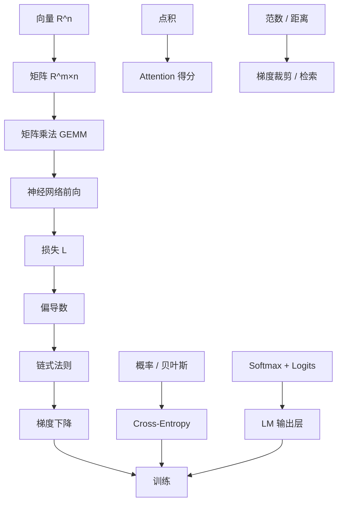

# 第二章总结

> 从 Bit 到 AGI · 第二章：数学（Math） · 第二章总结

第一章把世界读成 Bit 与浮点数组；第二章把这些数组放进**可计算的数学框架**。本篇串联向量→矩阵→GEMM→梯度→概率→点积→Softmax 的知识链，给出「读代码 / 读论文时该想起什么公式」的速查表，并指向第三章：信息论。

## 我们学了什么



## 核心公式速查

| 主题 | 公式 | 代码里常见 |
| ---- | ---- | ---------- |
| 向量存储 | $n \times \text{bytes}$ | `tensor.numel() * element_size` |
| 矩阵乘 FLOPs | $2mnk$ | `@`、`matmul`、cuBLAS |
| 梯度 | $\nabla f = (\partial f/\partial x_i)$ | `loss.backward()` |
| SGD | $\theta \leftarrow \theta - \eta \nabla \mathcal{L}$ | `optimizer.step()` |
| 链式法则 | $\frac{dy}{dx} = \frac{dy}{dg}\frac{dg}{dx}$ | autograd 计算图 |
| 点积 | $\mathbf{a}^\top\mathbf{b} = \sum a_i b_i$ | `a @ b` |
| L2 范数 | $\|\mathbf{x}\|_2 = \sqrt{\mathbf{x}^\top\mathbf{x}}$ | `torch.linalg.norm(g, ord=2)` |
| Softmax | $p_i = e^{z_i}/\sum e^{z_j}$ | `F.softmax(logits, -1)` |
| Cross-Entropy | $-\log p_k$ | `F.cross_entropy(logits, y)` |
| 贝叶斯 | $P(\theta \mid \mathcal{D}) \propto P(\mathcal{D} \mid \theta)P(\theta)$ | weight decay |

## 量化心智模型

读 LLM 配置时，用本章数字快速估算：

| 问题 | 心算方法 |
| ---- | -------- |
| 一个 hidden 向量占多少显存？ | $d \times 2$ 字节（bf16） |
| 线性层参数量？ | $d_{in} \times d_{out}$ |
| Attention 算力随 context 怎么变？ | $\propto L^2$ |
| 反向比前向贵多少？ | FLOPs ≈ 2× |
| 词表输出层多大？ | $V \times d$ 参数 |
| PPL 30 意味着什么？ | $\exp(\text{CE}) = 30$，平均相当于 30 选 1 |

**7B 模型 bf16 权重**：$7 \times 10^9 \times 2 \approx 14$ GiB。梯度 + optimizer states（Adam 再 ×2–3）→ 训练显存远超推理。

## 章节文章索引

1. [向量是什么](/manual/llm/bit-to-agi/02-math/what-is-a-vector) — $\mathbb{R}^n$，embedding 的基本单位
2. [矩阵是什么](/manual/llm/bit-to-agi/02-math/what-is-a-matrix) — batch 与权重的容器
3. [为什么矩阵乘法这么重要](/manual/llm/bit-to-agi/02-math/why-matrix-multiply-matters) — GEMM 占 >90% 算力
4. [梯度是什么](/manual/llm/bit-to-agi/02-math/what-is-gradient) — 最陡上升方向，训练用负梯度
5. [导数为什么可以学习](/manual/llm/bit-to-agi/02-math/why-derivatives-enable-learning) — 局部线性近似
6. [偏导数是什么](/manual/llm/bit-to-agi/02-math/what-is-partial-derivative) — 每个参数一个偏导
7. [链式法则是什么](/manual/llm/bit-to-agi/02-math/chain-rule) — 反向传播数学基础
8. [为什么损失函数可以下降](/manual/llm/bit-to-agi/02-math/why-loss-can-descend) — 泰勒一阶 + 学习率
9. [概率是什么](/manual/llm/bit-to-agi/02-math/what-is-probability) — LLM 输出分布
10. [贝叶斯是什么](/manual/llm/bit-to-agi/02-math/what-is-bayes) — 先验、MAP、weight decay
11. [点积是什么](/manual/llm/bit-to-agi/02-math/dot-product) — attention 得分
12. [范数与距离](/manual/llm/bit-to-agi/02-math/norms-and-distance) — 裁剪、检索、正则
13. [特征值的直觉](/manual/llm/bit-to-agi/02-math/eigenvalues-intuition) — 稳定性与初始化
14. [Softmax 与 Logits](/manual/llm/bit-to-agi/02-math/softmax-and-logits) — 输出层与 CE loss

## 与后续章节的衔接

| 本章概念 | 后续用到 |
| -------- | -------- |
| 概率、$-\log p$ | 第三章：熵、交叉熵、KL 散度 |
| 向量、点积 | 第四章：神经元、MLP |
| 矩阵、Softmax | 第五章：Self-Attention、Transformer |
| 梯度、链式法则 | 第七章：预训练、优化器、学习率 schedule |
| GEMM FLOPs | 第八章–第九章：推理与 GPU |

## 动手复盘

用 5 分钟跑通「最小训练环」，巩固本章概念：

```python
import torch
import torch.nn.functional as F

# 数据：10 类，输入 784 维
X = torch.randn(32, 784)
y = torch.randint(0, 10, (32,))

# 一层线性 = 矩阵乘 + logits
W = torch.randn(10, 784, requires_grad=True)
logits = X @ W.T                    # GEMM
loss = F.cross_entropy(logits, y)   # log-softmax + CE

loss.backward()                     # 链式法则 → 梯度
print(W.grad.shape)                 # (10, 784) 与 W 同形
print(f"loss={loss.item():.3f}, grad_norm={W.grad.norm():.2f}")
```

## 学习路径建议

若时间有限，按依赖顺序精读：

1. **必读**（打地基）：向量 → 矩阵 → GEMM → 梯度 → 链式法则 → Softmax
2. **训练必读**：偏导 → loss 下降 → 概率 / CE
3. **进阶直觉**：点积（attention）→ 范数（clip）→ 特征值（稳定）→ 贝叶斯（正则）

每篇的 Python 片段建议本地跑一遍；改数字观察 gradient、loss、softmax 输出变化——比死记公式有效。

## 自测清单

读完本章，你应能口头回答：

- $d=4096$、bf16 的一个向量占多少 KiB？
- 线性层 $(768 \to 3072)$ 多少参数？
- `loss.backward()` 后 `W.grad` 的 shape？
- 为什么 attention 算力 $\propto L^2$？
- CE = 2.3 对应正确类概率多少？
- 为什么 `F.cross_entropy` 要 logits 不要 softmax 后的 $p$？

若有任一卡住，回到对应篇章复习。

## 与代码库的映射（本仓库）

本专栏站点 `daiw` 后续章节实现 Transformer、训练脚本时，本章公式会反复出现：`site-config` 不管数学，但 `content/manual/bit-to-agi/` 各章 MDX 即你的「公式索引」。读 PyTorch 源码或 HuggingFace `modeling_*.py` 时，对照本章 shape 表逐行 trace。

## 术语对照（中英）

| 中文 | 英文 | 本章篇章 |
| ---- | ---- | -------- |
| 向量 | vector | what-is-a-vector |
| 矩阵 | matrix | what-is-a-matrix |
| 梯度 | gradient | what-is-gradient |
| 偏导数 | partial derivative | what-is-partial-derivative |
| 链式法则 | chain rule | chain-rule |
| 点积 | dot product | dot-product |
| 特征值 | eigenvalue | eigenvalues-intuition |
| 对数几率 | logit | softmax-and-logits |

## 下一章预告

第三章 **信息论** 回答：为什么 cross-entropy 是「天然」loss？熵 $H$、KL 散度、互信息与压缩、预测的统一视角——把本章「概率 + $-\log p$」升维到**比特**语言。读 `cross-entropy.mdx` 前，确保本章 Softmax 与概率篇已读。

本章 15 篇构成最小数学闭环：数据结构（向量、矩阵）→ 运算（GEMM、点积）→ 优化（梯度、链式法则）→ 输出（概率、softmax）。不必一次背熟；写代码、读 config、看 loss 曲线时回来查表即可。

## 时间投入建议

零基础：2–3 天，按 meta.json 顺序通读 + 跑每篇代码块。有 ML 基础：当公式索引，重点读 GEMM、链式法则、Softmax 三篇。复习：只看本章总结速查表 + 自测清单。

## 读者备忘

本章是**公式索引**，不是一次考试。写训练脚本时回来查 FLOPs 与 shape；读论文时回来查符号定义。下一章信息论把 $-\log p$ 解释成比特——与第一章 Bit 闭环。建议 bookmark 本章总结速查表；第四章起会反复引用向量、矩阵、梯度与 softmax。

::: info

本章内容面向程序员：公式可手推，数字可心算，代码可运行。遇到符号不熟时，先查本篇定义表，再查总结篇速查表，不必一次背熟全部细节。

:::

## 小结

第二章建立了 AI 数学的**最小完备集**：数据结构（向量、矩阵）→ 核心运算（GEMM、点积）→ 优化（梯度、链式法则、下降）→ 输出（概率、Softmax）。不必成为数学家；看到论文公式时，能对应到「shape、FLOPs、backward 在算什么」即可。下一章进入**信息论**——从「预测 = 压缩」理解 cross-entropy 为何是天然 loss，并与第一章 Bit 形成闭环。

→ 下一章：[第三章：信息（Information）](/manual/llm/bit-to-agi/03-information)
