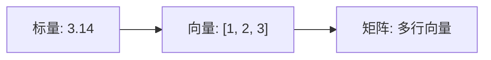

# 向量是什么

> 从 Bit 到 AGI · 第二章：数学（Math） · 向量是什么

第一章我们知道了：浮点数在内存里排成连续数组，GPU 一次处理成千上万个数。要把这种「一排数」变成可计算的数学对象，第一个概念就是**向量**。读完本篇，你会知道向量在代码里长什么样、在 AI 里表示什么，以及为什么维度 $d$ 决定了显存占用。后文所有「shape 不对」的 bug，多半可以还原成：某个本应是 $\mathbb{R}^n$ 的对象被当成了别的维度。

## 直觉：一行有序的数字

想象你在记录一个用户的特征：年龄 28、身高 175 cm、体重 70 kg。这不是三个孤立的变量，而是一个**有序列表**——顺序错了，含义就变了（不能把身高和年龄对调）。

在机器学习中，一张 $224 \times 224$ 的 RGB 图片，展平后得到 $224 \times 224 \times 3 = 150{,}528$ 维向量；一个 token 的 embedding 可能是 4096 维向量。**向量 = 把多个数值打包成一个数学对象**。



## 定义

**向量**（vector）是 $n$ 个实数组成的有序 $n$ 元组，记作 $\mathbf{x} \in \mathbb{R}^n$：

$$
\mathbf{x} = \begin{bmatrix} x_1 \\ x_2 \\ \vdots \\ x_n \end{bmatrix}, \quad x_i \in \mathbb{R}
$$

程序员视角：

| 概念 | 数学 | 代码（NumPy） |
| ---- | ---- | ------------- |
| 向量 | $\mathbf{x} \in \mathbb{R}^n$ | `x = np.array([1.0, 2.0, 3.0])` |
| 维度 | $n$ | `x.shape == (3,)` |
| 第 $i$ 个分量 | $x_i$ | `x[i]`（0-indexed 对应 $x_{i+1}$） |

向量有两种常见视角：

- **几何视角**：$n$ 维空间中的一个点或从原点出发的箭头。
- **数据视角**：一个样本的特征向量（feature vector）。

## 例子

**例 1：词 embedding**

GPT 类模型里，词表大小 $V \approx 128{,}000$，隐藏维度 $d = 4096$。每个 token 对应 embedding 矩阵 $\mathbf{E} \in \mathbb{R}^{V \times d}$ 的一行——一个 4096 维向量。查表操作 `E[token_id]` 就是取一个向量。

**例 2：批量输入**

训练时不会一次只喂一个向量，而是堆成**矩阵**（下一篇讲）。batch size $B=32$、维度 $d=768$ 时，输入形状为 $(32, 768)$——32 个 768 维向量排成矩阵。

```python
import numpy as np

# 单个向量
x = np.array([0.1, -0.3, 0.7, 0.0])  # shape (4,)

# 一批向量（矩阵）
batch = np.random.randn(32, 768)      # 32 个 768 维向量
print(batch.nbytes)                   # 32 * 768 * 8 = 196608 字节 ≈ 192 KiB (float64)
```

## 量化

| 量 | 公式 / 数值 |
| -- | ----------- |
| 存储（float32） | $n \times 4$ 字节 |
| 存储（float16 / bf16） | $n \times 2$ 字节 |
| LLaMA-7B 隐藏层维度 | $d = 4096$ |
| 单层激活向量（bf16） | $4096 \times 2 = 8192$ 字节 ≈ 8 KiB |
| 向量加法 FLOPs | $n$ 次加法 |
| 向量与矩阵乘（$\mathbf{y} = \mathbf{W}\mathbf{x}$，$\mathbf{W} \in \mathbb{R}^{m \times n}$） | $2mn$ FLOPs（乘加各 $mn$ 次） |

::: info

深度学习中「维度 $d$」几乎无处不在：embedding 维度、注意力头维度、FFN 中间层维度。看到 $d=4096$ 时，立刻能心算：一个向量占 8 KiB（bf16）。

:::

## 工程视角：向量在栈里的位置

第一章讲过：float32 占 4 字节，bf16 占 2 字节。向量在内存里就是**一段连续地址**，没有「向量头」之类的元数据——`shape=(4096,)` 是框架层的抽象。

PyTorch `Tensor` 除了数据指针，还记录 `dtype`、`device`、`requires_grad`。训练时同一个逻辑向量可能在 CPU 上初始化、再 `.cuda()` 拷到 GPU；显存里仍是 $n$ 个浮点连续排列。`view` / `reshape` 不改变底层存储，只改解释方式——这与第一章「contiguous」概念直接相关。

**广播**（broadcasting）是向量运算的糖：形状 `(3,)` 与 `(3, 4096)` 相加时，短向量沿 batch 维复制，无需真的分配 $3 \times 4096$ 次。理解广播，能避免 silent bug：`(4096,)` 与 `(4096, 1)` 在某些运算里不等价。

| 操作 | 输入 shape | 输出 shape | FLOPs |
| ---- | ---------- | ---------- | ----- |
| 向量加 $\mathbf{a}+\mathbf{b}$ | $(n,), (n,)$ | $(n,)$ | $n$ |
| 标量乘 $c\mathbf{a}$ | $(n,)$ | $(n,)$ | $n$ |
| 矩阵乘 $\mathbf{W}\mathbf{x}$ | $(m,n), (n,)$ | $(m,)$ | $2mn$ |

ResNet 把 224×224×3 图片变成 2048 维向量再分类；BERT 把 512 个 token 各变成 768 维向量。维度从 $10^5$ 压到 $10^3$，正是「学习有用表示」——用较低维向量承载语义，而不是 raw pixel。

## 常见误区

1. **向量 ≠ Python list**：`list` 可以混类型；向量要求同类型浮点数组，且支持向量运算。
2. **行向量 vs 列向量**：$\mathbf{x} \in \mathbb{R}^{1 \times n}$ 与 $\mathbf{x} \in \mathbb{R}^{n \times 1}$ 在矩阵乘法里结果不同。PyTorch 里 `(n,)` 与 `(1, n)` 广播行为也不同——写代码时注意 `shape`。
3. **高维不等于「更精确」**：150528 维的像素向量很稀疏、冗余；神经网络学的是低维流形上的表示（如 4096 维 embedding）。

## 动手试一试

```python
import numpy as np

def vector_memory(n: int, dtype_bytes: int = 4) -> int:
    """float32 向量占用的字节数"""
    return n * dtype_bytes

# GPT-4 级 hidden size 估算
for d in [768, 4096, 8192]:
    kb = vector_memory(d, 2) / 1024  # bf16
    print(f"d={d:5d} → {kb:.1f} KiB per vector")
```

## 深入一层：几何与代数统一

把向量看作箭头：加法 $\mathbf{a}+\mathbf{b}$ 是平行四边形法则；数乘 $c\mathbf{a}$ 是拉伸/翻转。$\mathbb{R}^2$ 里直观，$\mathbb{R}^{4096}$ 里代数规则**完全相同**——这是抽象的力量。

**单位向量** $\hat{\mathbf{x}} = \mathbf{x}/\|\mathbf{x}\|_2$ 只保留方向。Attention 里有时对 $\mathbf{q},\mathbf{k}$ 做 LayerNorm，等价于控制参与点积的尺度，使 score 更取决于方向而非模长。

**零向量** $\mathbf{0}$ 是加法单位元；任何向量空间都有。Padding token 的 embedding 初始常接近 $\mathbf{0}$ 或小随机——避免 padding 干扰 attention（配合 mask 置 $-\infty$）。

**线性组合**：$\mathbf{y} = \sum_i \alpha_i \mathbf{v}_i$。Embedding 查表是 one-hot 与 $\mathbf{E}$ 行向量的线性组合特例；Softmax 加权 attention 输出 $\sum_j \alpha_j \mathbf{v}_j$ 是 general 线性组合——向量语言贯穿全网络。

**内存对齐**：GPU 喜欢 128 字节对齐访问。$d=4096$、bf16 时一行 8192 字节，恰为 64 的倍数——某些 kernel 对 $d$ 有 alignment 假设，改 hidden size 偶发踩性能坑。

读 `config.json` 时把 `hidden_size` 当成向量的 $n$；把每个 token 的 hidden state 当成 $\mathbb{R}^n$ 里的一点——此后所有章节的 shape 讨论都建立在这套语言上。

## 读者备忘

**向量 = 一维浮点数组 = $\mathbb{R}^n$ 元素。** 看到 `hidden_size=4096`，立刻反应：bf16 下单向量 8 KiB；batch 32 即 256 KiB 仅一层激活。维度是贯穿全书的核心数字。

## 小结

向量是 $\mathbb{R}^n$ 中的有序实数组，是 ML 里表示样本、token、特征的基本单位。代码里对应一维 `ndarray` / `Tensor`；显存与 FLOPs 都随维度 $n$ 线性增长。下一篇我们把多个向量叠起来，看**矩阵**如何组织与变换它们。

→ 下一篇：[矩阵是什么](/manual/llm/bit-to-agi/02-math/what-is-a-matrix)
