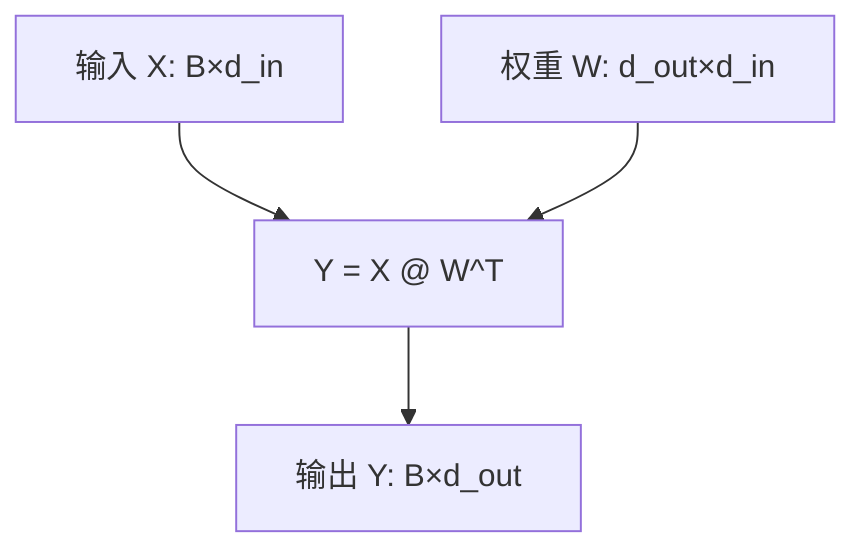

# 为什么矩阵乘法这么重要

> 从 Bit 到 AGI · 第二章：数学（Math） · 为什么矩阵乘法这么重要

如果只能保留一个运算来概括现代 AI，那就是**矩阵乘法**（GEMM, General Matrix Multiply）。全连接层、卷积（im2col 后也是 GEMM）、注意力里的 $\mathbf{QK}^\top$ 和 $\mathbf{AV}$，本质全是它。本篇用数字说明：为什么 GPU 为 GEMM 而生，以及一次 Transformer 前向里有多少次矩阵乘。读完你会能用 $2mnk$ 粗算一层 Linear、一块 Attention 的算力，并理解为何采购 GPU 时看 TFLOPS 指标。

## 直觉：一次乘法，批量变换

标量乘法：$y = w \cdot x$，一个数乘一个数。

矩阵乘法：$\mathbf{Y} = \mathbf{X}\mathbf{W}$，**同一组权重 $\mathbf{W}$ 同时作用于 batch 里每一个输入向量**。这就是「并行」的数学形式——GPU 有数千个核心，正好一次算 $\mathbf{Y}$ 的一个元素。



## 定义

设 $\mathbf{A} \in \mathbb{R}^{m \times k}$，$\mathbf{B} \in \mathbb{R}^{k \times n}$，则：

$$
\mathbf{C} = \mathbf{A}\mathbf{B} \in \mathbb{R}^{m \times n}, \quad c_{ij} = \sum_{l=1}^{k} a_{il} b_{lj}
$$

即 $\mathbf{C}$ 的第 $(i,j)$ 元素 = $\mathbf{A}$ 第 $i$ 行与 $\mathbf{B}$ 第 $j$ 列的**点积**（后面会专门讲）。

**计算复杂度**：$O(mnk)$，FLOPs = $2mnk$（每个 $c_{ij}$ 需要 $k$ 次乘加）。

## 例子

**例 1：全连接层**

```python
import numpy as np

B, d_in, d_out = 32, 768, 3072
X = np.random.randn(B, d_in)
W = np.random.randn(d_out, d_in)  # PyTorch Linear 的 weight 形状

Y = X @ W.T                      # (32, 768) @ (768, 3072) -> (32, 3072)
flops = 2 * B * d_in * d_out
print(f"FLOPs = {flops:,}")      # 150,994,944 ≈ 151 MFLOPs
```

**例 2：Self-Attention 里的两次 GEMM**

设 $B$ 个 token、$d$ 维、$h$ 个头，每头维度 $d_h = d/h$。

| 步骤 | 运算 | 形状 | FLOPs（量级） |
| ---- | ---- | ---- | ------------- |
| QK^T | $\mathbf{Q}\mathbf{K}^\top$ | $(B, L, d_h) \times (B, d_h, L)$ | $2BL^2 d_h$ |
| AV | $\mathbf{A}\mathbf{V}$ | $(B, L, L) \times (B, L, d_h)$ | $2BL^2 d_h$ |

序列长度 $L=4096$、$d=4096$、$h=32$ 时，单层注意力两次 GEMM（全部头）合计约 $4 L^2 d = 4 \times 4096^2 \times 4096 \approx 2.7 \times 10^{11}$ FLOPs（约 0.27 TFLOPs）——这就是为什么长上下文吃算力。

## 量化：GPU 与 GEMM

| 指标 | 数值 |
| ---- | ---- |
| NVIDIA A100 FP16 峰值 | ≈ 312 TFLOPS |
| NVIDIA H100 FP16 峰值 | ≈ 989 TFLOPS（稠密） |
| NVIDIA B200 FP16 / FP8 峰值 | ≈ 2,250 / 4,500 TFLOPS（稠密） |
| cuBLAS / CUTLASS | GPU 上 GEMM 的专用库，利用率可达 80%+ |
| 训练 7B 模型一步 | 前向+反向 GEMM 占 **>90%** 算力时间 |

**Roofline 模型**：GEMM 是**计算密集型**（arithmetic intensity $\approx O(n)$ 对大矩阵）。GPU 高带宽 HBM + 大量 CUDA core，正是为这种运算设计。CPU 做同样 GEMM 可能慢 10–100 倍。

::: info

第一章提到「AI 喜欢矩阵」——根本原因就是：**神经网络 = 层层矩阵乘 + 少量逐元素非线性**（ReLU、Softmax 等）。非线性计算量相对 GEMM 可忽略。

:::

## 工程视角：GEMM 在训练循环里占多少

打开 PyTorch profiler 或 Nsight，一次 Transformer 训练 step 的热力图几乎全红在 `mm`、`bmm`、`addmm` 上——其余 `relu`、`dropout`、`layer_norm` 占比个位数百分比。这不是实现问题，是**算法结构**决定的：参数化线性变换 + 非线性，线性部分全是 GEMM。

**批矩阵乘**（batched GEMM）：形状 $(B, m, k) \times (B, k, n) \to (B, m, n)$。Multi-head attention 对 $h$ 个头并行，每头一个小 GEMM，GPU 一次 launch 处理整个 batch×head——cuBLAS 的 `strided_batched_gemm` 专为此优化。

**Tensor Core**（NVIDIA Ampere 及以后）：对 $16 \times 16$ 块做混合精度矩阵乘，有效吞吐是 CUDA core 的数倍。要触发 Tensor Core，$m,n,k$ 通常需为 8 或 16 的倍数——部分框架 padding 隐藏层维度到 64 的倍数 partly 为此。

| 硬件 | FP16 峰值 | 7B 模型单 token 前向（粗估） |
| ---- | --------- | ---------------------------- |
| A100 | 312 TFLOPS | ~14 GFLOPS（前向 2N）→ ~0.045 ms 算力下界 |
| H100 / B200 | 989 / 2,250 TFLOPS | 同算力 ~3–7× 快 |

实际 latency 远高于理论：内存带宽、kernel launch、Softmax、LayerNorm 串行部分都会拖后腿。但**优化 GEMM 仍是第一优先级**——FlashAttention、融合 kernel、连续内存布局都服务于此。

## 常见误区

1. **「矩阵乘就是两个 for 循环」**：朴素三重循环 $O(n^3)$ 对大矩阵极慢；实际用分块（tiling）、共享内存、Tensor Core 等优化。
2. **忽略转置**：PyTorch `X @ W.T` 与 `W @ X.T` 形状不同；写错转置是 shape mismatch 的头号原因。
3. **以为卷积不是 GEMM**：$3\times3$ 卷积可通过 im2col 变成 GEMM，cuDNN 内部就这么干。

## 动手试一试

```python
def attention_gemm_flops(L: int, d: int, h: int, B: int = 1) -> int:
    d_h = d // h
    # QK^T + AV, each 2*B*L*L*d_h FLOPs
    return 4 * B * L * L * d_h

for L in [512, 2048, 8192]:
    f = attention_gemm_flops(L, d=4096, h=32)
    print(f"L={L:5d} → {f/1e12:.2f} TFLOPs per layer (attention only)")
```

## 深入一层：Strassen 与「够快就行」

理论上 Strassen 矩阵乘 $O(n^{2.81})$ 渐近优于 $O(n^3)$，实践中 $n<1000$ 几乎总用朴素或 blocked GEMM——常数因子与 cache 友好更重要。LLM 的 $d=4096$ 落在「blocked GEMM + Tensor Core 甜区」。

**Winograd / FFT 卷积**：小 kernel 卷积有快速算法；cuDNN 自动选。对你而言：**卷积层 ≈ GEMM**，Profiler 里归类为 `conv2d` 或 `im2col+gemm`。

**稀疏 GEMM**：权重剪枝 90% 为 0 后，稠密 GEMM 浪费——需要 CSR/Block sparse 格式。GPT-4 是否稀疏未知；开源稀疏推理（SparseGPT 等）仍属前沿，默认 stack 仍是 dense GEMM。

**算力预算表**（单层 Transformer，$d=4096$，$L=4096$，$h=32$，$B=1$）：

| 模块 | 主导运算 | 粗算 FLOPs |
| ---- | -------- | ---------- |
| QKV proj | 3× GEMM $L\times d\times d$ | $6Ld^2$ |
| QK^T + AV | $2\times 2 L^2 d_h h$ | $4L^2 d$ |
| FFN | $2\times 2 L d (4d)$ | $16Ld^2$ |

Attention 在 $L$ 大时超 FFN；$L$ 小（如 512）时 FFN 主导——这解释 FlashAttention、长上下文优化的动机。

Profile 训练 step 时，若 GEMM 占比低于 80%，常见原因是 batch 过小、Python 开销过大，或算子未 fuse——值得排查，因为健康 Transformer 训练里 GEMM 通常应占绝对多数时间。

## 与 Transformer 的算力账

一层 Decoder block：QKV 投影 $3 \times 2Ld^2$ FLOPs；attention $4L^2d$；FFN $16Ld^2$（$d_{ff}=4d$）。32 层 × 上述；再 × batch。7B 模型一次 forward 数十 TFLOPs 量级——**其中 GEMM 占绝对多数**。优化 attention（FlashAttention）、融合 LayerNorm+Linear，都是减少 GEMM 以外的 overhead，而非取代 GEMM。

推理 KV cache 不减少 QK^T 的历史计算，但减少重复投影——算力账仍随生成长度增长。长 context 产品（128k）的硬件成本，根子在本章 $L^2$ 公式。

## 读者备忘

记住三句话：**① 神经网络 = 层层 GEMM + 少量非线性；② FLOPs 粗算看 $2mnk$；③ 长 context 的瓶颈在 $L^2$ 的 attention GEMM。** 读论文见 FLOPs 估算表，用本章公式验算数量级是否合理。

::: info

本章内容面向程序员：公式可手推，数字可心算，代码可运行。遇到符号不熟时，先查本篇定义表，再查总结篇速查表，不必一次背熟全部细节。

:::

::: info

复习建议：先通读直觉与定义，再跑代码块验证数字，最后看读者备忘与小结。与第一章的 float 数组、SIMD、GPU 并行对照阅读，印象更深。后续章节会在 Transformer、训练、推理中反复调用本章符号，值得在笔记里自建一张 shape/FLOPs 速查表。

:::

## 小结

矩阵乘法 $\mathbf{C}=\mathbf{AB}$ 复杂度 $O(mnk)$，是神经网络前向与反向的核心。GPU + cuBLAS 专为 GEMM 优化；Transformer 注意力在长序列下 GEMM 量随 $L^2$ 增长。理解 GEMM，就理解了为什么 AI 训练要买 GPU、为什么 context length 是硬成本。下一篇进入**梯度**：GEMM 算前向，梯度算如何改权重。

→ 下一篇：[梯度是什么](/manual/llm/bit-to-agi/02-math/what-is-gradient)
