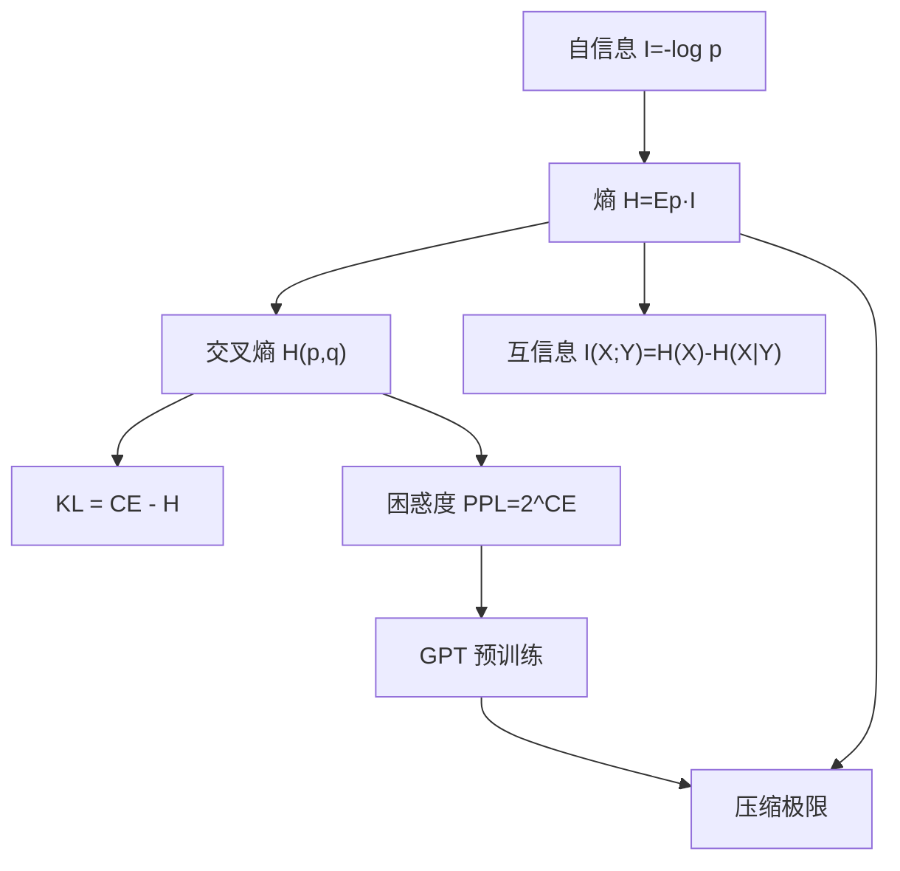

# 第三章总结

> 从 Bit 到 AGI · 第三章：信息（Information） · 第三章总结

本章从「什么是信息」出发，走到「预测即压缩」，把 GPT 预训练目标钉在信息论的坐标系里。读完应能回答：**比特、熵、交叉熵、KL、困惑度、下一个 Token 预测**之间是什么关系，以及各自的数量级。

## 核心概念一张图

## 公式速查

| 概念 | 公式 | 单位 |
| ---- | ---- | ---- |
| 自信息 | $I(x) = -\log_2 p(x)$ | bit |
| 熵 | $H(X) = -\sum p \log_2 p$ | bit |
| 条件熵 | $H(X \mid Y) = H(X,Y) - H(Y)$ | bit |
| 互信息 | $I(X;Y) = H(X) - H(X \mid Y)$ | bit |
| 交叉熵 | $H(p,q) = -\sum p \log_2 q$ | bit |
| KL 散度 | $D_{\mathrm{KL}}(p\|q) = H(p,q) - H(p)$ | bit |
| 困惑度 | $\mathrm{PPL} = 2^{H(p,q)}$ | 无量纲 |
| GPT 损失 | $\mathcal{L} = -\frac{1}{T}\sum \log q_\theta(x_t \mid x_{<t})$ | bit/Token |

## 数量级备忘

| 对象 | 典型数值 |
| ---- | -------- |
| 公平硬币熵 | 1 bit |
| 英文字符熵（含上下文） | 1.0–1.5 bit/字符 |
| 磁盘 ASCII 存储 | 8 bit/字符 |
| GPT 词表大小 | 50k–100k |
| 随机猜下一 Token | $\log_2 |V| \approx 16$ bit |
| 好模型每 Token CE | 3–4 bit（PPL 8–16） |
| 上下文带来的互信息 | 10+ bit（相对无上下文） |

## 各篇要点回顾

1. **[什么是信息](/manual/llm/bit-to-agi/03-information/what-is-information)**：信息 = 消除的不确定性；$I(x)=-\log_2 p(x)$；小概率事件信息量大。
2. **[信息熵是什么](/manual/llm/bit-to-agi/03-information/what-is-entropy)**：平均自信息；语言高度可预测故熵远低于随机上界。
3. **[为什么压缩就是去除信息冗余](/manual/llm/bit-to-agi/03-information/compression-removes-redundancy)**：码长 $\ge H$；去掉的是超过熵的多余比特。
4. **[为什么语言具有统计规律](/manual/llm/bit-to-agi/03-information/language-has-statistics)**：Zipf、N-gram、条件熵随上下文下降；PPL 可量化。
5. **[为什么 GPT 可以预测下一个 Token](/manual/llm/bit-to-agi/03-information/why-gpt-predicts-next-token)**：CLM + 自回归；简单损失 + 强统计规律 + 大模型。
6. **[互信息是什么](/manual/llm/bit-to-agi/03-information/mutual-information)**：$Y$ 让 $X$ 少不确定多少；上下文与续写强相关。
7. **[交叉熵是什么](/manual/llm/bit-to-agi/03-information/cross-entropy)**：训练损失本体；$-\log q(\text{正确类})$。
8. **[KL 散度是什么](/manual/llm/bit-to-agi/03-information/kl-divergence)**：模型相对真实的额外代价；最小化 CE ≡ 最小化 KL。
9. **[预测即压缩](/manual/llm/bit-to-agi/03-information/prediction-is-compression)**：算术编码 + 预测器；GPT 在学最短描述。

## 通向下一章

信息论回答了「**学什么**」：拟合语料的条件概率，最小化交叉熵。还没回答「**用什么算**」——矩阵、梯度、激活函数、反向传播。第四章[神经网络](/manual/llm/bit-to-agi/04-neural-networks)起，把 $q_\theta(x_t \mid x_{<t})$ 具体化成数十亿参数的 Transformer 权重。

::: info

复习建议：用本章 Python 片段算 3 个分布的 $H$、$H(p,q)$、$D_{\mathrm{KL}}$，再对照 GPT 日志里的 loss 与 PPL。手算一次，比背公式记得牢。

:::

## 本章目录

- [什么是信息](/manual/llm/bit-to-agi/03-information/what-is-information)
- [信息熵是什么](/manual/llm/bit-to-agi/03-information/what-is-entropy)
- [为什么压缩就是去除信息冗余](/manual/llm/bit-to-agi/03-information/compression-removes-redundancy)
- [为什么语言具有统计规律](/manual/llm/bit-to-agi/03-information/language-has-statistics)
- [为什么 GPT 可以预测下一个 Token](/manual/llm/bit-to-agi/03-information/why-gpt-predicts-next-token)
- [互信息是什么](/manual/llm/bit-to-agi/03-information/mutual-information)
- [交叉熵是什么](/manual/llm/bit-to-agi/03-information/cross-entropy)
- [KL 散度是什么](/manual/llm/bit-to-agi/03-information/kl-divergence)
- [预测即压缩](/manual/llm/bit-to-agi/03-information/prediction-is-compression)
