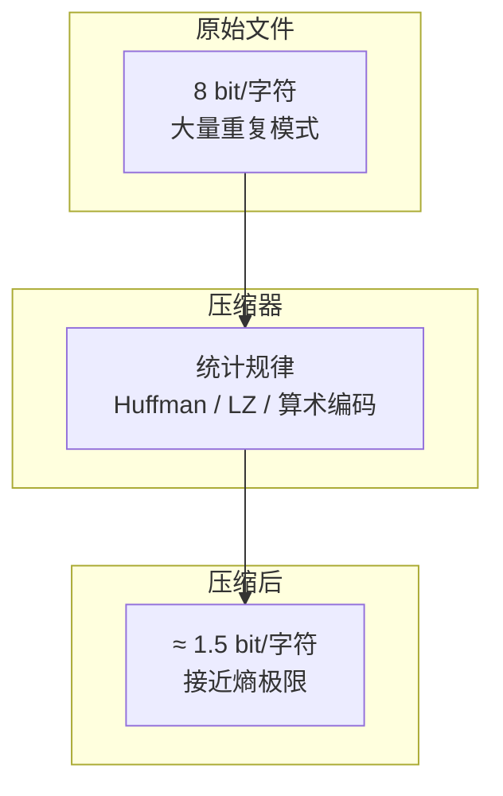

# 为什么压缩就是去除信息冗余

> 从 Bit 到 AGI · 第三章：信息（Information） · 为什么压缩就是去除信息冗余

你有一个 1 MB 的英文 `.txt` 文件，用 gzip 压到 300 KB——**700 KB 去哪了？** 不是内容被删了，解压后逐字节一致；消失的是**冗余**：那些「不惊讶」、可以从上下文猜到的比特。压缩的本质，就是用更短的编码表示同样的信息。

## 直觉：摩尔斯码的启示

摩尔斯码里：

- `e` = `.`（1 个符号）
- `z` = `--..`（4 个符号）

高频字母用短码，低频用长码——**平均码长最短**。香农证明：若码长按 $-\log_2 p(x)$ 分配，平均长度趋近熵 $H(X)$，这就是**最优压缩**的理论极限。

冗余 = 实际码长 − 理论最短码长。英文文本磁盘上每字符 8 bit，真实熵约 1.5 bit/字符 → **冗余率约 80%**。



## 定义：无损压缩与熵

**无损压缩**：存在解压函数 $D$，使得 $D(C(x)) = x$，原始比特流完整恢复。

对服从分布 $p$ 的随机源，**平均最短描述长度**满足：

$$
L_{\text{avg}} \ge H(X) \quad \text{（bit/符号）}
$$

等号在理想算术编码下渐近可达。**压缩掉的比特 = 原表示中超过 $H(X)$ 的部分**，即冗余。

两种经典思路：

| 方法 | 核心思想 | 代表算法 |
| ---- | -------- | -------- |
| 统计编码 | 按符号频率分配变长码 | Huffman、算术编码 |
| 字典编码 | 用指针替换重复子串 | LZ77、LZ78 → gzip、zlib |

## 例子一：Huffman 编码手算

四个符号 A、B、C、D，概率如下：

| 符号 | 概率 | 自信息 $-\log_2 p$ |
| ---- | ---- | ------------------ |
| A | 0.5 | 1.00 bit |
| B | 0.25 | 2.00 bit |
| C | 0.125 | 3.00 bit |
| D | 0.125 | 3.00 bit |

熵：$H = 0.5 \times 1 + 0.25 \times 2 + 0.125 \times 3 + 0.125 \times 3 = 1.75$ bit/符号。

固定长度编码需 $\lceil \log_2 4 \rceil = 2$ bit/符号，**浪费 0.25 bit/符号**。Huffman 给 A 分配 `0`（1 bit），B 分配 `10`（2 bit），C/D 各 3 bit，加权平均码长 = 1.75 bit，**恰好等于熵**。

### 自己拖一下

上面这组概率是 2 的幂次，所以 Huffman 恰好压到熵墙。但这是特例——拖动概率，看树怎么重新长、以及 Huffman 撞不撞得到那堵墙：

<HuffmanTree />

拖到「极端偏斜」预设时会看到最反直觉的一幕：熵只有 0.24 bit，但 Huffman 平均码长仍是 1 bit 出头——**码长是熵的 4 倍多**。因为 Huffman 每个符号至少花一个**完整的** bit，而熵允许「分数个 bit」。这道缝隙正是下一章[算术编码](/manual/llm/bit-to-agi/03-information/prediction-is-compression)要钻的。

## 例子二：真实文件的压缩比

一段 100,000 字符的英文小说片段（ASCII）：

| 表示方式 | 大小 | 每字符 bit |
| -------- | ---- | ---------- |
| 原始 `.txt` | 100,000 字节 | 8.0 |
| gzip -9 | ≈ 35,000 字节 | ≈ 2.8 |
| 理论熵下限（估） | ≈ 18,000 字节 | ≈ 1.5 |

gzip 还没碰到熵墙，但已去掉大部分**字母频率冗余**和**重复短语**（`the`、`and`、常见词组）。图片、视频的 JPEG/H.264 同理，不过允许**有损**丢弃人眼/耳不敏感的信息——那是另一层「冗余」（感知冗余）。

## 量化：压缩率与 GPT 的关系

定义**压缩率**：

$$
\text{压缩率} = 1 - \frac{\text{压缩后字节数}}{\text{原始字节数}}
$$

上例 gzip 压缩率 ≈ 65%。**语言模型与压缩器共享同一目标**：找到数据的统计规律，用更短的方式编码。

2016 年 DeepMind 的论文 *Learning to Compress* 展示：神经网络预测下一个字节越准，算术编码压缩率越高。**GPT 本质上是一个极强大的「预测器」**——若把它当压缩模型，对文本的「等效压缩」远超 gzip，只是工程上不会用 175B 参数的模型来压 zip 文件（不划算）。

::: info

**Kolmogorov 复杂度** $K(x)$：产生字符串 $x$ 的最短程序长度。真实文本的 $K$ 不可计算，但**可压缩性**反映 $K$ 的上界——熵估计的是随机源，Kolmogorov 复杂度针对**单个具体文件**。

:::

## 动手试一试

```python
import gzip
import math
from collections import Counter

sample = """
The quick brown fox jumps over the lazy dog. """ * 500  # 故意重复

raw = sample.encode("utf-8")
compressed = gzip.compress(raw, compresslevel=9)

print(f"原始: {len(raw):,} 字节")
print(f"gzip: {len(compressed):,} 字节")
print(f"压缩率: {1 - len(compressed)/len(raw):.1%}")

# 估计字符熵（越接近压缩后每字符 bit 越好）
counts = Counter(sample)
n = len(sample)
h = -sum((c/n) * math.log2(c/n) for c in counts.values())
print(f"字符熵估计: {h:.2f} bit/字符")
print(f"gzip 每字符: {len(compressed)*8/len(sample):.2f} bit/字符")
```

重复句子越多，gzip 压缩率越高——**可预测 = 可压缩**。

## 量化：冗余率与信息效率

定义**信息效率**：

$$
\eta = \frac{H(X)}{L_{\text{raw}}} \times 100\%
$$

原始 ASCII 英文 $\eta \approx 1.5/8 \approx 19\%$——**八成比特是冗余**。gzip 压到 2.8 bit/字符时 $\eta \approx 54\%$；仍低于 100%，因为 gzip 的模型比真实语言简单，还有 $D_{\mathrm{KL}}$ 差距。

中文 UTF-8 每字 3 字节（24 bit），常用汉字约 7000 字，均匀熵上限 $\log_2 7000 \approx 12.8$ bit。实际中文文本每字熵约 **5–8 bit**（仍随上下文下降），冗余同样可观——这也是中文分词与 BPE 在第六章要解决的问题：**用更少 Token 承载同样语义**。

对程序员更直观的例子：`git` 仓库里 `.json` 配置文件重复键名 `"name"`、`"version"` 成千上万次；`gzip` 在 `git push` 时传输 pack 文件，正是利用这种重复——与语言模型利用 `the` 高频并无本质区别。

**LZ 字典编码**如何发现冗余：滑动窗口里若见过子串 `the `，遇到再次出现时只存「往回指 5 个字符、长 4」的指针（具体格式因算法而异）。指针比原文短 → 压缩。神经网络不存显式指针，而用权重**隐式编码**「哪些上下文对应哪些续写」——容量大得多，可理解为「可学习的无限字典」。

## 常见误区

| 误区 | 纠正 |
| ---- | ---- |
| 「压缩丢了数据」 | 无损压缩**比特表示变短**，信息内容不变 |
| 「加密文件压不动所以没冗余」 | 加密破坏**统计规律**，让压缩器「看不见」冗余；冗余在明文里 |
| 「zip 越小文件越有价值」 | 小只说明**重复模式多**或**熵低**，不代表语义重要 |

## 小结

- 压缩去除的是**超过熵下限的多余比特**——冗余。
- 最优码长按 $-\log_2 p(x)$ 分配；平均码长 $\ge H(X)$。
- 英文文本 8 bit 存储 vs ≈1.5 bit 熵 → 巨大压缩空间。
- 语言模型通过**预测**发现统计规律，与压缩器殊途同归（详见[预测即压缩](/manual/llm/bit-to-agi/03-information/prediction-is-compression)）。

下一篇：这些统计规律从哪来？为什么[语言具有统计规律](/manual/llm/bit-to-agi/03-information/language-has-statistics)？
