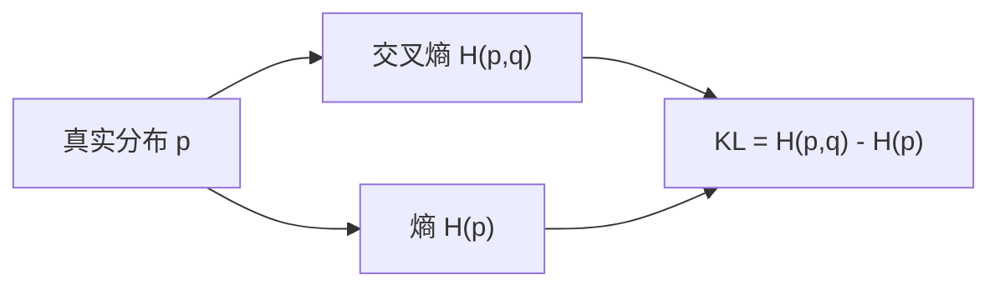

# KL 散度是什么

> 从 Bit 到 AGI · 第三章：信息（Information） · KL 散度是什么

交叉熵可以拆成两部分：真实世界固有的不确定性 $H(p)$，加上模型带来的「额外惊喜」$D_{\mathrm{KL}}(p \| q)$。**KL 散度**（Kullback–Leibler divergence）度量后一项——模型分布 $q$ 相对真实分布 $p$ 多「浪费」了多少 bit。理解 KL，就理解为什么降低 training loss 就是在让模型分布逼近语料分布。

## 直觉：多付的路费

你要从城市 A 到 B，最优路线平均耗时 30 分钟（$H(p)$）。你走了次优路线，平均 45 分钟。多花的 15 分钟 = **KL 散度**——不是「总路程」，而是**因选错策略而多付出的代价**。

KL 不是距离：$D_{\mathrm{KL}}(p \| q) \neq D_{\mathrm{KL}}(q \| p)$，不对称。

## 定义

$$
D_{\mathrm{KL}}(p \| q) = \sum_x p(x) \log_2 \frac{p(x)}{q(x)} = H(p, q) - H(p)
$$

等价期望形式：

$$
D_{\mathrm{KL}}(p \| q) = \mathbb{E}_{x \sim p}\left[\log_2 \frac{p(x)}{q(x)}\right]
$$

性质：

- $D_{\mathrm{KL}}(p \| q) \ge 0$，当且仅当 $p = q$ 时取等（Gibbs 不等式）
- 不对称：交换 $p$、$q$ 一般得到不同值
- 单位：bit（用 $\ln$ 则为 nat）



## 例子一：二元分布手算

| | $p$ | $q$ |
| --- | --- | --- |
| 事件 0 | 0.8 | 0.5 |
| 事件 1 | 0.2 | 0.5 |

$$
H(p) = -0.8\log_2 0.8 - 0.2\log_2 0.2 \approx 0.72 \text{ bit}
$$

$$
H(p,q) = -0.8\log_2 0.5 - 0.2\log_2 0.5 = 1.00 \text{ bit}
$$

$$
D_{\mathrm{KL}}(p \| q) = 1.00 - 0.72 = \mathbf{0.28 \text{ bit}}
$$

模型把 80/20 猜成 50/50，每观测一次平均多付 0.28 bit。

## 例子二：GPT 训练中的 KL

设语料在某一上下文下真实下一词分布为 $p$，模型输出 $q_\theta$。

| 阶段 | 典型 $D_{\mathrm{KL}}(p \| q)$ | 含义 |
| ---- | ------------------------------ | ---- |
| 随机初始化 | ≈ $\log_2 |V| \approx 16$ bit | 接近均匀瞎猜 |
| 训练中期 | 5–8 bit | 学到局部 n-gram 级规律 |
| GPT-3 收敛（估） | 1–2 bit | 长程依赖仍有余地 |

**RLHF / 蒸馏**里常出现「相对参考模型 $q_{\text{ref}}$ 的 KL 惩罚」：

$$
\mathcal{L}_{\text{RLHF}} = \cdots + \beta \, D_{\mathrm{KL}}(\pi_\theta \| \pi_{\text{ref}})
$$

防止微调后的策略 $\pi_\theta$ 偏离预训练分布太远，避免「模式崩塌」或胡言乱语。这里 KL 方向是 $\pi_\theta$ 相对 $\pi_{\text{ref}}$——**不对称性**决定了惩罚「新模型比老模型更离谱」的方向。

::: warning

$D_{\mathrm{KL}}(p \| q)$ 当 $q(x) = 0$ 但 $p(x) > 0$ 时为 $+\infty$。神经网络 Softmax 给每个词微小概率，实践中避免无穷；**标签平滑**（label smoothing）故意让 $p$ 不全为 one-hot，也缓解此问题。

:::

## 量化：与 JS 散度、交叉熵训练

**Jensen–Shannon 散度**（对称、有界）：

$$
D_{\mathrm{JS}}(p \| q) = \frac{1}{2}D_{\mathrm{KL}}\!\left(p \,\middle\|\, \frac{p+q}{2}\right) + \frac{1}{2}D_{\mathrm{KL}}\!\left(q \,\middle\|\, \frac{p+q}{2}\right)
$$

取值 $[0, 1]$ bit（用 $\log_2$ 时）。评估两个模型谁更接近人类语料时，JS 比 KL 更稳。

训练时固定语料 $p$，$H(p)$ 是常数，故：

$$
\arg\min_\theta H(p, q_\theta) \;\Leftrightarrow\; \arg\min_\theta D_{\mathrm{KL}}(p \| q_\theta)
$$

**最小化交叉熵 = 最小化 KL**。GPT 预训练的每一步 SGD，都在把数十亿参数的 $q_\theta$ 往 $p$ 推 一小步。

## 动手试一试

```python
import math

def kl_divergence(p: dict, q: dict) -> float:
    kl = 0.0
    for x, px in p.items():
        qx = max(q[x], 1e-15)
        if px > 0:
            kl += px * math.log2(px / qx)
    return kl

def entropy(p: dict) -> float:
    return -sum(px * math.log2(px) for px in p.values() if px > 0)

def cross_entropy(p: dict, q: dict) -> float:
    return -sum(px * math.log2(max(q[x], 1e-15)) for x, px in p.items())

p = {0: 0.8, 1: 0.2}
q = {0: 0.5, 1: 0.5}

print(f"H(p)     = {entropy(p):.3f} bit")
print(f"H(p,q)   = {cross_entropy(p, q):.3f} bit")
print(f"KL(p||q) = {kl_divergence(p, q):.3f} bit")
print(f"验证 CE-H: {cross_entropy(p,q) - entropy(p):.3f}")

# 不对称
q2 = {0: 0.9, 1: 0.1}
print(f"KL(p||q2) = {kl_divergence(p, q2):.3f}")
print(f"KL(q2||p) = {kl_divergence(q2, p):.3f}")
```

## 量化：前向 KL 与反向 KL 的直觉

两个方向常出现在不同场景：

| 方向 | 优化效果（直觉） | 典型用途 |
| ---- | ---------------- | -------- |
| $D_{\mathrm{KL}}(p \| q)$ | $q$ 覆盖 $p$ 的高概率区域，**mode-covering** | 最大似然 / GPT 预训练 |
| $D_{\mathrm{KL}}(q \| p)$ | $q$ 集中在 $p$ 的峰值，**mode-seeking** | 变分推断、某些 RL |

预训练用 $D_{\mathrm{KL}}(p \| q)$：若语料里「巴黎」作法国首都出现频繁，$q$ **必须**在那里给质量，否则 CE 爆炸。反向 KL 会更容忍忽略低频模式——不适合学全量语料。

### 自己拖一下

「mode-covering」和「mode-seeking」作为两个英文词，传达的信息量几乎为零。但把它拖出来，一秒就懂——固定一个双峰的 $p$，拖动单峰的 $q$，看两个方向的 KL 朝相反方向跑：

<KLDivergence />

**把 $q$ 停在其中一个峰上**：反向 KL 触底、前向 KL 飙升。**把 $q$ 摊开盖住两个峰**：两个数立刻对调。这就是两个词的全部含义——前向 KL 逼 $q$ 去**覆盖** $p$ 的每个模式（贪多），反向 KL 允许 $q$ **缩进**任意一个模式装死（求精）。选哪个方向，就是选让模型贪多还是求精。

**信息瓶颈**（Information Bottleneck）训练目标：

$$
\min I(X; T) - \beta I(T; Y)
$$

在表示 $T$ 上压缩输入 $X$，同时保留对目标 $Y$ 的互信息——与「压缩冗余、保留预测力」同一精神，只是多分类标签 $Y$。自监督 LLM 里 $Y = X_{t+1}$，瓶颈体现在有限维隐藏状态与正则上。

**与 GAN 的对比**：生成对抗网络隐式最小化 JS 散度的变体，不显式算 $p$。GPT 显式密度建模 $q_\theta \approx p$，训练目标直接是 CE/KL——**可算 PPL、可校准概率**（理论上），这是自回归 LLM 在工程可解释性上的优势。

KL 也可衡量**两个模型**差距：基座 $q_0$ 与微调后 $q_1$，$D_{\mathrm{KL}}(q_1 \| q_0)$ 过大说明微调「跑偏」；RLHF 用此项约束正在于此。

**相对熵与证据**：贝叶斯更新里，观测数据让后验相对先验的 KL 增量 = 数据带来的信息增益。预训练可粗浅视为：用语料块不断更新 $q_\theta$，每块让 $D_{\mathrm{KL}}(p_{\text{chunk}}\|q)$ 降一点——大批量 SGD 是蒙特卡洛估计该 KL 的梯度。

**数值例子：三分类 soft 标签**

真实 $p = (0.6, 0.3, 0.1)$，模型 A：$q_A = (0.55, 0.35, 0.10)$，模型 B：$q_B = (0.9, 0.05, 0.05)$。

| 模型 | $H(p,q)$ | $D_{\mathrm{KL}}(p\|q)$ |
| ---- | -------- | ----------------------- |
| A | 1.30 bit | 0.01 bit |
| B | 1.82 bit | 0.52 bit |

B 把概率堆在第一类，看起来「更自信」，但对 $p$ 中占 30% 的第二类给分过低 → KL 更大。这说明**自信且错**比**谦虚且接近**更糟——CE/KL 惩罚的是分布形状，不是单纯自信度。

微调时若 $D_{\mathrm{KL}}(\pi_\theta \| \pi_{\text{ref}}) > 10$ bit/Token（示意阈值，任务相关），人类可读质量常明显劣化——出现重复、离题、遗忘事实。$\beta$ 系数在 RLHF 里调节此项，典型搜索范围 $0.01$–$0.2$。预训练阶段则没有参考模型项，KL 完全相对真实语料 $p$。检查点对比时，可看验证集 CE 与 KL 代理指标是否同步下降——只降 CE 不降生成质量，往往是过拟合特定 n-gram 记忆。蒸馏场景里教师 $p$ 与学生 $q$ 的 $D_{\mathrm{KL}}(p\|q)$ 直接作损失项，用小模型逼近大模型分布。学生 CE 低但 $D_{\mathrm{KL}}(p\|q)$ 高，说明没学到教师的「概率形状」。

## 常见误区

| 误区 | 纠正 |
| ---- | ---- |
| 「KL 是对称距离」 | 不满足对称性；$D_{\mathrm{KL}}(p\|q) \neq D_{\mathrm{KL}}(q\|p)$ |
| 「KL = 0 则模型完美」 | 只对**该上下文该分布**成立；整体语料上 KL 平均仍可为正 |
| 「RLHF 的 KL 和预训练 KL 是一回事」 | 方向与参考分布不同；RLHF 约束**策略不偏离参考模型** |

## 小结

- $D_{\mathrm{KL}}(p \| q) = H(p,q) - H(p)$：模型相对真实的**额外不确定性**。
- 恒非负，$p = q$ 时为零；**不对称**。
- GPT 预训练最小化交叉熵 ≡ 最小化 $D_{\mathrm{KL}}(p \| q_\theta)$。
- RLHF 用 KL 约束微调不要跑太远。

下一篇把预测、压缩、熵串成一条定理链：[预测即压缩](/manual/llm/bit-to-agi/03-information/prediction-is-compression)。
