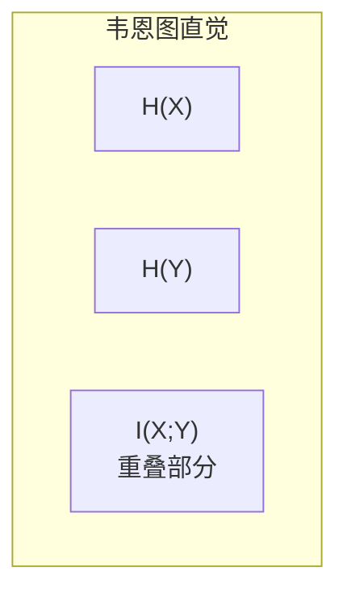

# 互信息是什么

> 从 Bit 到 AGI · 第三章：信息（Information） · 互信息是什么

知道「明天暴雨」后，你对「是否带伞」的犹豫立刻消失——**Y 告诉了 X 一些事**。互信息（Mutual Information）量化这种「彼此透露多少信息」，单位仍是 bit。它解释为什么 GPT 需要长上下文：上文与下文互信息越高，下一个 Token 越好猜。

## 直觉：两个变量有多「纠缠」

抛两枚公平硬币 $A$、$B$，互信息为 0：知道 $A$ 是正面对猜 $B$ 毫无帮助。

若 $B$ 总是等于 $A$（作弊联轴硬币），知道 $A$ 就完全确定 $B$，互信息 = $B$ 的熵 = 1 bit。

语言里：知道前文 `The doctor gave the nurse` 后，`her` 比 `his` 更可能——**上下文 $C$ 与下一个词 $W$ 互信息很大**。

## 定义

离散随机变量 $X$、$Y$ 的**互信息**：

$$
I(X; Y) = \sum_{x,y} p(x,y) \log_2 \frac{p(x,y)}{p(x)\,p(y)}
$$

等价形式（最常用）：

$$
I(X; Y) = H(X) - H(X \mid Y) = H(Y) - H(Y \mid X)
$$

即：**知道 $Y$ 后，$X$ 的不确定性减少了多少**。

性质：

- $I(X; Y) \ge 0$，等号当且仅当 $X$、$Y$ 独立
- $I(X; Y) = I(Y; X)$（对称）
- $I(X; X) = H(X)$（自己与自己互信息 = 自身熵）



## 例子一：联轴硬币

| 设置 | $H(B)$ | $H(B \mid A)$ | $I(A;B)$ |
| ---- | ------ | ------------- | -------- |
| 独立公平硬币 | 1 bit | 1 bit | **0 bit** |
| $B = A$ | 1 bit | 0 bit | **1 bit** |
| $B = A$ 以 90% 概率，否则反 | 1 bit | ≈0.47 bit | **≈0.53 bit** |

第三种是「软关联」——多数时候相同，偶尔不同；互信息介于 0 与 1 之间。

## 例子二：上下文与下一个 Token

设词表大小 $|V| = 50{,}000$，无上下文时：

$$
H(W) \approx \log_2 |V| \approx 15.6 \text{ bit}
$$

给定 50 Token 的英文上下文后，经验上：

$$
H(W \mid C) \approx 3 \text{–} 4 \text{ bit}
$$

互信息估计：

$$
I(W; C) = H(W) - H(W \mid C) \approx 12 \text{–} 12.6 \text{ bit}
$$

**上下文「告诉」了下一个词大约 12 bit 的信息**——这就是为什么长上下文值钱：更多 $C$ 通常（虽不严格单调）带来更高 $I(W; C)$。

Attention 机制的直觉：在计算 $q(w \mid c)$ 时，动态选择**与当前预测互信息高的历史 Token**（如主语、动词）。

## 量化：点互信息 PMI

单个事件层面的互信息叫**点互信息**（PMI）：

$$
\text{PMI}(x; y) = \log_2 \frac{p(x,y)}{p(x)\,p(y)}
$$

词嵌入训练（Word2Vec）里的 **Skip-gram** 隐式最大化词与上下文的 PMI。PMI 高 = 搭配强（`machine` 与 `learning`）；PMI 低或负 = 几乎独立。

| 词对 | PMI（示意） | 含义 |
| ---- | ----------- | ---- |
| machine – learning | 高正 | 强搭配 |
| the – apple | 中等 | 常见但不固定 |
| banana – democracy | ≈0 或负 | 无稳定关联 |

## 动手试一试

```python
import math
from collections import Counter

# 联轴硬币联合分布 P(A,B)
# A,B ∈ {0,1}，90% 相同
joint = {(0,0): 0.45, (0,1): 0.05, (1,0): 0.05, (1,1): 0.45}
pa = {0: 0.5, 1: 0.5}
pb = {0: 0.5, 1: 0.5}

def mutual_information(joint, marginal_x, marginal_y):
    mi = 0.0
    for (x, y), p_xy in joint.items():
        if p_xy > 0:
            mi += p_xy * math.log2(p_xy / (marginal_x[x] * marginal_y[y]))
    return mi

def entropy_from_marginal(m):
    return -sum(p * math.log2(p) for p in m.values() if p > 0)

h_b = entropy_from_marginal(pb)
# H(B|A) = sum_a P(a) H(B|A=a)
h_b_given_a = 0.0
for a in (0, 1):
    cond = {b: joint[(a,b)] / pa[a] for b in (0, 1)}
    h_b_given_a += pa[a] * entropy_from_marginal(cond)

mi = mutual_information(joint, pa, pb)
print(f"I(A;B) = {mi:.3f} bit")
print(f"H(B) - H(B|A) = {h_b - h_b_given_a:.3f} bit")  # 应相等
```

## 常见误区

| 误区 | 纠正 |
| ---- | ---- |
| 「互信息 = 相关系数」 | 相关只捕线性关系；互信息捕**任意统计依赖** |
| 「上下文越长互信息一定越大」 | 太远 Token 可能条件独立；且模型未必能利用 |
| 「高 PMI 词对语义相近」 | PMI 高 = **共现多**；`strong`–`tea` 可高 PMI 但非同义 |

## 量化：条件互信息与多变量

推广到**条件互信息**：

$$
I(X; Y \mid Z) = H(X \mid Z) - H(X \mid Y, Z)
$$

读作：已知 $Z$ 后，$Y$ 还能额外透露 $X$ 多少信息。Transformer 多层堆叠，可粗浅理解为逐层提取更高阶的 $I(\text{当前表示}; \text{历史} \mid \text{已抽取特征})$。

链式法则把联合熵拆开：

$$
H(X_1,\ldots,X_T) = \sum_{t=1}^{T} H(X_t \mid X_{<t})
$$

每步条件熵下降 = 前文对当前 Token 的互信息累积。GPT-3 级模型在长上下文上仍能从第 500 个 Token 获得约 **0.5–1 bit** 的额外互信息（相对只看 50 Token）——收益递减但非零，这是加长 context window 的工程动机。

Fano 不等式把互信息与分类错误率联系起来：互信息越高，**理论错误率下界**越低。下一 Token 预测错误率下界由 $I(W;C)$ 约束——不是「模型想多准就多准」，信息论给天花板。

**数据处理不等式**：若处理链 $X \to Y \to Z$，则 $I(X;Z) \le I(X;Y)$。中间层若丢信息，下游无法找回。深度网络设计要避免过早瓶颈；Transformer 残差连接让信息高速公路保留，使深层仍能访问低层互信息——工程与信息论同向。

**互信息不可直接优化**：$I(X;Y)$ 需 $p(x,y)$ 估计，高维下难算。表征学习用**对比学习**等代理：拉近正样本对、推远负样本，隐式增大 $I(\text{表示};\text{标签})$。GPT 不用显式对比损失，但下一 Token CE 隐式最大化 $I(\text{上下文};\text{下一 Token})$ 的可实现下界。

**词嵌入视角**：Word2Vec 论文证明 Skip-gram 负采样近似最大化词与上下文的 PMI。高 PMI 词对在向量空间里靠近——几何距离编码了**统计互信息**的影子。GPT 不用单独学嵌入表冻结，但隐藏状态同样承载「哪些历史与当前相关」的互信息结构；Attention 权重可视作**软互信息分配**（哪些位置对当前预测贡献大）。

估算互信息的**朴素插件**：用模型算 $H(W)$ 与 $H(W|C)$ 的蒙特卡洛差。实践中 $H(W|C)$ 用 NLL 平均近似，$H(W)$ 用更大 $n$-gram 或 Held-out 估计。差值给出 $I(W;C)$ 的下界——用于比较 4k vs 128k 上下文窗口是否值得加钱。工业界粗经验：从 4k 扩到 32k，长文档问答的可用率明显提升，因远距互信息被模型读到了；再扩到 128k，边际收益取决于任务是否真用那么长前文。互信息为零的 Token 对可安全裁剪（Prompt 压缩、RAG 摘要），这是长上下文工程里的实用启发。

## 小结

- $I(X;Y) = H(X) - H(X|Y)$：$Y$ 让 $X$ 的不确定性减少量。
- 独立 → 0；完全相同 → $H(X)$。
- 语言中上下文与下一 Token 互信息可达 **10+ bit**，是 GPT 有效的前提。
- 训练损失用的[交叉熵](/manual/llm/bit-to-agi/03-information/cross-entropy)与熵、互信息构成同一套度量体系。

下一篇：把「模型分布 vs 真实分布」的差距写成损失函数——[交叉熵是什么](/manual/llm/bit-to-agi/03-information/cross-entropy)。
