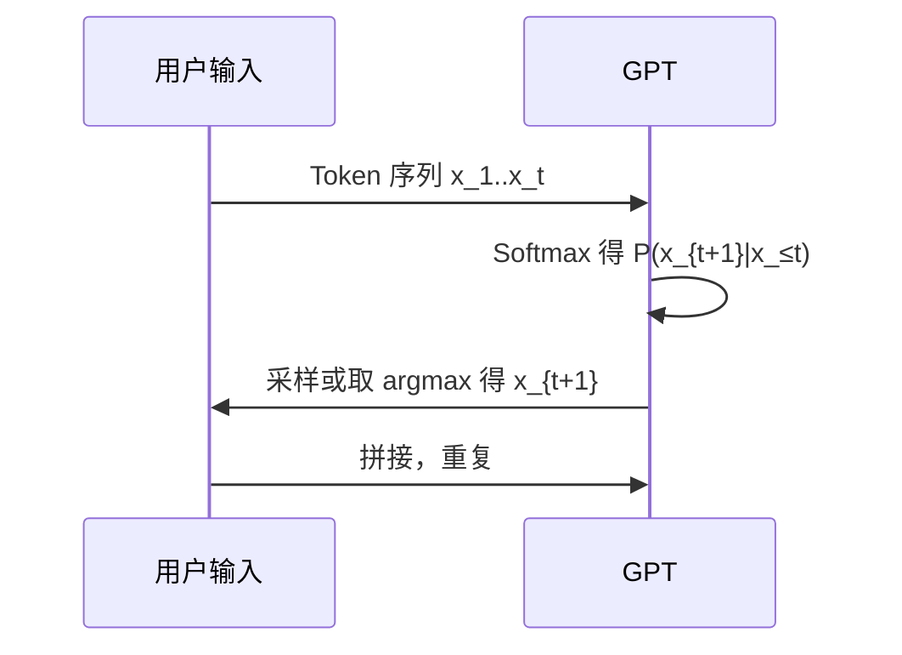

# 为什么 GPT 可以预测下一个 Token

> 从 Bit 到 AGI · 第三章：信息（Information） · 为什么 GPT 可以预测下一个 Token

ChatGPT 能写诗、写代码、回答问题——但训练目标惊人地简单：**给定前文，预测下一个 Token 是什么**。没有「理解模块」、没有「知识图谱」标签，只有海量文本上的**下一个词分类任务**。它之所以能工作，是因为上一篇讲的语言统计规律足够强，而 Transformer 足够大、看得足够远。

## 直觉：超级自动补全

你在 IDE 里写 `import numpy as`，编辑器建议 `np`。GPT 做的是同一件事，只是：

- 词表从几十个关键字变成 **~50,000 Token**
- 上下文从几个词变成 **数千到百万 Token**（4k–1M+ 窗口）
- 参数从 0 变成 **数十亿到数千亿**

「预测下一个 Token」= 在词表里做**多分类**，选出条件概率最高的续写。生成整段话 = 反复预测、把输出拼回输入，循环几十到几千次。

## 定义：因果语言建模（CLM）

训练样本是一段 Token 序列 $x = (x_1, \ldots, x_T)$。模型参数 $\theta$ 定义分布 $q_\theta(x_t \mid x_{<t})$。目标是最小化**负对数似然**（= 交叉熵，见后文）：

$$
\mathcal{L}(\theta) = -\frac{1}{T}\sum_{t=1}^{T} \log q_\theta(x_t \mid x_{<t})
$$

等价表述：**最大化训练语料在模型下的概率** $\prod_t q_\theta(x_t \mid x_{<t})$。

推理时**自回归**（autoregressive）生成：



## 例子一：一步预测的数字

词表大小 $|V| = 50{,}257$（GPT-2）。上下文「The capital of France is」，模型输出 logits 向量 $\mathbf{z} \in \mathbb{R}^{50257}$，经 Softmax：

$$
q_\theta(x_{t+1} = w) = \frac{e^{z_w}}{\sum_{w'} e^{z_{w'}}}
$$

假设正确续写 Token ` Paris` 的概率 $q = 0.42$：

- 这一步损失：$-\log_2 0.42 \approx 1.25$ bit
- 若随机猜：$-\log_2 (1/50257) \approx 15.6$ bit

模型把不确定性从 15.6 bit 压到 1.25 bit——**这一步就贡献了约 14 bit 的「信息提取」**。

## 例子二：训练规模与效果

| 模型 | 参数量 | 训练 Token 数 | 英文 PPL（约） |
| ---- | ------ | ------------- | -------------- |
| GPT-2 small | 117M | 40B | ~30 |
| GPT-2 large | 774M | 40B | ~22 |
| GPT-3 | 175B | 300B | ~15–20 |
| Llama 3 / DeepSeek-V3 / Qwen3 | 8B–671B | 15T–36T | ~1.5–1.7 |
| GPT-4 / GPT-5 级（估） | 未公开 | 13T+（估） | 更低 |

三个规律同时成立：

1. **更多数据** → 见到更多搭配与事实模板
2. **更大模型** → 拟合更长程、更细的条件依赖
3. **更长上下文** → 条件熵进一步下降

::: info

GPT 不「查数据库记答案」。「巴黎是法国首都」之所以能被续写，是因为训练语料里该搭配出现成千上万次，**被压进了权重里的条件概率**。这是统计规律，不是符号逻辑推理——尽管表面效果很像。

:::

## 量化：一次前向传播的算力

生成 **1 个 Token**（模型规模近似 GPT-3 175B，FP16）：

- 参数量 $N = 1.75 \times 10^{11}$
- 每 Token 约 $2N$ FLOPs（乘加各算一次）
- 合计 ≈ **350 GFLOPs/Token**

若 A100 峰值 312 TFLOPS（理论值），单卡理论下限约 0.9 ms/Token——实际因内存带宽约 **50–100 ms/Token**。生成 500 Token 回复 ≈ **25–50 秒**（未优化）；vLLM 等推理优化可降一个数量级。

训练侧：300B Token × 175B 参数规模，总 FLOPs 约 $6 \times 10^{23}$ 量级，需数千 GPU·月——预测下一个词并不「简单」，只是**目标函数简单**。

## 动手试一试：玩具 next-token 预测

```python
import math
from collections import Counter, defaultdict

corpus = "to be or not to be that is the question ".split()
corpus *= 5

# 最简单的 bigram 语言模型
bigram = defaultdict(Counter)
for a, b in zip(corpus, corpus[1:]):
    bigram[a][b] += 1

def predict_next(context_word: str) -> list[tuple[str, float]]:
    counts = bigram[context_word]
    total = sum(counts.values())
    return [(w, c/total) for w, c in counts.most_common()]

def nll(context: str, actual_next: str) -> float:
    probs = dict(predict_next(context))
    p = probs.get(actual_next, 1e-12)
    return -math.log2(p)

# 预测
print(predict_next("to"))       # [('be', 0.9+), ...]
print(f"NLL('be'|'to') = {nll('to', 'be'):.2f} bit")

# 整句平均
words = corpus
total_nll = sum(nll(words[i], words[i+1]) for i in range(len(words)-1))
print(f"平均: {total_nll/(len(words)-1):.2f} bit/Token")
print(f"PPL ≈ {2**(total_nll/(len(words)-1)):.1f}")
```

这段 20 行的 bigram 模型就是 GPT 的**极简祖先**——差别在规模与神经网络表达能力。

## 量化：词表、温度与采样

推理时不一定取 $\arg\max$。常见策略：

| 策略 | 做法 | 效果 |
| ---- | ---- | ---- |
| Greedy | 每步最高概率 | 确定、易重复 |
| Top-k | 只在概率最高的 $k$ 个里采样 | $k=50$ 时常用 |
| Top-p (nucleus) | 累积概率达 $p$ 的最小集合 | 自适应候选数 |
| Temperature $T$ | logits 除以 $T$ 再 Softmax | $T>1$ 更随机，$T\to 0$ 趋 greedy |

$T = 0.8$ 时，原本 $q=0.42$ 的 Token 概率会被重新分配——**改变生成分布**，但不改变训练目标。训练始终优化真实语料上的 $p$，采样只是部署时的「风格旋钮」。

中文场景：同样 1k 上下文，BPE 后约 600–800 Token（英文约 750 Token），每 Token 承载更多汉字笔画信息，但**每步仍是 50k 类分类**——算力主要花在矩阵乘法，而非词表查找。

**与第二章的衔接**：Softmax 把 logits 变成 $q$；交叉熵对 $q$ 取 $-\log$。训练时反向传播降低 CE，等价于提高正确 Token 的 $q$ 并压低无关 Token——第二章「损失可以下降」在这里的具体实例就是**在词表上调整概率质量**。

长程依赖例子：「The trophy would not fit in the suitcase because it was too ___」。`it` 指甲还是箱？人类用常识选 `small`（箱太小）；模型需在数百 Token 前文里保留**语义互信息**，而非仅 bigram。Transformer 自注意力让任意两位置直接交互，使 $I(x_t; x_{t-k})$ 在较大 $k$ 时仍可非零——RNN 在长 $k$ 上梯度消失，故旧模型长程互信息估得更差。

## 常见误区

| 误区 | 纠正 |
| ---- | ---- |
| 「预测下一个词太简单，不可能聪明」 | 简单**目标** + 难**分布**；棋类 AI 也曾用简单胜负目标达到超人水平 |
| 「模型只是在背训练集」 | 背高频搭配是事实；但组合泛化（新句子、新代码）来自**学习生成规则** |
| 「预测 = 只能续写」 | 指令微调、RLHF 改变**条件分布**；预训练核心仍是 CLM |
| 「概率最高的一定对」 | 训练学的是**分布**，而非单一确定答案；采样温度控制多样性 |

## 小结

- GPT 训练 = 最小化 $\mathcal{L} = -\frac{1}{T}\sum \log q_\theta(x_t \mid x_{<t})$，即**逐 Token 交叉熵**。
- 单步把不确定性从 $\log_2 |V|$ bit 降到 1–4 bit，依赖语言的统计可预测性。
- 自回归生成：预测 → 拼接 → 再预测，循环构成全文。
- 损失函数与[交叉熵](/manual/llm/bit-to-agi/03-information/cross-entropy)、[互信息](/manual/llm/bit-to-agi/03-information/mutual-information)紧密相关——下面几篇把数学工具补齐。

下一篇：[互信息是什么](/manual/llm/bit-to-agi/03-information/mutual-information)——两个变量彼此「透露」多少信息？
