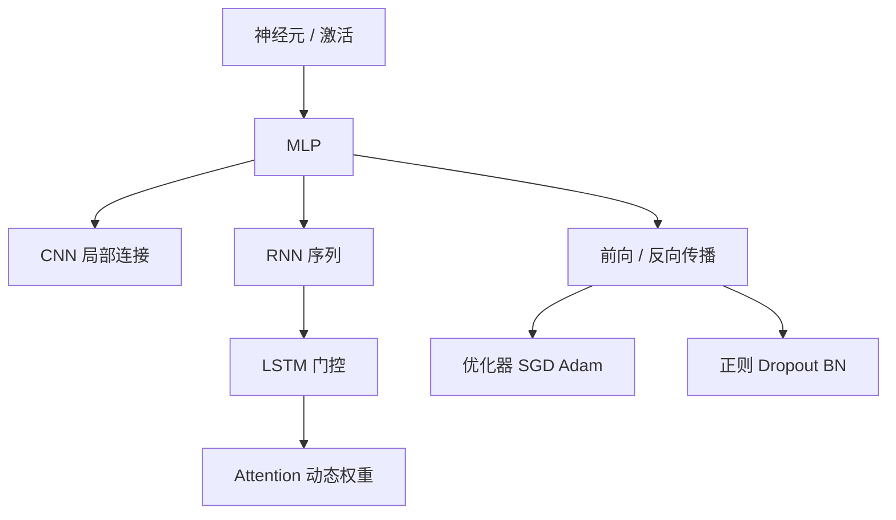

# 第四章总结

> 从 Bit 到 AGI · 神经元、反向传播、CNN/RNN 到 Attention——第四章知识地图

第四章把「神经网络」从黑盒拆成可计算的图：**神经元 + 激活 + 层叠 + 损失 + 梯度 + 优化**。你不需要背架构名词，而要会估算 **参数量、FLOPs、显存** 与 **训练不稳定** 从哪来。

## 知识地图

## 按主题回顾

| 主题 | 核心数字/结论 | 延伸阅读 |
| --- | --- | --- |
| 激活 | ReLU 缓解饱和；Sigmoid 易梯度消失 | [ReLU](/manual/llm/bit-to-agi/04-neural-networks/why-relu-wins)、[Sigmoid](/manual/llm/bit-to-agi/04-neural-networks/why-sigmoid-fails) |
| CNN | 参数从 $HWC^2$ 降到 $k^2C$ | [CNN](/manual/llm/bit-to-agi/04-neural-networks/why-cnn-succeeds) |
| RNN | 长序列梯度 $\propto \gamma^T$ 衰减 | [RNN](/manual/llm/bit-to-agi/04-neural-networks/why-rnn-vanishes)、[LSTM](/manual/llm/bit-to-agi/04-neural-networks/what-lstm-solves) |
| Attention | 权重 $\sum \alpha_i = 1$，并行度 $O(n^2)$ | [为何出现](/manual/llm/bit-to-agi/04-neural-networks/why-attention-emerged) |
| 训练 | 反向传播 ≈ 链式法则自动求导 | [前向](/manual/llm/bit-to-agi/04-neural-networks/forward-pass)、[反向](/manual/llm/bit-to-agi/04-neural-networks/backward-pass) |
| 泛化 | 参数多 + 数据少 → 过拟合 | [正则](/manual/llm/bit-to-agi/04-neural-networks/overfitting-and-regularization) |

## 你应该能回答的问题

1. 一层全连接 $d_{\text{in}} \to d_{\text{out}}$ 有多少参数？（$d_{\text{in}} \times d_{\text{out}} + d_{\text{out}}$）
2. 为什么 LLM 不用纯 CNN/RNN 收尾？（长程依赖与并行；见第五章）
3. [Dropout](/manual/llm/bit-to-agi/04-neural-networks/dropout) 训练时随机的意义？（集成近似，防共适应）

## 与下一章的衔接

第四章的 Attention 是 **第五章 Transformer** 的直接前传。Transformer 把 Attention 当作核心「混合器」，去掉 RNN 的递归，换 **$O(n^2)$ 并行注意力** + [位置编码](/manual/llm/bit-to-agi/05-transformer/position-encoding)。建议顺序阅读：[Embedding](/manual/llm/bit-to-agi/05-transformer/what-is-embedding) → [Self Attention](/manual/llm/bit-to-agi/05-transformer/self-attention) → [块解剖](/manual/llm/bit-to-agi/05-transformer/transformer-block-anatomy)。

## 动手检查清单

- [ ] 用 PyTorch 写 2 层 MLP 训 MNIST，打印 train/val loss 曲线
- [ ] 手算 2 维输入下 ReLU 与 Sigmoid 的梯度范围
- [ ] 读一篇模型的 `config.json`，对照隐藏层维度与层数

## 训练闭环回顾

第四章 20 篇可压缩为一条链：**数据** → [前向](/manual/llm/bit-to-agi/04-neural-networks/forward-pass) → [损失](/manual/llm/bit-to-agi/04-neural-networks/loss-functions) → [反向](/manual/llm/bit-to-agi/04-neural-networks/backward-pass) → [优化器](/manual/llm/bit-to-agi/04-neural-networks/optimizer-sgd-adam) → 更新权重。不稳定时按序排查：[初始化](/manual/llm/bit-to-agi/04-neural-networks/weight-initialization) → [BN/LN](/manual/llm/bit-to-agi/04-neural-networks/batch-normalization) → [激活](/manual/llm/bit-to-agi/04-neural-networks/why-relu-wins) → lr → [正则](/manual/llm/bit-to-agi/04-neural-networks/overfitting-and-regularization)。

架构选型速记：**表格/向量** → MLP；**图像** → CNN（或 ViT）；**序列（2017 前）** → LSTM；**序列（现代）** → Transformer Attention。没有万能架构，只有**归纳偏置与数据规模**的匹配。

## 若需回顾单篇

- 单元：[什么是神经元](/manual/llm/bit-to-agi/04-neural-networks/what-is-neuron) · [ReLU](/manual/llm/bit-to-agi/04-neural-networks/why-relu-wins)
- 架构：[MLP](/manual/llm/bit-to-agi/04-neural-networks/what-is-mlp) · [CNN](/manual/llm/bit-to-agi/04-neural-networks/why-cnn-succeeds) · [Attention](/manual/llm/bit-to-agi/04-neural-networks/why-attention-emerged)
- 训练：[反向传播](/manual/llm/bit-to-agi/04-neural-networks/backward-pass) · [AdamW](/manual/llm/bit-to-agi/04-neural-networks/optimizer-sgd-adam)

完成以上，第四章就算「过关」——进入现代 LLM 的主舞台。
