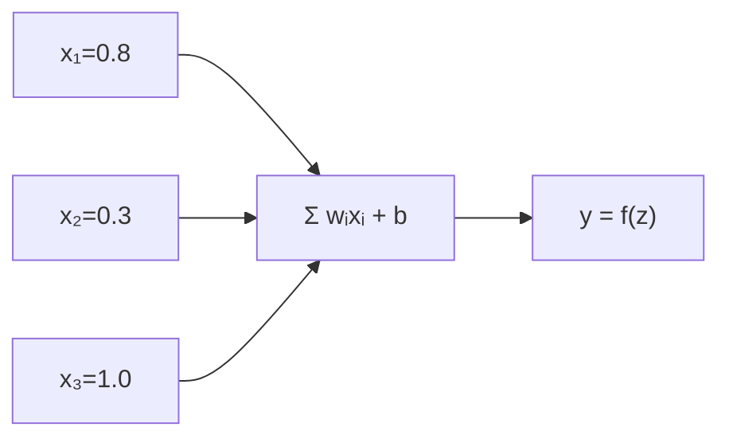

# 什么是神经元

> 从 Bit 到 AGI · 第四章：神经元（Neuron） · 什么是神经元

神经网络里的一切，最终都归结为一个数字：神经元接收若干输入，做一次加权求和，再输出一个数字。搞懂这一行公式，你就拿到了读后面 MLP、CNN、Transformer 的钥匙。

## 直觉

想象你在决定是否出门带伞。三个信号同时进来：天空有多阴（0～1）、天气预报概率（0～1）、你昨天是否被淋湿（0 或 1）。你对每个信号有不同的「重视程度」——这就是权重 $w$。你还可能有个默认倾向，比如「我本来就爱带伞」——这就是偏置 $b$。

大脑不会把三个数字直接相加就下结论，而是先算一个综合得分，再决定「带 / 不带」。人工神经元也一样：先算加权和，再经过激活函数（下一篇细讲）得到输出。



## 定义

单个神经元（人工神经元、感知机单元）的计算分两步：

1. **预激活（logit）**：$z = \sum_{i=1}^{n} w_i x_i + b = \mathbf{w}^\top \mathbf{x} + b$
2. **输出**：$y = f(z)$，其中 $f$ 是激活函数

参数规模：$n$ 个输入对应 $n$ 个权重 + 1 个偏置，共 **$n + 1$** 个可学习标量。若用 float32 存储，一个神经元约 **$4(n+1)$** 字节。

## 例子

**例 1：手算一个二输入神经元**

设 $\mathbf{x} = [2.0,\ 3.0]^\top$，$\mathbf{w} = [0.5,\ -1.0]^\top$，$b = 0.1$：

$$
z = 0.5 \times 2.0 + (-1.0) \times 3.0 + 0.1 = 1.0 - 3.0 + 0.1 = -1.9
$$

若暂时令 $f(z) = z$（恒等，仅作演示），则输出 $y = -1.9$。

**例 2：用 NumPy 批量算 3 个样本**

```python
import numpy as np

X = np.array([[2.0, 3.0],
              [1.0, 0.0],
              [0.5, 4.0]])          # shape (3, 2)
w = np.array([0.5, -1.0])
b = 0.1

z = X @ w + b                       # [−1.9, 0.6, −3.65]
print(z)
```

三个样本共享同一组 $\mathbf{w}, b$，一次矩阵乘法完成——这正是 GPU 擅长的「同一操作、不同数据」。

| 样本 | $x_1$ | $x_2$ | $z$ |
| ---- | ----- | ----- | --- |
| 1    | 2.0   | 3.0   | −1.9 |
| 2    | 1.0   | 0.0   | 0.6  |
| 3    | 0.5   | 4.0   | −3.65 |

## 量化

- **计算量**：对一个样本、$n$ 维输入，一次神经元需 **$n$ 次乘法 + $n$ 次加法**（乘加可合并为 $n$ 次 MAC）。
- **1000 维输入、float32**：参数量 1001 个 ≈ **4 KB**；前向一次 ≈ **1000 FLOPs**（量级，未计激活函数）。
- **与生物神经元对比**：生物神经元有复杂树突、脉冲时序；人工神经元是连续实值、同步更新的简化模型——够用，且可微。

::: info

第二章学过向量点积：$\mathbf{w}^\top \mathbf{x}$ 就是「权重向量与输入向量的相似度」再加偏置。神经元本质上是在问：输入模式与「我关心的模式」有多匹配？

:::

## 常见误区

1. **「神经元 = 一个 if 语句」**——只有加权和、没有激活函数时，多层堆叠仍等价于一层线性变换（见[为什么要激活函数](/manual/llm/bit-to-agi/04-neural-networks/why-activation-functions)）。
2. **「偏置可有可无」**——去掉 $b$ 相当于决策边界必须过原点；有 $b$ 时超平面可以平移，表达能力更强。
3. **「输出就是概率」**——只有经过 sigmoid/softmax 等才把输出约束到 $(0,1)$；裸 $z$ 可以是任意实数。

## 动手试一试

```python
def neuron(x, w, b, activation=lambda z: z):
    z = sum(wi * xi for wi, xi in zip(w, x)) + b
    return activation(z), z

y, z = neuron([2, 3], [0.5, -1.0], 0.1)
print(f"z={z:.1f}, y={y:.1f}")  # z=-1.9, y=-1.9
```

改 `w[1]` 从 −1.0 到 +1.0，观察 $z$ 如何从 −1.9 变到 +4.1——这就是训练要调整的旋钮。

## 工程与训练视角

在 PyTorch 里，一个 `nn.Linear(in, out)` 就是 **out 个神经元** 并行：权重形状 `(out, in)`，一次 `y = x @ W.T + b` 完成整层。GPU kernel 把百万神经元融合成一次 GEMM（通用矩阵乘），这也是「AI 喜欢矩阵」的落地原因。

训练时每个神经元独立接收梯度 $\partial L / \partial w_i = (\partial L / \partial z) \cdot x_i$。若某神经元长期 $z \leq 0$（ReLU 后恒 0），其权重梯度为 0——**死神经元**问题在宽层网络里偶尔出现，靠 He 初始化、合适学习率与 BatchNorm 缓解。

**与生物神经元的差异**（量化对比）：

| 维度 | 人工神经元 | 生物神经元（量级） |
| ---- | ---------- | ------------------ |
| 输入数 | $10^2$～$10^4$ | $10^3$～$10^4$ 突触 |
| 更新 | 每 batch 同步 | 脉冲时序、局部可塑性 |
| 能耗 | 1 MAC ≈ pJ 级（芯片） | 1 脉冲 ≈ fJ 级 |

理解这些差异有助于避免把「神经网络 = 大脑仿真」的过度类比；我们用的是**受启发而高度简化的计算单元**。

## 感知机学习规则（历史）

1950s **感知机收敛定理**：若数据线性可分，感知机更新 $w \leftarrow w + \eta(t-y)x$ 在有限步内收敛。不可分则振荡——引出 **口袋算法**、**SVM** 等后续。

现代 **单个神经元**  rarely 单独使用；但 **逻辑回归** = 一个神经元 + sigmoid + BCE，仍是工业界基线（风控、广告 CTR）。理解神经元 = 理解 LR 的神经网络视角。

**多输出神经元层**：$Y = f(XW^T + b)$，$Y \in \mathbb{R}^{B \times d_{\text{out}}}$——一个「层」即 $d_{\text{out}}$ 个神经元并行，与「一个神经元」概念一致，只是向量化书写。

## 动手与阅读建议

建议对照 PyTorch 文档 `torch.nn` 模块，把本篇公式与 `Linear`、`ReLU`、`LSTM`、`MultiheadAttention` 的 `forward` 签名一一对应。读论文时先圈出 **张量 shape**（如 $(B, T, d)$）再读公式，比死记符号快得多。

若训练 loss 不降：先画 **train loss 曲线**（逐步、非 epoch 平均），看是震荡、plateau 还是 NaN。NaN 从 **lr 减半** 与 **gradient clip** 开始试；plateau 查 **wd 是否过大** 或 **数据是否标错**。验证集只用于 **选超参**，勿反复调 test。

本章内容在第五章 **Transformer** 会全部复现：QKV 是 Attention，FFN 是 MLP，Pre-LN 是 LayerNorm。掌握本章 = 读 GPT 论文的最低门槛。完成 MNIST 或 XOR 小实验（CPU 即可）再进入下一章，手感差异很大。

## 术语对照（中英）

Neuron/Unit 神经元；Activation 激活函数；Hidden layer 隐藏层；Logit 预激活 $z$；Embedding 把离散 id 映射为连续向量；Epoch 全数据扫一遍；Iteration/Step 一个 batch 更新一次；Learning rate 学习率 $\eta$；Weight decay 权重衰减（L2 或 AdamW）；Fine-tune 微调预训练权重。读英文文档时这些词与中文教材一一对应，避免混用「单元/神经元/节点」造成概念漂移。

## 小结

神经元 = **加权求和** + **激活函数**；参数量 $n+1$，核心运算是点积。多层神经元堆叠才构成网络；下一篇解释为什么中间必须插入非线性的 $f$。

→ 下一篇：[为什么要激活函数](/manual/llm/bit-to-agi/04-neural-networks/why-activation-functions)
