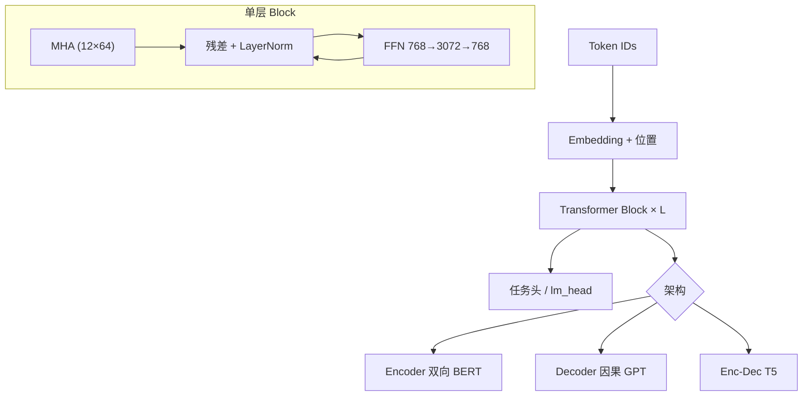

# 第五章总结

> 从 Bit 到 AGI · 第五章：Transformer · 从 Embedding 到 Scaling Laws 的知识地图

本章以 **BERT-base**（$d_{\text{model}}=768$，12 层，12 头，$d_{\text{ff}}=3072$，110M 参数）为标尺，拆解 Transformer 的每一块积木：从 token 如何变成向量，到 Self-Attention 如何 $O(n^2)$ 交换信息，再到 Encoder/Decoder 如何分叉成 BERT 与 GPT，最后如何用 Scaling Laws 规划更大模型。

## 知识地图

## 核心公式速查

| 概念 | 公式 |
|---|---|
| Self-Attention | $\text{softmax}(QK^\top / \sqrt{d_k}) V$ |
| 多头 | $h=12$，$d_k = 768/12 = 64$ |
| FFN | $\text{GELU}(x W_1) W_2$，$W_1 \in \mathbb{R}^{768 \times 3072}$ |
| 残差 | $x + \text{Sublayer}(x)$（Post-Norm 外裹 LN） |
| 复杂度 | Attention $O(n^2 d)$；FFN $O(n d \cdot d_{\text{ff}})$ |
| 参数量主项 | $\approx 12 L d^2$（忽略 embedding） |

## 架构对照

| | BERT | GPT | T5 |
|---|---|---|---|
| 栈 | Encoder | Decoder | Enc+Dec |
| Attention | 双向 | 因果 | 双向 + 因果 + Cross |
| 预训练 | MLM | CLM | Span corruption |
| Norm | Post | Pre | Pre（常见） |
| 典型用途 | 理解、Embedding | 生成、对话 | 翻译、text2text |

## 数量级记忆

- **单层参数**：~7.1M（Attn 2.4M + FFN 4.7M）
- **Embedding**：~23M（$30522 \times 768$）
- **$n=512$ 单层 FLOPs**：~7 GFLOPs；12 层 ~86 GFLOPs
- **Attention 内存**：$12 n^2 \times 4$ B（fp32，12 头）
- **Chinchilla**：训练 token 数 $\approx 20 \times$ 参数量

## 阅读路线回顾

1. [Embedding](/manual/llm/bit-to-agi/05-transformer/what-is-embedding) → [位置](/manual/llm/bit-to-agi/05-transformer/position-encoding) → [Self-Attention](/manual/llm/bit-to-agi/05-transformer/self-attention) → [QKV](/manual/llm/bit-to-agi/05-transformer/qkv)
2. 训练稳定：[残差](/manual/llm/bit-to-agi/05-transformer/residual-connection) → [LayerNorm](/manual/llm/bit-to-agi/05-transformer/layer-norm) → [FFN](/manual/llm/bit-to-agi/05-transformer/feed-forward) → [多头](/manual/llm/bit-to-agi/05-transformer/multi-head-attention)
3. 架构：[Decoder](/manual/llm/bit-to-agi/05-transformer/decoder) / [Encoder](/manual/llm/bit-to-agi/05-transformer/encoder) / [Enc-Dec](/manual/llm/bit-to-agi/05-transformer/encoder-decoder)
4. 进阶：[统一性](/manual/llm/bit-to-agi/05-transformer/why-transformer-unifies) → [$O(n^2)$](/manual/llm/bit-to-agi/05-transformer/attention-complexity) → [RoPE 等](/manual/llm/bit-to-agi/05-transformer/positional-encoding-variants) → [Pre/Post-Norm](/manual/llm/bit-to-agi/05-transformer/pre-norm-vs-post-norm)
5. 对比与缩放：[BERT vs GPT](/manual/llm/bit-to-agi/05-transformer/bert-vs-gpt) → [Scaling Laws](/manual/llm/bit-to-agi/05-transformer/scaling-laws-intro) → [RNN 对比](/manual/llm/bit-to-agi/05-transformer/from-rnn-to-transformer) → [块解剖](/manual/llm/bit-to-agi/05-transformer/transformer-block-anatomy)

## 下一章预告

第六章进入 **Tokenizer**：同样的 768 维 embedding，中文为何往往比英文消耗更多 token、BPE 如何决定词表大小 $V$，以及 $V \times d$ 参数如何从分词策略长出来。

→ [第六章：Token](/manual/llm/bit-to-agi/06-tokenizer)
