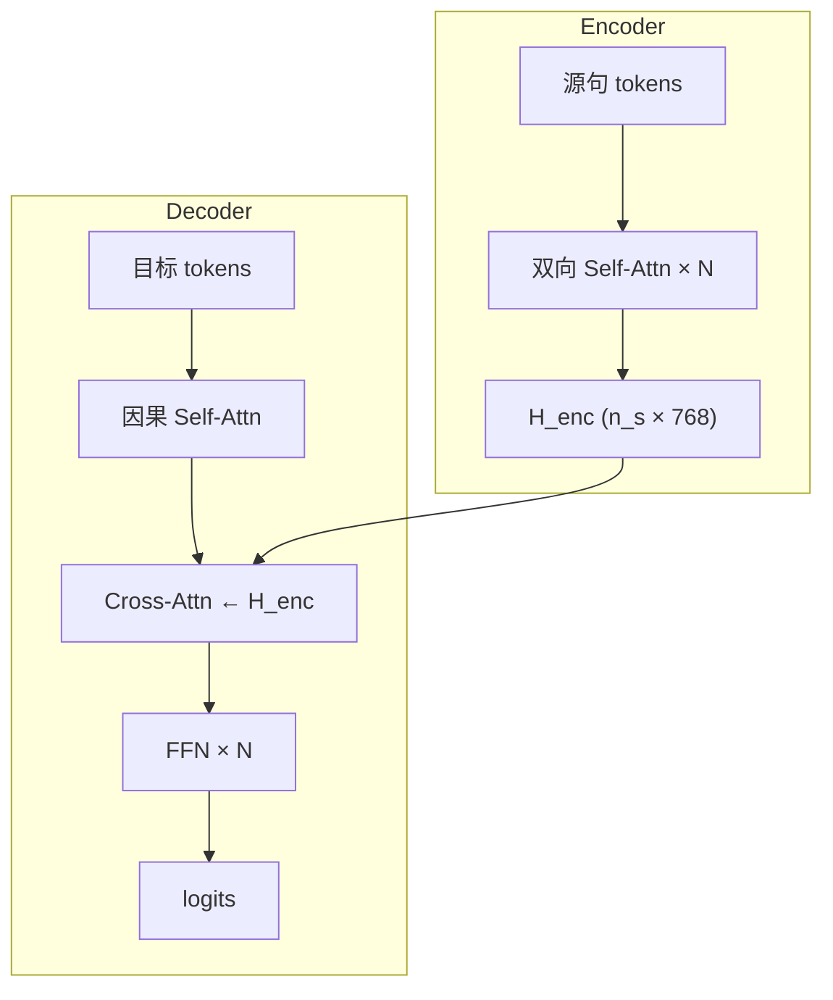

# Encoder-Decoder 架构

> 从 Bit 到 AGI · 第五章：Transformer · 原始翻译模型与 T5 的编解码组合

2017 年原论文为机器翻译设计：**Encoder** 读源语言整句，**Decoder** 自回归生成目标语言。两者之间靠 **Cross-Attention**（Encoder-Decoder Attention）连接——Decoder 的 Query 去「查询」Encoder 输出的 Key/Value。T5、BART、原始 Transformer 都属于这一类；理解与纯 Encoder（BERT）或纯 Decoder（GPT）的差异，是读模型卡片的基本功。

## 直觉：同声传译的两人分工

Encoder 像听译员：听完中文演讲，脑中形成完整语义表示。Decoder 像说译员：逐句说英文，每说一个词就回头看听译员的笔记（Cross-Attention）和自己已说的部分（Masked Self-Attention）。两个栈独立参数，信息在 Cross-Attention 处交汇。

## 定义

**Encoder 栈**（$N$ 层）：双向 Self-Attn + FFN，输入源句 token，输出 $\mathbf{H}_{\text{enc}} \in \mathbb{R}^{n_s \times d_{\text{model}}}$。

**Decoder 栈**（$N$ 层），每层三块：

1. Masked Self-Attention（目标句，因果）
2. **Cross-Attention**：$\mathbf{Q}$ 来自 decoder，$\mathbf{K}, \mathbf{V}$ 来自 $\mathbf{H}_{\text{enc}}$
3. FFN

Cross-Attention 公式同 Self-Attention，仅 Q/K/V 来源不同：

$$
\text{CrossAttn}(\mathbf{X}_{\text{dec}}, \mathbf{H}_{\text{enc}}) = \text{softmax}\left(\frac{\mathbf{Q}_{\text{dec}}\mathbf{K}_{\text{enc}}^\top}{\sqrt{d_k}}\right)\mathbf{V}_{\text{enc}}
$$

注意力矩阵 $\mathbf{A} \in \mathbb{R}^{n_t \times n_s}$：每个目标 token 对源句 $n_s$ 位置的权重。

## 例子

**例 1：原论文尺寸（base）**

| 超参 | 值 |
|---|---|
| $N$（层数） | 6 encoder + 6 decoder |
| $d_{\text{model}}$ | 512 |
| $h$ | 8 |
| $d_k = d_v$ | 64 |
| $d_{\text{ff}}$ | 2048 |

比 BERT-base（12 层 768）小；但**结构**是完整 Encoder-Decoder。

**例 2：T5-base**

Encoder + Decoder 各 12 层，$d_{\text{model}}=768$，$h=12$，$d_{\text{ff}}=3072$——与 BERT-base 单层同构，但**两套** 12 层，参数量约 220M 量级（含共享 embedding 等）。

**例 3：Cross-Attention 形状（$n_s=128, n_t=64$）**

| 张量 | 形状 |
|---|---|
| $\mathbf{H}_{\text{enc}}$ | $(128, 768)$ |
| $\mathbf{X}_{\text{dec}}$ | $(64, 768)$ |
| $\mathbf{Q}_{\text{dec}}$ | $(64, 768)$ |
| $\mathbf{K}_{\text{enc}}, \mathbf{V}_{\text{enc}}$ | $(128, 768)$ |
| Cross-Attn 权重 | $(64, 128)$ |

## 量化

- **参数量**：Roughly $2 \times$ 单栈（encoder+decoder 各 $N$ 层），Cross-Attn 每层增加约 $4 d^2$（Q 来自 dec，K/V 投影 enc）
- **翻译推理**：Encoder **一次**前向；Decoder **每生成 token 一步**，Cross-Attn 重复用同一 $\mathbf{H}_{\text{enc}}$（K/V 可缓存）
- **统一文本到文本**：T5 把各类任务都格式化成「输入文本 → 输出文本」，靠 Encoder-Decoder 统一框架

## 常见误区

1. **GPT 也有 Cross-Attention**：标准 GPT 无；只有带「条件生成」的变体（如某些 multimodal）才加。
2. **Encoder-Decoder 只能翻译**：摘要、问答、数据到文本均可；T5 即「万物皆 text-to-text」。
3. **Encoder 和 Decoder 必须层数相同**：原论文 $N$ 相同；实践中可不同，但需调参。

## 小结

Encoder-Decoder = 双向编码源句 + 因果解码目标句 + Cross-Attention 桥接。原论文 6+6 层、512 维；T5-base 对齐 BERT 的 768 维 12 层×2。下一篇：为何这一架构族统治了 NLP 与多模态。

下一篇：[为什么 Transformer 统一世界](/manual/llm/bit-to-agi/05-transformer/why-transformer-unifies)
