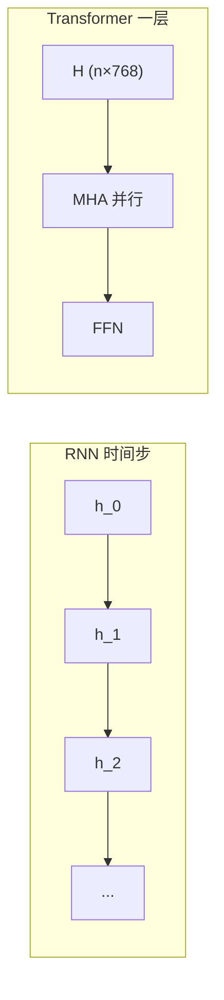

# 从 RNN 到 Transformer

> 从 Bit 到 AGI · 第五章：Transformer · 序列建模如何从逐步递推走向并行注意力

在 Transformer 之前，语言模型主要是 **RNN/LSTM**：按时间步把 hidden state 从左传到右，第 $t$ 步依赖 $h_{t-1}$。它天然适合序列，但**无法并行训练**、**长程梯度消失**、**瓶颈向量 $h_t$ 要压缩全部历史**。2017 年的 Transformer 用 Self-Attention 换掉递推，这些问题在同一架构族里被重新回答。

## 直觉：传话游戏 vs 全员视频会议

RNN 像传话：128 人站一列，只能听前一人 whisper，信息逐级失真。Transformer 像视频会议：128 人同时在线，每人直接看到（加权）所有人的发言摘要——一步更新，路径长度 $O(1)$。

## 定义

**RNN 一步**（隐藏维 $d_h$，常 $d_h = 768$ 对齐后续 Transformer）：

$$
\mathbf{h}_t = \tanh(\mathbf{W}_{hh} \mathbf{h}_{t-1} + \mathbf{W}_{xh} \mathbf{x}_t)
$$

计算必须按 $t = 1 \ldots n$ **串行**；训练反向通过时间（BPTT），梯度连乘 $\prod_t \partial \mathbf{h}_t / \partial \mathbf{h}_{t-1}$，长序列易 vanish/explode。

**Transformer 一层 Self-Attention**：

$$
\mathbf{H}^{(l+1)} = \text{FFN}(\text{MHA}(\mathbf{H}^{(l)}))
$$

整表 $\mathbf{H} \in \mathbb{R}^{n \times 768}$ **并行**计算；第 $i$ 行直接 attend 到所有 $j$，单步路径长度 1（单层）。

## 例子

**例 1：并行度**

| | RNN | Transformer |
|---|---|---|
| 训练时 seq 维 | 串行 $O(n)$ 步 | 并行 $O(1)$ 步（单层） |
| 单层路径长度 | $O(n)$ | $O(1)$ |
| 单层 seq 计算 | $O(n d^2)$ | $O(n^2 d + n d^2)$ |
| $n=512, d=768$ 谁赢 | $n$ 小且需长链时 RNN 省 $n^2$ | $n$ 中等以上 Transformer 训练更快 |

当 $n$ 不大（低于128）且只需窄 hidden，RNN FLOPs 可能更低；NLP 常见 $n=512$+，且要深层组合，Transformer 占优。

**例 2：LSTM 解决了什么、没解决什么**

LSTM 用门控缓解梯度消失，可记 **100～500** 步依赖；但仍是 $h_t$ 固定 768 维「瓶颈」，且**训练仍串行**。

**例 3：参数量对比（同 $d=768$ 单层）**

- RNN/LSTM 一层：$\approx 4 d^2 \sim 2.4$M（含四个门）
- Transformer 一层（Attn+FFN）：$\approx 2.4$M + $4.7$M $\approx 7.1$M

Transformer 单层更重，但 12 层并行堆叠在 GPU 上吞吐更高；且易扩到 96 层（GPT-3）。



```python
# RNN 必须逐步（无法整序列并行）
h = torch.zeros(batch, 768)
for t in range(seq_len):
    h = torch.tanh(h @ W_hh + x[:, t] @ W_xh)

# Transformer：一次
H = transformer_layer(x)  # x: (batch, seq, 768)
```

## 量化

| 指标 | RNN/LSTM（2015 SOTA） | Transformer（2017+） |
|---|---|---|
| WMT 翻译 BLEU | 基线 | +2～3（原论文） |
| 训练 wall-clock | 慢（串行） | 快（并行） |
| 最长有效依赖 | 数百 token | 数千+（多层+深栈） |
| 工业 LM 采用 | 已退出 SOTA | 标配 |

Attention 作为 RNN **加性注意力**（Bahdanau）已存在；Transformer 的 jump 是 **Self-Attention 直接充当序列混合层**，去掉递推。

## 常见误区

1. **RNN 完全被淘汰**：小设备、流式、极低延迟场景仍有 RNN/SSM；主流预训练 LM 不用。
2. **Transformer 没有顺序概念**：有位置编码；只是混合方式非递推。
3. **$O(n^2)$ 比 RNN 一定更慢**：训练并行性常让 Transformer 总时间更短；推理生成长度 $n$ 时两者都有挑战，靠 KV cache 等优化。

## 小结

RNN 串行递推、瓶颈 hidden、长程梯度难；Transformer 并行 Self-Attention、$O(1)$ 单层路径、易加深。BERT/GPT 的 768×12 配置是这一范式取代 LSTM 的标准落点。下一篇：把 Block 拆开做总复习。

下一篇：[Transformer 块的解剖](/manual/llm/bit-to-agi/05-transformer/transformer-block-anatomy)
