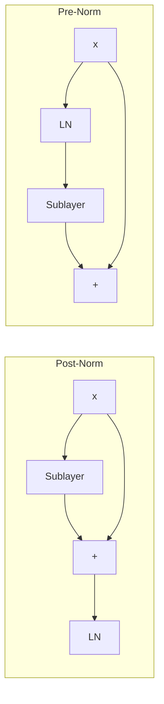

# Pre-Norm 与 Post-Norm

> 从 Bit 到 AGI · 第五章：Transformer · 层归一化在残差前后的训练差异

Transformer 每个子层外都有残差和 LayerNorm，但 **Norm 放在残差前还是后** 会显著影响深层训练稳定性。原论文与 BERT 用 **Post-Norm**；GPT-2、LLaMA 等现代 LLM 几乎清一色 **Pre-Norm**。选错可能导致 12 层能训、96 层发散。

## 直觉：先整理笔记再加工，还是加工完再整理

- **Post-Norm**：先开会（子层），再把纪要加回原文，最后统一润色（Norm）——输出尺度随层数累积，深层梯度易爆。
- **Pre-Norm**：先润色输入，再开会，最后只把纪要加回去——子层输入始终较稳定，梯度更易传过 96 层。

## 定义

**Post-Norm**（原始 Transformer / BERT）：

$$
\mathbf{x}_{l+1} = \text{LN}\bigl(\mathbf{x}_l + \text{Sublayer}(\mathbf{x}_l)\bigr)
$$

**Pre-Norm**（GPT-2 / LLaMA）：

$$
\mathbf{x}_{l+1} = \mathbf{x}_l + \text{Sublayer}\bigl(\text{LN}(\mathbf{x}_l)\bigr)
$$

注意最终输出层：Pre-Norm 架构常在栈顶**再加一次 LN** 再进 lm_head，否则最后一层 hidden 未归一化。

## 例子

**例 1：BERT-base vs GPT-2（12 层，768 维）**

| | BERT | GPT-2 |
|---|---|---|
| Norm 位置 | Post-Norm | Pre-Norm |
| 典型最大层数 | 12（base） | 12～48+ |
| 训练技巧 | warmup、小 lr | 同样需 warmup，但更深更易训 |

**例 2：梯度尺度（定性）**

Post-Norm 反向时，梯度经 LN 的 Jacobian，深层 $\prod_l$ 连乘方差更不稳定。Pre-Norm 的残差主路径 $\mathbf{x}_{l+1} = \mathbf{x}_l + \cdots$ 使 $\partial \mathbf{x}_{l+1}/\partial \mathbf{x}_l$ 含恒等项，**梯度 highway** 更明显。



**例 3：同一 Block 两种写法（伪代码）**

```python
# Post-Norm（BERT）
def post_norm_block(x, sublayer):
    return layer_norm(x + sublayer(x))

# Pre-Norm（GPT-2）
def pre_norm_block(x, sublayer):
    return x + sublayer(layer_norm(x))
```

## 量化

- **参数**：无差别；LN 仍是每层 2 个，各 $2 \times 768$
- **FLOPs**：相同
- **训练**：Post-Norm 96 层常需 **learning rate warmup** 更长、初始 lr 更小；Pre-Norm 默认 lr 可略大
- **表示能力**：Post-Norm 有时略优于同深度 Pre-Norm（论文争议）；实践中 **Pre-Norm + 加深** 更常见

| 深度 $N$ | Post-Norm 可训性 | Pre-Norm 可训性 |
|---|---|---|
| 12 | 容易 | 容易 |
| 48 | 需仔细调参 | 较稳 |
| 96+ | 困难 | LLaMA/GPT-3 采用 |

## 常见误区

1. **Pre-Norm 完全不需要 warmup**：仍需要；只是容忍度更高。
2. **RMSNorm 替代 LayerNorm 改变 Pre/Post 选择**：RMSNorm 常与 Pre-Norm 搭配（LLaMA），但正交。
3. **BERT 改成 Pre-Norm 等于 RoBERTa**：RoBERTa 主要是数据与训练时长；Norm 位置需单独改架构重训。

## 小结

Post-Norm：$\text{LN}(x + F(x))$，BERT 采用；Pre-Norm：$x + F(\text{LN}(x))$，GPT/LLaMA 采用，利于极深堆叠。读 checkpoint 实现时先确认 Norm 顺序。下一篇对比两种最流行的栈：BERT 与 GPT。

下一篇：[BERT 与 GPT 的区别](/manual/llm/bit-to-agi/05-transformer/bert-vs-gpt)
