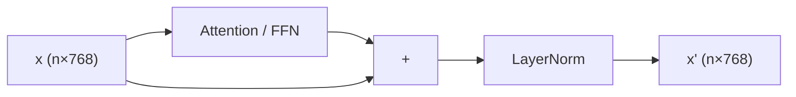

# Residual 连接

> 从 Bit 到 AGI · 第五章：Transformer · 残差如何让 12 层网络可训练

12 层 Transformer 若纯堆叠非线性变换，梯度反向传播时要连乘 12 次 Jacobian，极易**梯度消失或爆炸**。ResNet 的残差连接（Residual Connection）被原论文直接借用：**子层输出加上输入本身**，让梯度至少有一条「高速公路」直通浅层。

## 直觉：改错题而不是重写

子层 $F$ 不必从零学会完整映射 $H(\mathbf{x})$，只需学**修正量** $\Delta(\mathbf{x}) = H(\mathbf{x}) - \mathbf{x}$：

$$
\mathbf{y} = \mathbf{x} + F(\mathbf{x})
$$

若最优映射接近恒等，令 $F(\mathbf{x}) \to 0$ 即可；比让 $F$ 直接拟合恒等映射容易得多。

## 定义

Transformer 每个子层（Attention、FFN）外都包一层残差：

$$
\mathbf{x}' = \text{LayerNorm}(\mathbf{x} + \text{Sublayer}(\mathbf{x})) \quad \text{（Post-Norm）}
$$

或 Pre-Norm 变体（先 Norm 再子层，见[ Pre-Norm 与 Post-Norm](/manual/llm/bit-to-agi/05-transformer/pre-norm-vs-post-norm)）：

$$
\mathbf{x}' = \mathbf{x} + \text{Sublayer}(\text{LayerNorm}(\mathbf{x}))
$$

BERT-base 原版用 Post-Norm；GPT-2/3、LLaMA 等多用 Pre-Norm。

## 例子

**例 1：形状不变**

- 输入 $\mathbf{x}$：$(n, 768)$，如 $n=128$
- Attention 输出：$(128, 768)$
- 残差相加：逐元素加，**维度必须完全一致**

**例 2：梯度路径**

设损失 $L$，残差块 $\mathbf{y} = \mathbf{x} + F(\mathbf{x})$：

$$
\frac{\partial L}{\partial \mathbf{x}} = \frac{\partial L}{\partial \mathbf{y}}\left(\mathbf{I} + \frac{\partial F}{\partial \mathbf{x}}\right)
$$

恒等项 $\mathbf{I}$ 保证梯度至少以 1 倍传回，不会因 $\partial F/\partial \mathbf{x}$ 连乘而趋零。



## 量化

- **额外参数**：0（纯加法）
- **额外 FLOPs**：$n \cdot d_{\text{model}}$ 次加法；$n=512, d=768$ 时约 $3.9 \times 10^5$，相对 attention 可忽略
- **内存**：训练需存 $\mathbf{x}$ 供 backward，激活内存随层数线性增；12 层 BERT 激活是显存大头之一

| 层数 | 无残差（典型） | 有残差 |
|---|---|---|
| 12 层可训练性 | 困难 | 稳定 |
| 梯度直达浅层 | 否 | 是（+恒等路径） |

## 常见误区

1. **残差 = Skip Connection 仅用于 CNN**：Transformer 每个子层都有，是标配而非可选。
2. **相加前不用对齐维度**：Multi-Head 输出投影后必须回到 $d_{\text{model}}=768$ 才能与输入加。
3. **残差能无限加深**：有帮助但非万能；极深（100+ 层）还需 Pre-Norm、初始化、学习率 warmup 等配合。

## 动手试一试

```python
import torch
import torch.nn as nn

class ResidualBlock(nn.Module):
    def __init__(self, sublayer: nn.Module):
        super().__init__()
        self.sublayer = sublayer
        self.norm = nn.LayerNorm(768)

    def forward(self, x):
        return self.norm(x + self.sublayer(x))  # Post-Norm

x = torch.randn(128, 768)
block = ResidualBlock(nn.Linear(768, 768))
y = block(x)
assert y.shape == x.shape
```

## 小结

残差 $\mathbf{x} + F(\mathbf{x})$ 让深层 Transformer 可训练，无额外参数。每个 Attention 与 FFN 子层外各包一层。下一篇讲残差后的 LayerNorm 做什么。

下一篇：[LayerNorm](/manual/llm/bit-to-agi/05-transformer/layer-norm)
