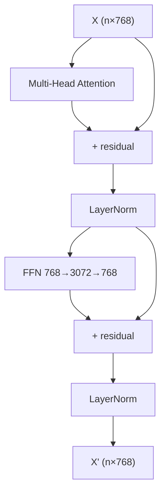

# Transformer 块的解剖

> 从 Bit 到 AGI · 第五章：Transformer · 一层 Block 内数据流与参数量全景

读论文、看 HuggingFace 配置、调 vLLM 参数时，最终都落到**一层 Transformer Block**：张量从哪进、经过哪些子层、形状如何保持、参数花在哪。本篇以 **BERT-base 的一层**（$d_{\text{model}}=768$，12 头，$d_{\text{ff}}=3072$，Post-Norm）做完整解剖，把本章散落的拼图拼成一张图。

## 直觉：一层工厂流水线

原料：$(n, 768)$ 的 token 矩阵。工序 1：Multi-Head Attention 全员交换信息；工序 2：残差+LayerNorm；工序 3：FFN 每人独立扩维再压回；工序 4：再残差+LayerNorm。出厂仍是 $(n, 768)$，可堆叠 12 次。

## 定义：BERT Encoder Layer 数据流

输入 $\mathbf{X}^{(l)} \in \mathbb{R}^{n \times 768}$

1. $\mathbf{A} = \text{MHA}(\mathbf{X}^{(l)})$ → $(n, 768)$
2. $\mathbf{X}' = \text{LN}(\mathbf{X}^{(l)} + \mathbf{A})$
3. $\mathbf{F} = \text{FFN}(\mathbf{X}')$：$\text{GELU}(\mathbf{X}' \mathbf{W}_1 + \mathbf{b}_1)\mathbf{W}_2 + \mathbf{b}_2$
4. $\mathbf{X}^{(l+1)} = \text{LN}(\mathbf{X}' + \mathbf{F})$

GPT Decoder Layer 区别：MHA 带因果 mask；Pre-Norm 顺序为 $x + F(\text{LN}(x))$；栈顶额外 LN。

## 例子

**例 1：形状全程（$n=128$，batch 省略）**

| 步骤 | 张量 | 形状 |
|---|---|---|
| 输入 | $\mathbf{X}^{(l)}$ | $(128, 768)$ |
| QKV 投影后（每头） | $\mathbf{Q}_h, \mathbf{K}_h, \mathbf{V}_h$ | $(128, 64)$ |
| Attention 权重 | $\mathbf{A}_h$ | $(128, 128)$ |
| MHA 输出 | | $(128, 768)$ |
| FFN 中间 | | $(128, 3072)$ |
| 输出 | $\mathbf{X}^{(l+1)}$ | $(128, 768)$ |

**例 2：单层参数量账本**

| 子模块 | 公式 | 参数量 |
|---|---|---|
| QKV + $\mathbf{W}^O$ | $4 \times 768^2$ | 2.36M |
| FFN $\mathbf{W}_1, \mathbf{W}_2, \mathbf{b}$ | $768 \times 3072 + 3072 \times 768 + 3072 + 768$ | 4.72M |
| LayerNorm ×2 | $2 \times 2 \times 768$ | 3.1K |
| **单层合计** | | **≈ 7.09M** |

12 层 trunk：$7.09 \times 12 \approx 85$M；加 embedding 23.8M + MLM 头 ≈ **110M**（BERT-base）。

**例 3：单层 FLOPs（$n=512$）**

| 子模块 | GFLOPs（约） |
|---|---|
| MHA（含 QKV） | 2.4 |
| FFN | 4.8 |
| LayerNorm + 残差 | 低于0.01 |
| **合计** | **≈ 7.2** |

12 层 × 7.2 ≈ **86 GFLOPs** / 前向 / sample（不含 embedding、head；粗算）。



```python
# HuggingFace BERT layer 参数量验证思路
from transformers import BertConfig, BertModel
cfg = BertConfig(hidden_size=768, num_hidden_layers=1,
                 num_attention_heads=12, intermediate_size=3072)
model = BertModel(cfg)
params = sum(p.numel() for p in model.encoder.layer[0].parameters())
print(params)  # ≈ 7_090_000
```

## 量化：12 层 BERT-base 全栈

| 项目 | 值 |
|---|---|
| 层数 $L$ | 12 |
| $d_{\text{model}}$ | 768 |
| $h$ | 12，$d_k=64$ |
| $d_{\text{ff}}$ | 3072 |
| 最大序列 | 512 |
| 总参数 | ~110M |
| fp32 权重体积 | ~440 MB |
| 前向 FLOPs（$n=512$，粗算） | ~90 GFLOPs |

**Decoder-only（GPT-2 small）** 单层结构类似，Pre-Norm + 因果 MHA；trunk 参数量同量级，embedding+词表更大。

## 常见误区

1. **每层输出维度会变**：错；全程 $d_{\text{model}}=768$，才能残差相加。
2. **Attention 和 FFN 参数各半**：FFN 约占单层 67%（4.72/7.09）。
3. **`hidden_size` 即 $d_{\text{model}}$**：HuggingFace 命名；`intermediate_size` 即 $d_{\text{ff}}$。

## 动手试一试

打开任意 `config.json`，验证：`hidden_size=768`，`num_attention_heads=12`，`intermediate_size=3072`，`num_hidden_layers=12` → 即 BERT-base 标准块；心算单层 ~7M × 12 ≈ 85M。

## 小结

一层 Block = MHA（2.36M）+ FFN（4.72M）+ 2×LN + 2×残差；输入输出均为 $(n, 768)$。BERT-base 堆 12 层得 110M 参数模型。本章知识点在此汇总；详见[本章总结](/manual/llm/bit-to-agi/05-transformer/chapter-summary)。

下一篇：[本章总结](/manual/llm/bit-to-agi/05-transformer/chapter-summary)
