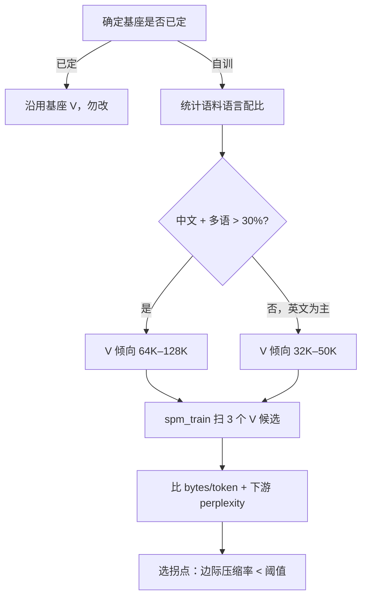

# 词表大小如何选

> 从 Bit 到 AGI · 第六章：Token · 词表大小如何选

训练自己的 Tokenizer 或选型基座模型时，**词表大小 $V$** 是少数几个「一锤子定终身」的超参：Embedding 矩阵行数固定、checkpoint 里 merge 规则固定，**训练中途几乎不能改**。本篇给出 trade-off 框架与常用数量级。

## 直觉

词表像 **字典的厚度**：薄字典（小 $V$）每个词要拆成很多音节字母（Token 多）；厚字典（大 $V$）专有词条多，查一次就行（Token 少），但 **整本字典印刷成本**（Embedding 参数）更高。还要考虑：你的读者主要说什么语言、字典里要不要收录代码和 emoji。

## 定义

**词表大小 $V$**：BPE merge 次数 + 基础符号数 + 特殊 Token 数。

**特殊 Token**：`<pad>`、`<unk>`、`<s>`、`</s>`、`<|im_start|>` 等，通常占 **256–1024** 个 ID，从 $V$ 中预留。

**character_coverage**（SentencePiece）：目标字符覆盖率，如 0.9995；未覆盖字符走 byte fallback，每个 byte 可能 1 Token。

**压缩率** $C = B / N$（bytes/token）：$V$ 增大时 $C$ 通常上升，边际递减。

## 例子

**例子 1：公开模型的 $V$ 选择**

| 模型 | $V$ | 主要语料 | 设计取向 |
| --- | ---: | --- | --- |
| GPT-2 | 50,257 | 英文 WebText | 经典基准 |
| Llama 2 | 32,000 | 英文为主 | 偏小，省 Embedding |
| Llama 3 | 128,256 | 多语 + 代码 | 扩容降 Token 数 |
| Gemma 2 | 256,000 | 多语 | 极大词表 |
| Qwen2 / Qwen2.5 / Qwen3 | 151,646 | 中英为主 | 中文友好 merge |
| GPT-4o / o3 / GPT-5 (`o200k_base`) | 200,019 | 多语 + 代码 | 非拉丁语系压缩率显著提升 |
| DeepSeek-V3 / R1 | 129,280 | 中英 + 代码 | 字节级 BPE |

**例子 2：同一语料，不同 $V$ 训练结果（示意）**

在 10 GB 中英混合语料上训练 SentencePiece BPE：

| $V$ | 平均 bytes/token | Embedding（$d$=4096） | 训练 merge 时间 |
| ---: | ---: | ---: | ---: |
| 8,000 | 2.1 | 33M | 5 min |
| 32,000 | 2.8 | 131M | 20 min |
| 64,000 | 3.2 | 262M | 45 min |
| 128,000 | 3.5 | 525M | 2 h |

$V$ 从 32K → 128K，bytes/token 只涨约 **25%**，Embedding 却 **翻 4 倍**——需用下游 loss 与推理 Token 账单验证是否值得。

## 量化：选型不等式

**Embedding 内存**（bf16）：

$$
\text{MB}_{\text{embed}} = \frac{V \times d \times 2}{1024^2}
$$

$V=128{,}000, d=4096$ → **1000 MB ≈ 1 GB** 仅 Embedding 权重。

**训练步 Token 吞吐**：同样 GPU 小时，Token 数少 → 见到的 **unique 样本位置** 少；但每步序列短，可增大 batch。经验法则：

$$
\text{有效吞吐} \propto \frac{\text{batch\_tokens}}{N_{\text{avg}}}
$$

大 $V$ 降低 $N_{\text{avg}}$，可能 **提高训练吞吐**（同样 8K context 窗口装更多样本）。

**推荐区间**（现代预训练常见做法）：

| 场景 | 建议 $V$ | 理由 |
| --- | ---: | --- |
| 英文小模型（低于 3B） | 32K–50K | 省参数 |
| 多语中模型（7–14B） | 64K–152K | 平衡中文/代码 |
| 大模型 + 长代码（70B+） | 128K–256K | 降推理 Token |
| 领域微调（沿用基座） | **不改** | 必须与基座一致 |

**中文占比高**时，$V \ge 64K$ 通常比 32K  **每汉字 Token 数少 10–20%**；但应在自己的语料上用 `spm_train` 实测，不要外推。

## 决策流程



## 常见误区

- **「越大越好」**：256K Embedding 在 1B 小模型上可能占 **>50% 参数**，主干容量不足。
- **「32K 对中文够用」**：可用，但同等文本 Token 多 → 训练和推理都更贵；7B 以上模型普遍扩容。
- **「character_coverage=1.0」**：强制覆盖所有 Unicode 会爆炸；0.9995 + byte_fallback 是常态。

## 动手试一试

扫描多个 `vocab_size`，画 bytes/token 曲线：

```python
import subprocess
import sentencepiece as spm

for v in [8000, 16000, 32000, 64000]:
    prefix = f"sp_v{v}"
    subprocess.run([
        "spm_train", f"--input=corpus.txt", f"--model_prefix={prefix}",
        f"--vocab_size={v}", "--model_type=bpe",
        "--character_coverage=0.9995", "--byte_fallback=true",
    ], check=True)
    sp = spm.SentencePieceProcessor(model_file=f"{prefix}.model")
    text = open("eval.txt", encoding="utf-8").read()
    n = len(sp.encode(text, out_type=int))
    b = len(text.encode("utf-8"))
    print(f"V={v:6d}  tokens={n}  bytes/token={b/n:.3f}")
```

选 **bytes/token 增益开始平缓** 的 $V$（拐点），而非最大值。

## 与 Scaling Laws 的弱耦合

[Scaling Laws](/manual/llm/bit-to-agi/05-transformer/scaling-laws-intro) 讨论 **模型参数量、数据量、算力** 与 loss 的幂律关系；**词表 $V$ 不在经典 Chinchilla 公式中心**，但通过两条路径间接影响：

- **参数有效分配**：过大 $V$ 使 Embedding+输出层占比过高，「瘦主干」导致 loss 下降变慢；
- **Token 数 $N$**：同样字符预算，$N$ 小则同样 $L_{\max}$ 内可装更多 **独立样本**，数据多样性上升。

因此 $V$ 的选型应在 **固定算力预算** 下做小规模 ablation：训 3 个 100M–1B 代理模型，比较 valid loss 与 **推理 Token 成本**，再外推到目标规模——纯理论无法替代此步。

**多阶段训练**：极少数项目先小 $V$ 预训练，再 **扩展词表并初始化新行**（Embedding 扩展技术）；复杂度高，仅在大厂预训练路线出现，个人开发者 **一次选定 $V$** 即可。

**Reserved 特殊 ID**：训练时务必预留 **256+ 特殊 Token** 给 chat、tool call、多模态占位；$V=32000$ 若写满自然子词，后期加 `<|image|>` 需 **挤占或扩容**，引发全量 retrain。规划词表时把 special 与 merge 子词 **分开计数**。

**下游任务 sensitivity**：分类任务输入 512 Token 时，$V$ 从 32K 提到 64K 对 accuracy 影响常 **低于 1%**；生成任务长输出时 Token 节省直接降 **延迟与 bill**。选型应问：「瓶颈在训练 loss 还是推理 $N$？」——答案决定 $V$ 偏向大或小。

**法律与合规语料**：垂直领域（医疗、法律）术语极多；过小 $V$ 使专业名词被拆碎，模型需更多 Token 表达同一概念。领域预训练或 **继续训练 Tokenizer**（第十章）前，应统计术语表的 **bytes/token 分布**，避免词表成为领域适配瓶颈。

**推理量化与 $V$**：INT4/INT8 量化主要压 **Linear 权重**；Embedding 表也量化，但 **词表越大，查表 miss 与校准误差** 略增。极大 $V$（256K）部署到边缘设备时，Tokenizer 文件 + Embedding 体积可能 **超过 int4 主干**，需在选型阶段纳入 **端侧预算**。若目标硬件 RAM < 2 GB，优先 $V \le 32K$ 并实测 int4 perplexity 回退是否可接受。词表与语料 **同版本冻结** 后写入 model card，避免下游微调用到「新语料 + 旧 merge 表」的组合。开源发布时 `.model` 与 `config.json` 里 `vocab_size` **必须一致**，否则加载即报错。个人复现论文 checkpoint 时，**Tokenizer 下载链接** 与权重同等重要，缺一则无法 inference。

## 小结

词表大小在 **Embedding 参数** 与 **Token 数/文本** 之间权衡；英文小词表、多语大词表是近年主流趋势。自训 Tokenizer 时在 32K/64K/128K 上实测 bytes/token；微调或部署 **必须** 与基座 $V$ 一致。

下一篇：[Tokenization 的坑](/manual/llm/bit-to-agi/06-tokenizer/tokenization-pitfalls)
