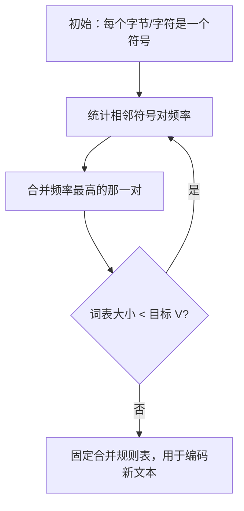

# BPE 是什么

> 从 Bit 到 AGI · 第六章：Token · BPE 是什么

**BPE（Byte Pair Encoding，字节对编码）** 是 GPT、Llama 等模型最常用的子词训练算法：从字符（或字节）出发，反复合并语料里最高频的相邻符号对，直到词表达到目标大小。搞懂 BPE，就搞懂了「Token 是怎么被**学**出来的」。

## 直觉

BPE 像 **压缩文件时的词典构建**：先统计「哪两个相邻片段最常一起出现」，把它们合成一个新符号加入词典；下一轮再统计，包括刚合成的新符号。高频词组（`the`、`ing`、`人工智能`）会越早被合并，最终一个 Token 就代表一长串字符。



## 定义

**训练输入**：预分词后的语料（GPT 用 regex 预切分；原始 BPE 论文对英文按空格切词后再拆字母）。

**初始词表**：所有出现过的基础符号（字符或 UTF-8 字节）集合，大小 $|V_0|$。

**合并规则**：第 $i$ 步选择频率最高的相邻对 $(a, b)$，新建符号 $ab$，词表 $V_i = V_{i-1} \cup \{ab\}$。

**目标**：执行 $V - |V_0|$ 次合并，得到词表大小 $V$。

**编码**：对未知文本，按**训练时记录的合并优先级**贪心应用合并（频率高的合并优先），直到无法再合并。

训练复杂度：每轮需扫描语料统计对频，朴素实现 $O(\text{语料长度} \times \text{合并轮数})$；工业实现用优先队列与索引优化。

## 例子

**例子 1：玩具语料手工推演**

语料（已预切分为词内字符序列）：`low`、`low`、`lowest`、`newer`、`newest`

初始符号：`l o w e s t n r`（加词尾标记 `</w>` 等细节此处略）

| 轮次 | 最高频对 | 新符号 | 词表变化 |
| ---: | --- | --- | --- |
| 1 | `(l, o)` | `lo` | +1 |
| 2 | `(lo, w)` | `low` | +1 |
| 3 | `(e, s)` | `es` | +1 |
| … | … | … | … |

几轮之后 `low` 成为单个 Token；`lowest` 可能编码为 `low` + `est`（2 Token）。

### 自己点一下

上面那张表写到第 3 轮就打了「…」——因为静态表格讲不透 BPE 的关键：**新符号会参与下一轮统计**。点「下一步」，亲眼看这个递归展开：

<BpeTrainer />

注意第 2 步合并的 `(lo, w)` 里，`lo` 就是第 1 步刚造出来的符号——BPE 的全部精髓就在这个自指里。跑完 6 步后，用学到的规则编码 `lowest`，得到 `low` + `est`（2 Token），正是上面说的。把这套流程从 5 个词放大到几十 GB 语料、几万条 merge 规则，就是 GPT 真实的 tokenizer。

**例子 2：GPT-2、GPT-4/4o 与开源模型的 BPE 变体**

| 模型 | 编码名 | 词表大小 | 基础单元 |
| --- | --- | ---: | --- |
| GPT-2 | `gpt2` | 50,257 | 字节级 BPE（256 字节 + 合并） |
| GPT-3/4 | `cl100k_base` | 100,256 | `tiktoken` BPE + 特殊 Token |
| GPT-4o / o3 / GPT-5 | `o200k_base` | 200,019 | 多语言与中文大幅优化的 `tiktoken` BPE |
| Llama 3 / 4 | `tiktoken` BPE | 128,256 / 202,048 | 字节级 `tiktoken` BPE |
| Qwen2.5 / Qwen3 | 字节级 BPE | 151,646 | 中英与代码友好的大词表 BPE |
| Llama 2 / Gemma | SentencePiece BPE | 32,000 / 256,000 | UTF-8 友好 BPE |

`cl100k_base` 中 `tiktoken` 可直接调用：

```python
import tiktoken

enc = tiktoken.get_encoding("cl100k_base")
print(enc.encode("Byte Pair Encoding"))  # 通常 3 个 Token
print([enc.decode([t]) for t in enc.encode("Byte Pair Encoding")])
```

## 量化

设最终词表 $V = 50{,}000$，Embedding 维度 $d = 12{,}288$（GPT-3 175B 配置）：

$$
\text{Embedding 参数} = 50{,}000 \times 12{,}288 \approx 6.1 \times 10^8
$$

合并轮数 $= V - |V_0| \approx 50{,}000 - 256 \approx 49{,}744$ 次（字节级起点）。

**压缩率**：英文维基百科上，BPE 32K 词表通常 **1 Token ≈ 4 字符 ≈ 4 字节**；纯 ASCII 代码约 **1 Token ≈ 3–3.5 字符**。

**中文**：UTF-8 每字 3 字节，BPE 32K–100K 词表下常见 **1 汉字 ≈ 1.5–2.5 Token**，即 **1.2–2.5 字节/Token**——比英文「更费 Token」。

## 常见误区

- **「BPE 编码是全局最优切分」**：贪心合并，非最优；同一字符串可能有多种切分，编码规则固定一种。
- **「训练和推理用同一套 Python 库就行」**：必须加载**同一 merge 规则文件**；规则差一个 merge，Token ID 全乱。
- **「BPE 只能用于英文」**：字节级 BPE 对任意 UTF-8 有效；中文效果取决于训练语料配比。

## 动手试一试

用 `tokenizers` 库在迷你语料上训练 BPE：

```python
from tokenizers import Tokenizer
from tokenizers.models import BPE
from tokenizers.trainers import BpeTrainer
from tokenizers.pre_tokenizers import Whitespace

tokenizer = Tokenizer(BPE(unk_token="<unk>"))
tokenizer.pre_tokenizer = Whitespace()

trainer = BpeTrainer(vocab_size=500, special_tokens=["<unk>", "[CLS]", "[SEP]"])
tokenizer.train(files=["tiny_corpus.txt"], trainer=trainer)

text = "low low lowest newer newest"
print(tokenizer.encode(text).tokens)
print(tokenizer.encode(text).ids)
```

观察 `low` 是否合并为单 Token；调大 `vocab_size` 看 Token 数如何下降。

## BPE 的局限与后续变体

**贪心非最优**：BPE 一旦合并 `(l,o)`，后续无法撤销；某些语言里更优切分被早期错误 merge 锁死。**Unigram**（SentencePiece 可选）用概率模型在多种切分间选似然最大者，缓解此问题。

**对数与空白敏感**：GPT 的 regex 预分词把 `\n\n`、缩进视为特殊模式；复制粘贴代码时多空一行，Token 边界即变。这不是 BPE 独有，但 **regex + BPE 叠加** 使调试更隐蔽。

**多语公平性**：若训练语料 95% 英文，merge 预算几乎被英文 n-gram 占满；中文仅能通过 **字节三元组** 间接合并，效率低于英文。**刻意提高中文语料权重** 或在中文子集上 **二次训练 merge**（风险：与基座不兼容）是数据团队常争论的话题——没有免费午餐，只有语料配比与 $V$ 的再平衡。

**WordPiece vs BPE**：BERT 用 WordPiece，合并依据是 **似然增益** 而非纯频率；GPT 系用频率 BPE。二者在工程上都是子词，差异在训练目标细节，对应用开发者而言 **换模型即换编码器** 即可。

**推理侧 merge 表大小**：100K 词表的 merge 规则链最长约 $10^5$ 步；`tiktoken` 用 Rust 哈希表 $O(N)$ 编码整句，单次 encode 微秒级。自写 Python 循环 merge 可能慢 **100× 以上**——在 Agent 循环里每步都 encode 工具返回时，应 **缓存** 或 **批量** 编码。

**可逆性**：标准 BPE 编码 + 解码往返无损（对同一词表）；但 **切分边界** 非唯一——同一字符串理论上存在多种合法 BPE 切分，训练选定的 merge 优先级固定输出一种，分析 adversarial 切分时需注意此点。

**与压缩算法的关系**：BPE 思想来自 1994 年数据压缩论文；gzip 的 LZ77 + Huffman 在字节级操作，而 NLP BPE 在 **可解释子词** 上停止，以便每个 Token 对应 Embedding 行。二者同源，目标不同——一个最小化磁盘，一个最小化 $N$ 且可微分学习。

::: info

OpenAI 的 `tiktoken` 用 Rust 实现 BPE 编码，速度比纯 Python 快一个数量级以上——生产环境计数 Token 应用官方编码器，不要自己重写 merge 逻辑。

:::

## 小结

BPE 通过 **高频合并** 把字节/字符拼成子词，在有限词表下表示任意文本。GPT 系列、Llama 的 BPE 变体都沿用这一思想；词表大小与 merge 规则文件是模型 artifact 的一部分，与权重同等重要。

下一篇：[SentencePiece 是什么](/manual/llm/bit-to-agi/06-tokenizer/what-is-sentencepiece)
