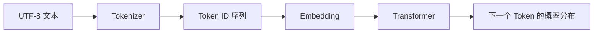

# Token 是什么

> 从 Bit 到 AGI · 第六章：Token · Token 是什么

你在 API 账单里看到的「Token」，不是字节，也不是 Unicode 码点，而是 **Tokenizer 切出来的离散符号**。模型每一步只预测「下一个 Token 的 ID」；Embedding 层把 ID 映射成向量，Transformer 在向量空间里运算。搞不清 Token，就搞不清上下文长度、费用和训练数据量。

## 直觉

把 Token 想成 **乐高积木的型号编号**。同样一面墙，用大砖块（粗粒度 Token）只需 100 块，用小砖块（细粒度 Token）可能要 400 块——墙的面积（语义）一样，但块数（Token 数）不同。模型有「一次最多能拿多少块」的上限（上下文窗口），也有「每块都要付钱」的计费规则（API 按 Token 计价）。



## 定义

**Token**：词表（vocabulary）中的一个条目，对应唯一整数 ID $t \in \{0, 1, \ldots, V-1\}$，其中 $V$ 是词表大小。

**Tokenizer**：确定性函数 $f: \text{UTF-8 字符串} \rightarrow (t_1, t_2, \ldots, t_n)$，满足解码函数 $g$ 使 $g(f(x)) = x$（无损或可配置略损）。

**与字节的关系**：一段文本的 UTF-8 字节数为 $B$；切分后 Token 数为 $N$。二者没有固定比例，取决于语言、词表和算法。英文常见 $N \approx B/4$；中文常见 $N \approx B/2$ 甚至更高。

## 例子

**例子 1：同一句子的两种「长度」**

| 文本 | UTF-8 字节 | Token 数（cl100k_base 量级） |
| --- | ---: | ---: |
| `Hello, world!` | 13 | 4 |
| `你好，世界！` | 18 | 6–8 |

字节更少的中文句，Token 数反而可能更多——这就是后面「中文更贵」的伏笔。

**例子 2：模型眼里只有整数**

```python
import tiktoken

enc = tiktoken.get_encoding("cl100k_base")
text = "GPT reads tokens, not characters."
ids = enc.encode(text)
print(ids)       # 例如 [8266, 11886, 11439, 11, 539, 3430, 13]
print(len(ids))  # Token 数 = 7
print(enc.decode(ids))  # 还原原文
```

Embedding 层接收的是 `ids` 这样的列表，不是字符串。

## 量化

设词表大小为 $V$，Embedding 维度为 $d$，则 Embedding 矩阵参数量约为：

$$
\text{params}_{\text{embed}} = V \times d
$$

GPT-3 175B 量级模型常用 $V \approx 50{,}000$，$d \approx 12{,}288$，仅 Embedding 就有约 **6.1 亿**参数。Token 不是「轻量概念」，它直接占模型体积。

一次前向推理的计算量与序列长度 $N$（Token 数）近似平方关系（自注意力 $O(N^2 d)$）。**Token 数翻一倍，注意力 FLOPs 约翻四倍**——比字节数更能预测算力。

## 常见误区

| 误区 | 事实 |
| --- | --- |
| 「1 个汉字 = 1 个 Token」 | 取决于词表；常见 BPE 下 1 个汉字常对应 1–2 个 Token |
| 「Token 就是单词」 | 英文一个单词可能被切成多个 Token（如 `unhappiness` → `un` + `happiness`） |
| 「字符数 × 4 ≈ Token 数」 | 只对英文粗略成立；中文、代码、emoji 偏差很大 |

::: warning

不同模型的 Tokenizer **互不兼容**。同一段文本在 GPT-4 与 Llama 3 下的 Token 数可能差 20% 以上；估算成本时必须指定编码器。

:::

## 动手试一试

安装 `tiktoken` 后，对比下面三段的 Token 数与 UTF-8 字节数：

```python
import tiktoken

enc = tiktoken.get_encoding("cl100k_base")

samples = [
    "The quick brown fox jumps over the lazy dog.",
    "快速的棕色狐狸跳过了懒狗。",
    "def fib(n: int) -> int:\n    return n if n < 2 else fib(n-1) + fib(n-2)",
]

for s in samples:
    n_tok = len(enc.encode(s))
    n_byte = len(s.encode("utf-8"))
    print(f"bytes={n_byte:3d}  tokens={n_tok:3d}  ratio={n_byte/n_tok:.2f} bytes/token")
```

记录 `bytes/token`：英文往往接近 4，中文往往接近 2 或更低（意味着同样字节数下 Token 更多）。

## 与 Bit、Embedding 的衔接

回顾 [第一章](/manual/llm/bit-to-agi/01-bits/why-text-is-utf8)：磁盘与网络里的文本已是 UTF-8 字节串。Tokenizer 是 **Bit/字节 → 整数 ID** 的第一层语义抽象；[Embedding 层](/manual/llm/bit-to-agi/04-neural-networks/what-is-neuron) 再把 ID 映成 $d$ 维浮点向量。整条链路可写为：

$$
\text{UTF-8 字节} \xrightarrow{\text{Tokenizer}} \text{Token ID} \xrightarrow{\text{Embedding}} \mathbf{x} \in \mathbb{R}^d
$$

GPT 类模型在 [第三章](/manual/llm/bit-to-agi/03-information/why-gpt-predicts-next-token) 中「预测下一个 Token」，损失函数在 **词表维度 $V$** 上做 softmax——因此输出层权重矩阵也是 $V \times d$，与 Embedding 共享或绑定的设计（weight tying）在参数上再省 $V \times d$ 个浮点数。Tokenizer 的 $V$ 一旦确定，**输入 Embedding + 输出投影** 的规模就被锁死。

**特殊 Token** 不占自然语言语义，却承担控制流：`endoftext` 表序列结束；Chat 模型里的 `<|im_start|>user` 标记角色。它们同样占一个词表 ID，在计数时必须计入——用户只打了 50 字，账单里可能是 80 Token。

**解码（Decoding）** 是编码的逆过程：模型输出 logits 向量（长度 $V$），采样或 argmax 得到一个 ID，再 `decode` 成 UTF-8 片段拼回字符串。若 Tokenizer 版本错误，单个 ID 可能解出乱码字节，整段输出不可读。

**批量推理中的 padding**：同一 batch 内序列长度不一，短序列右侧 pad 到 $N_{\max}$；pad Token 在 attention mask 里被屏蔽，不贡献语义，但 **仍占 FLOPs 与显存**。因此 Serving 常按长度分桶（bucketing），减少 pad 浪费——桶的粒度同样以 Token 为单位，不是字节。

**Loss 只在 Token 上定义**：训练时 cross-entropy 对每个 **非 mask 位置** 的 Token 计算；一个汉字若被切成 2 Token，梯度会 **回传到两个 ID 的 embedding**，模型学的是子词级预测，而非字级对齐。评估 perplexity 时也在 Token 空间报告——跨 Tokenizer 比较 ppl 无意义。

**工具链入口**：HuggingFace `AutoTokenizer`、OpenAI `tiktoken`、Google `sentencepiece` 的 `encode()` 是 **应用层与模型之间的契约**。任何 RAG、Agent、微调脚本若绕过官方 API 自写正则切分，都在重新发明一个劣化版 Tokenizer——debug 成本远高于调用一行 `encode`。

**上下文窗口的「可见文本」**：用户在 UI 里数「字数」，模型在内部数 Token；产品若显示「剩余 1000 字」而实际按 Token 限流，中文用户会 **提前撞墙**。正确做法是 **后端返回 remaining_tokens**，前端用当前会话 encoding 估算，而非固定字/token 换算系数。上线前对 **简中、繁中、英** 各抽样 100 条真实 query 做 encode 分布图，是成本与体验兼保的最低投入。

## 小结

Token 是模型输入输出的**最小离散单位**，由 Tokenizer 从 UTF-8 文本切出；计费、上下文窗口、注意力算力都以 Token 数为尺度。字节数描述存储，Token 数描述模型「看到多长」——二者不可混用。

下一篇：[为什么不用汉字](/manual/llm/bit-to-agi/06-tokenizer/why-not-chinese-char)
