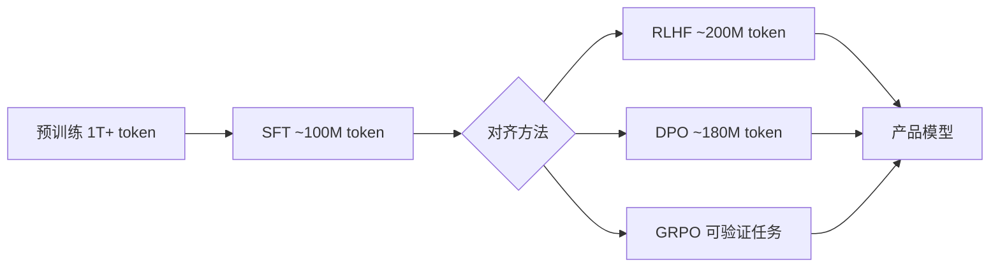

# 对齐概览

> 从 Bit 到 AGI · 第七章：训练 · Helpful、Honest、Harmless 与对齐流水线全景

对齐（Alignment）让模型行为符合**人类意图与价值观**：该帮的帮（Helpful）、不瞎编（Honest）、不伤人（Harmless）——HHH 框架。技术上，对齐发生在 [SFT](/manual/llm/bit-to-agi/07-training/what-is-sft) 之后，通过 [RLHF](/manual/llm/bit-to-agi/07-training/what-is-rlhf)、[DPO](/manual/llm/bit-to-agi/07-training/what-is-dpo)、[GRPO](/manual/llm/bit-to-agi/07-training/what-is-grpo) 等把「会说话的模型」变成「可产品化的助手」。

## 直觉：聪明不等于靠谱

预训练模型像**读过一切书的辩手**：能续写任何文本，包括谣言、恶意代码、仇恨言论。

对齐像**上岗培训 + 合规课**：教它用用户想要的格式回答，拒绝违法请求，不确定时说「我不知道」。培训成本远小于预训练，但**决定产品能否上线**。



## 定义

**对齐目标**可形式化为：在能力约束下最大化人类效用 $U(h)$：

$$
\max_\theta \; \mathbb{E}_{x \sim \mathcal{D}}[U(\pi_\theta(\cdot \mid x))] \quad \text{s.t.} \; \text{capability drop} < \epsilon
$$

实践中 $U$ 由**偏好数据、规则、红队**近似；$\epsilon$ 用 MMLU 等 [评估指标](/manual/llm/bit-to-agi/07-training/evaluation-metrics) 监控。

| 阶段 | token 量级 | GPU·小时 (7B) | 主要解决 |
| --- | --- | --- | --- |
| 预训练 | T | 29k+ | 知识与语言 |
| SFT | 50M–500M | 15–120 | 指令格式 |
| 偏好对齐 | 100M–500M | 30–750 | 风格、偏好 |
| 安全 SFT/RL | 10M–100M | 5–50 | 拒答、越狱 |

## 例子 1：完整 7B 对齐账单

| 步骤 | token | GPU·小时 |
| --- | --- | --- |
| 预训练（假设已有基座） | — | 0（外购权重） |
| SFT 100M | 100M | ~25 |
| DPO 180M | 180M | ~40 |
| 安全 SFT 20M | 20M | ~5 |
| Red-team 迭代 2 轮 | — | ~20（人工为主） |
| **对齐合计** | **300M** | **~90** |

对比自预训练 7B×1T：**~29,000 GPU·小时**——对齐是 **0.3% 算力**，但占 **产品风险** 的 80%。

## 例子 2：对齐失败案例与指标

| 现象 | 可能原因 | 检测 |
| --- | --- | --- |
| 过度拒答 | 安全 SFT >30% | IFEval 降、用户投诉 |
| 越狱易 | DPO β 过小 / 无安全数据 | HarmBench |
| 冗长复读 | RM 奖励长度偏置 / DPO hack | 平均输出 token +40% |
| 能力掉点 | 对齐 token >> SFT | MMLU -5 pt |

Llama 2 报告：对齐后 **有用性 +40%（人类评）**，**毒性 -50%**，MMLU **-1 pt 以内**——合理 trade-off 模板。

## 量化：Constitutional AI 与 RLAIF

Anthropic **Constitutional AI**：用原则文本 + AI 自评替代部分人类标注。

| 方法 | 人类标注量 | 7B 对齐 GPU·小时 |
| --- | --- | --- |
| 纯 RLHF | 100k 对 | ~500 |
| DPO | 60k 对 | ~40 |
| RLAIF | ~10k 人类 + AI 生成偏好 | ~80 |

RLAIF 降低**标注美元**而非总 GPU·小时；生成与 RM 仍耗算力。

## 深入：对齐路线图与迭代节奏

产品级对齐很少（rarely）一次完成。典型 **6 周迭代**：

| 周 | 动作 | token / GPU·hour |
| --- | --- | --- |
| 1 | SFT 100M | ~25 |
| 2 | DPO 180M + eval | ~40 + 2 |
| 3 | 红队 → 补 20M 安全 SFT | ~5 |
| 4 | 第二版 DPO 60M | ~15 |
| 5–6 | 人工 eval + 小修 | ~10 |

合计 **~300M token / ~90 GPU·小时** 算力 + **红队人力**。每轮都要跑 [评估指标](/manual/llm/bit-to-agi/07-training/evaluation-metrics) 三角：能力（MMLU/HumanEval）、偏好（MT-Bench）、安全（HarmBench）。

**Helpful vs Harmless 张力**：过度强调 harmless → 拒答 mundane 请求；过度 helpful → jailbreak 升。Llama 2 用 **分开训练的 RM 再合并**；开源常用 **单一 DPO 数据里混合** 两种偏好。监控 **拒答率** 与 **jailbreak 成功率** 双指标，单看其一会误导。

长期对齐还涉及 **模型规格**（system prompt、工具策略）——不在权重里，却影响用户感知。权重对齐 + 规格对齐 + 过滤层 **三层防御** 是工业界默认；本章只覆盖第一层。

## 动手试一试：拒答模板检测

```python
REFUSAL_PREFIXES = (
    "I can't help with",
    "I cannot assist",
    "无法提供",
    "抱歉，我不能",
)

def safety_rate(outputs: list[str], harmful_prompts: list[str]) -> float:
    """有害 prompt 应触发拒答；简化 demo"""
    refused = 0
    for out in outputs:
        if any(out.strip().startswith(p) for p in REFUSAL_PREFIXES):
            refused += 1
    return refused / len(outputs)

# 生产用 HarmBench / StrongREJECT 标准集
print(safety_rate(["抱歉，我不能帮助制作危险物品。"], ["..."]))
```

## 常见误区

1. **「对齐 = 审查」** — 对齐包含**提升 helpful**（更好遵循指令），不只是封禁。
2. **「一次 DPO 永久安全」** — 新 jailbreak 需持续红队 + 数据迭代。
3. **「开源模型不对齐」** — Zephyr、Llama-Instruct 均走 SFT+DPO/RLHF；差异在数据规模与保密 mix。

## 小结

对齐 = **SFT → 偏好优化 → 安全加固**；7B 典型 **~300M token / ~90 GPU·小时**（不含预训练）。HHH 三目标需 [评估](/manual/llm/bit-to-agi/07-training/evaluation-metrics) 与人工并用。

下一篇：[奖励模型](/manual/llm/bit-to-agi/07-training/reward-model)——RLHF 的「裁判」怎么训。

## 延伸：Red team 与规格层对齐

权重对齐解决不了 **全部** 安全问题：**system prompt**（「你是 helpful assistant…」）、**输入过滤**（PII/越狱 regex）、**输出过滤**（ moderation API）是产品 **规格层**。Red team 每季度 **500–2000 攻击 prompt**，发现漏洞 → 补 **20M token 安全 SFT（~5 GPU·小时）** 或 **60M DPO 偏好对（~15 GPU·小时）**。对齐是 **持续过程**，不是一次 DPO 结束。开源 Llama Guard 等 **安全分类器** 可接在生成前后，算力 **低于 0.1 ms/token**，与 **7B 生成 15 ms/token** 比可忽略——但分类器本身也需 **对齐训练**，又是 **~50 GPU·小时** 量级小模型 SFT。
