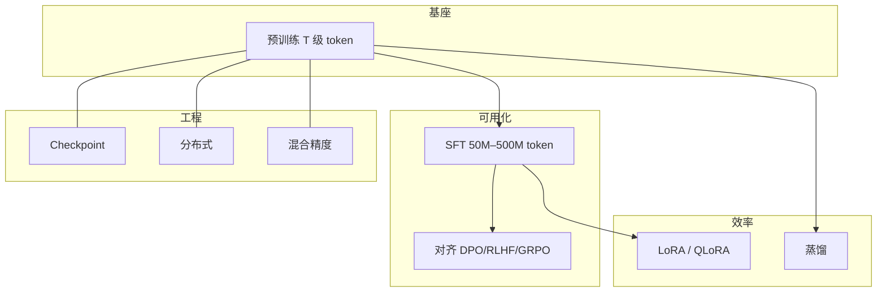

# 第七章总结

> 从 Bit 到 AGI · 第七章：训练 · 从预训练到对齐的全链路回顾

第七章把大语言模型的**训练流水线**拆成了可估算的模块：每一阶段都回答两个问题——**喂多少 token**、**烧多少 GPU·小时**。下面用一张表串起全章，方便你规划实验或读懂工业界技术报告。

## 全链路一览

## 7B 模型：各阶段 token 与 GPU·小时（量级）

| 阶段 | 典型 token | GPU·小时（粗算） | 本篇 |
| --- | --- | --- | --- |
| 预训练 | 1T | ~29,000（单卡等价） / 512 卡 ~3 天 | [预训练](/manual/llm/bit-to-agi/07-training/what-is-pretraining) |
| SFT 全参 | 100M | ~25–111 | [SFT](/manual/llm/bit-to-agi/07-training/what-is-sft) |
| SFT LoRA | 40M | ~6–10 | [LoRA](/manual/llm/bit-to-agi/07-training/what-is-lora) |
| DPO | 180M | ~30–50 | [DPO](/manual/llm/bit-to-agi/07-training/what-is-dpo) |
| RLHF PPO | 200M | ~400–750 | [RLHF](/manual/llm/bit-to-agi/07-training/what-is-rlhf) |
| GRPO（数学） | 410M 生成 | ~200–400 | [GRPO](/manual/llm/bit-to-agi/07-training/what-is-grpo) |
| 对齐合计 | ~300M | ~90（SFT+DPO+安全） | [对齐概览](/manual/llm/bit-to-agi/07-training/alignment-overview) |

**结论**：预训练占 **99%+ 算力**；产品体验占 **对齐 + SFT**，通常 **低于 100 GPU·小时**（7B LoRA+DPO 路径）。

## 关键技术选型速查

| 需求 | 推荐 | 原因 |
| --- | --- | --- |
| 个人微调 7B | [QLoRA](/manual/llm/bit-to-agi/07-training/what-is-qlora) | 24GB 卡、~6 GPU·小时 |
| 开源偏好对齐 | SFT → [DPO](/manual/llm/bit-to-agi/07-training/what-is-dpo) | 无 PPO、无 RM |
| 数学/代码推理 RL | [GRPO](/manual/llm/bit-to-agi/07-training/what-is-grpo) | 可验证奖励 |
| 更大容量、固定推理成本 | [MoE](/manual/llm/bit-to-agi/07-training/what-is-moe) | 激活参数小 |
| 小模型学大模型 | [蒸馏](/manual/llm/bit-to-agi/07-training/distillation) | Teacher 生成 silver data |
| 省显存训大 batch | [梯度累积](/manual/llm/bit-to-agi/07-training/gradient-accumulation) + [混合精度](/manual/llm/bit-to-agi/07-training/mixed-precision-training) | 标配 |
| 70B+ | [分布式](/manual/llm/bit-to-agi/07-training/distributed-training-overview) ZeRO+TP | 单机不够 |

## 公式与指标备忘

- 训练 FLOPs ≈ **6 × N_params × N_tokens**
- Perplexity = **exp(cross-entropy loss)**
- Chinchilla 最优 token ≈ **20 × N_params**
- 全局 batch 常按 **token/step** 计（7B 预训练 ~4M）

评估勿只看 loss：[MMLU / HumanEval / MT-Bench](/manual/llm/bit-to-agi/07-training/evaluation-metrics) 分工不同。

## 深入：按目标选路径

| 你的目标 | 最低成本路径 | 预算量级 |
| --- | --- | --- |
| 个人助手 | 开源 7B + QLoRA SFT + DPO | **低于 100 GPU·小时** |
| 领域客服 | 7B LoRA + 领域 200M SFT token | **~50 GPU·小时** |
| 数学推理 | 强基座 + GRPO 400M 生成 token | **~300 GPU·小时** |
| 自研 7B 基座 | 预训练 1T | **~29k GPU·小时** |
| 70B 全参 SFT | ZeRO-3 + 64 GPU | **~200 GPU·小时** |

**不要跳步**：顺序永远是 **PT → SFT → 对齐**；LoRA/QLoRA 降成本，不替代预训练。完整 7B 产品对齐 **~90 GPU·小时 + \$5k–50k 数据** 是合理区间。

## 工程 checklist

1. **[数据配比](/manual/llm/bit-to-agi/07-training/data-mixing)**：预训练 mix + SFT 安全 15–25%
2. **[学习率](/manual/llm/bit-to-agi/07-training/learning-rate-schedule)**：warmup + cosine；SFT LR < 预训练
3. **[Checkpoint](/manual/llm/bit-to-agi/07-training/checkpoint)**：async + 保留多份 eval
4. **[稳定性](/manual/llm/bit-to-agi/07-training/training-stability)**：grad clip、NaN 即停
5. **对齐**：[奖励模型](/manual/llm/bit-to-agi/07-training/reward-model) 仅 RLHF 需要

## 下一章

训练出的权重要在用户请求时 **快且省** 地跑起来——第八章 [推理（Inference）](/manual/llm/bit-to-agi/08-inference) 讲 KV Cache、量化、Flash Attention 与 batching。

若你要**亲手训一版**，第十章 [自己训练一个模型](/manual/llm/bit-to-agi/10-train-your-llm) 按步骤实操。

## 自检

- [ ] 能估算 7B×1T token 预训练 **~29k GPU·小时**
- [ ] 能说出 SFT 只对 **assistant** 算 loss 的原因
- [ ] 能比较 DPO（~40 GPU·小时）与 PPO（~500 GPU·小时）适用场景

过关后，你具备「训得起、训得稳、评得过」的地图——细节在第十章 [端到端实战](/manual/llm/bit-to-agi/10-train-your-llm/collect-data) 展开。

## 延伸：本章 20 篇如何读

不必线性精读：按目标跳读。**只想微调** → SFT、LoRA、QLoRA、DPO、评估、稳定性。**想懂工业流水线** → 预训练、数据配比、分布式、checkpoint、对齐概览。**想搞数学 RL** → GRPO、评估、稳定性。每篇独立含 **token/GPU·小时** 量级，可当 **速查表**。回到 [本章目录](/manual/llm/bit-to-agi/07-training) 开始下一篇。

第四章 [优化器](/manual/llm/bit-to-agi/04-neural-networks/optimizer-sgd-adam) 的 AdamW 是本章所有阶段的默认优化器；第三章 [交叉熵](/manual/llm/bit-to-agi/03-information/cross-entropy) 是 PT/SFT loss 本体。第六章 [Token](/manual/llm/bit-to-agi/06-tokenizer) 决定 **token 计数与中文成本**——1T 中文 token 的信息量与 1T 英文不同，mix 不能只看比例。第九章 [GPU](/manual/llm/bit-to-agi/09-gpu) 解释 **为何 512 卡仍要 3 天**（内存带宽、MFU）。第十章把本章数字变成 **可执行 checklist**；第八章把训好的 14 GB 权重变成 **50 token/s 的服务**。全专栏是一条链：**Bit → 梯度 → Transformer → Token → 训练 → 推理 → 工程**。
