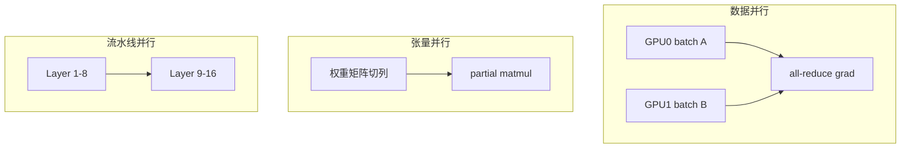

# 分布式训练概览

> 从 Bit 到 AGI · 第七章：训练 · 数据并行、张量并行、流水线与 ZeRO

分布式训练（Distributed Training）把**一次 LLM 训练**拆到多张 GPU、多台机器上。7B 可单机 8 卡；70B 全参数需 **张量并行 + 流水线 + ZeRO**；671B MoE 需 **数百–数千卡**。理解三种并行维度，才能读懂集群账单与故障日志。

## 直觉：大工程三种分工

- **数据并行（DP）**：每人拿**不同 batch**，算完梯度**平均**——像 8 人各改 8 份作业，最后对答案。
- **张量并行（TP）**：**一层矩阵**切成 8 块，各卡算一块——像一行方程 8 人各算几个未知数。
- **流水线并行（PP）**：模型**按层**切，卡 0 算 1–10 层，卡 1 算 11–20 层——像工厂流水线。



## 定义

| 策略 | 切什么 | 通信 | 典型用途 |
| --- | --- | --- | --- |
| **DDP** | 数据 | all-reduce 梯度 | 7B 以下多卡 |
| **FSDP / ZeRO-2/3** | 数据 + 分片 optimizer/权重 | reduce-scatter | 7B–70B 省显存 |
| **TP** | 单层权重 | all-reduce / all-gather | 单层太大 |
| **PP** | 层序列 | P2P 激活 | 层数多、跨节点 |
| **EP** | MoE 专家 | all-to-all | MoE 专用 |

**3D 并行**（Megatron-DeepSpeed）：TP × PP × DP，例如 70B 用 TP=8, PP=4, DP=16 → **512 GPU**。

## 例子 1：7B 预训练 1T token，512 GPU

| 配置 | 数值 |
| --- | --- |
| 并行 | DP=512（无 TP/PP，7B 单层可单卡） |
| 每卡 micro | 8192 token |
| 全局 batch | 512 × 8192 ≈ **4.2M token/step** |
| 总 steps | 1T / 4.2M ≈ **238k** |
| 每 step 时间 | ~1.2 s（含 all-reduce） |
| 墙钟 | 238k × 1.2s ≈ **79 小时 ≈ 3.3 天** |
| **总 GPU·小时** | 512 × 79 ≈ **40,400** |

与单卡粗算 ~29k GPU·小时 比，多卡有 **~30% 通信 overhead**——正常。

## 例子 2：70B 全参数 SFT，64× A100 80GB

| 配置 | 数值 |
| --- | --- |
| ZeRO-3 + TP=4 + PP=2 | 64 GPU |
| 可训练 token batch | ~512k / step |
| 500M token SFT | ~977 steps |
| 每 step | ~8–15 s |
| 墙钟 | **~2–4 小时** |
| **GPU·小时** | **~128–256** |

同数据 LoRA 7B 单卡：**~6 GPU·小时**——分布式是为**全参大模型**服务。

## 量化：通信瓶颈

| 互联 | 带宽 | 适合 |
| --- | --- | --- |
| NVLink 4.0 / 5.0 | ~900–1800 GB/s | 单节点 TP（或 GB200 NVL72 机架） |
| InfiniBand HDR | ~200 Gb/s | 跨节点 DP/PP |
| 以太网 25G | ~3 GB/s | 小模型 DP 勉强 |

**TP 不要跨节点**（延迟敏感）；**DP 可跨节点**（all-reduce 可重叠计算）。

MoE **Expert Parallel**：token 路由到不同卡的专家，all-to-all 通信量 ∝ batch × hidden × top-k；DeepSeek-V3 训练需专门优化网络。

## 深入：弱扩展与故障恢复

**Weak scaling**：GPU 512→1024，ideal 墙钟减半；实际往往 **1.3–1.5× 加速**，因 all-reduce 占比上升。7B 1T token 在 512 GPU **~3.3 天**，1024 GPU **~2.5 天** 而非 1.65 天——规划 deadline 要留 **30% slack**。

**故障**：大 job MTBF 可能 **每 48–72 小时** 一卡坏。无 [checkpoint](/manual/llm/bit-to-agi/07-training/checkpoint) 则丢整 job；有每 2000 step 存盘，最多丢 **8B token ≈ 323 GPU·小时（512 卡）**。Elastic training（torchrun `max_restarts`）+ 共享 filesystem checkpoint 是标配。

小团队 **8 卡复现 7B 预训练** 不现实 1T，但可 **复现 10B token** 验证 mix 与 hyperparam：10B / 4M = **2500 step**，8 卡 **~2–3 天 / ~500 GPU·小时**——足够看 loss 曲线是否与健康 1T run 同形。再决定是否砸 **29k GPU·小时** 全量。

TP 切分 attention 头：7B hidden=4096、head=32 时 TP=8 每卡 4 heads——实现复杂，7B 通常 **不需要 TP**；70B hidden=8192 则 **TP=8 几乎必须**。先 DP+ZeRO，OOM 再加 TP，最后 PP——这是 [DeepSpeed](/manual/llm/bit-to-agi/11-engineering/deepspeed) 文档的推荐顺序。

## 动手试一试：DDP 最小例

```python
import torch
import torch.distributed as dist
from torch.nn.parallel import DistributedDataParallel as DDP

def setup():
    dist.init_process_group("nccl")
    torch.cuda.set_device(int(os.environ["LOCAL_RANK"]))

# 每 rank 不同数据，梯度自动 all-reduce
model = DDP(model, device_ids=[local_rank])
loss = model(batch_local).loss
loss.backward()  # grad 已同步
optimizer.step()
```

生产用 **torchrun --nproc_per_node=8 train.py** 或 DeepSpeed `deepspeed --num_gpus=8`。

## 常见误区

1. **「GPU 越多一定越快」** — 通信主导时 weak scaling 变差；512→1024 卡可能只快 1.3×。
2. **「ZeRO 和 TP 二选一」** — 70B+ 常**组合**；ZeRO 省显存，TP 降单卡内存峰值。
3. **「分布式 = 高可用」** — 一卡挂掉常**整 job 停**；需 torch elastic + 频繁 [checkpoint](/manual/llm/bit-to-agi/07-training/checkpoint)。

## 小结

分布式 = **DP / TP / PP / ZeRO / EP** 组合；7B×1T 用 **512 GPU DP** 约 **3 天 / 40k GPU·小时**；70B SFT 64 卡 **~128–256 GPU·小时**。第九章 [GPU 章](/manual/llm/bit-to-agi/09-gpu) 补硬件视角。

下一篇：[评估指标](/manual/llm/bit-to-agi/07-training/evaluation-metrics)——loss 之外看什么。

## 延伸：Ring-AllReduce 与 pipeline bubble

**Ring-AllReduce** 是 DDP 梯度同步经典算法：N 卡通信量 **与 N 无关**（近似），适合 **多机 DP**。**Pipeline Parallel** 有 **bubble**（流水线空泡）：micro-batch 数 $m$ 应 **≥ PP stages × 2** 才填满，否则 GPU 空闲——70B PP=8 时常设 **micro=32+**，每 step 实际 forward **32× seq** token，调 accum 时要计入。7B 纯 DP 无 bubble 问题。Cloud **跨 AZ 训练** 带宽骤降，512 GPU job 可能 **MFU 从 40% 跌到 15%**——1T token 墙钟 **×2.5**，多 **~44k GPU·小时** 等价 waste；大 job 应用 **同 AZ 集群 + RDMA**。
