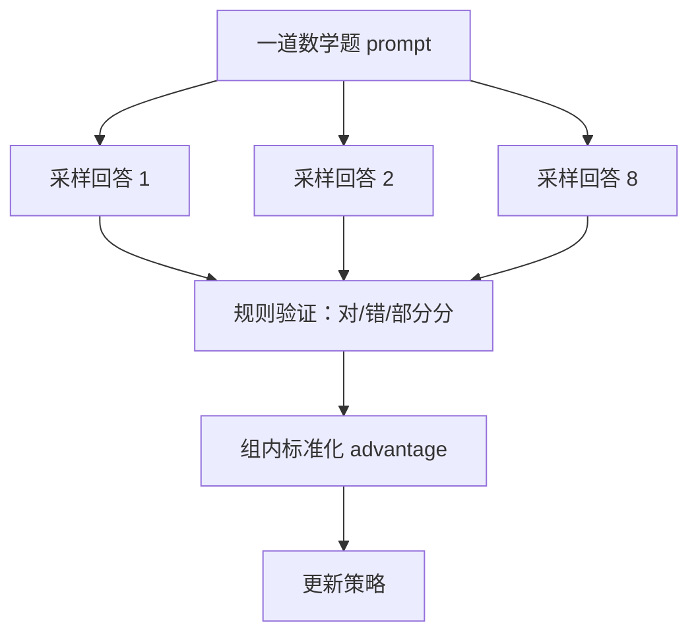

# GRPO 是什么

> 从 Bit 到 AGI · 第七章：训练 · 组相对策略优化：DeepSeek 用于推理模型的 RL 新范式

GRPO（Group Relative Policy Optimization，组相对策略优化）是 DeepSeek 在训练 **DeepSeek-R1** 推理模型时采用的 RL 变体：对同一 prompt **采样一组回答**，用组内相对排名代替 PPO 里的 **critic 价值网络**，特别适合**可验证奖励**（数学答案对错、代码是否通过测试）的场景。

## 直觉：班级排名，不用绝对分数

PPO 像每次考试都估一个「预期得分」（critic），再和实际分比。

GRPO 像把同一道题的 8 份答卷放一起**排名**：谁相对更好，谁就获得正向梯度——**不需要**知道这份卷子的绝对分数是多少，也不需要单独训 critic。



## 定义

对 prompt $x$，采样 $G$ 个输出 $\{y_i\}_{i=1}^G$，得到奖励 $\{r_i\}$。组内 baseline（均值）与标准化 advantage：

$$
\hat{A}_i = \frac{r_i - \text{mean}(\{r_j\})}{\text{std}(\{r_j\}) + \epsilon}
$$

再用类似 PPO 的 clipped objective 更新 $\pi_\theta$，**去掉 critic 网络**。DeepSeek 还常配合 **KL 到 SFT ref** 防崩溃。

与 PPO 对比：

| 维度 | PPO (RLHF) | GRPO |
| --- | --- | --- |
| Critic | 需要（同规模 LM 头） | **不需要** |
| 奖励来源 | 学习式 RM | 规则/验证器为主 |
| 采样 | 每 prompt 1–few 条 | 每 prompt **G=8–64 条** |
| 典型任务 | 开放对话偏好 | 数学、代码、推理 |

## 例子 1：DeepSeek-R1 量级（公开信息归纳）

| 项 | 数量级 |
| --- | --- |
| 基座 | DeepSeek-V3 671B MoE（激活 ~37B） |
| RL 阶段 | 数千 GPU·天（未完全公开） |
| 奖励 | 数学：答案匹配；代码：单元测试 |
| 采样组大小 G | 报告使用较大 G 以稳定梯度 |

671B MoE 激活 37B：单次 forward 接近 **37B 稠密** 算力；若 RL 生成 **10B token** rollout，FLOPs 粗算：

$$
6 \times 37 \times 10^9 \times 10^{10} \approx 2.2 \times 10^{21}
$$

128× H800 集群、40% 利用率 → **数万 GPU·小时** 量级（与官方「长周期 RL」一致）。

## 例子 2：7B 复现 GRPO（数学）

**场景**：GSM8K 风格，10k prompt，每组 **G=16** 采样，平均生成长 512 token，训练 5 epoch。

| 项 | 数值 |
| --- | --- |
| 总生成 token | 10k × 16 × 512 × 5 ≈ **410M** |
| 7B 生成 FLOPs（≈2N×tokens forward） | ~5.7×10¹⁸ |
| 8×A100，含 backward | **~200–400 GPU·小时** |

比同规模 DPO **贵**（在线采样多），但 **可验证奖励** 时 GRPO 上限更高——R1 的「啊哈 moment」来自长 RL。

## 量化：奖励设计

| 奖励类型 | 示例 | 稀疏性 |
| --- | --- | --- |
| 二元 | 答案 == 标准答案 → +1 else 0 | 极稀疏 |
| 格式 + 结果 | `<think>...</think>` 内有推导且答案对 → +1 | 中等 |
| 过程奖励（PRM） | 逐步打分 | 需 PRM 模型 |

纯稀疏奖励时，**G 要大**（16–64），否则组内全错 → advantage≈0 → 学不动。

## 深入：DeepSeek-R1 启示与 7B 复现路径

DeepSeek-R1 报告的长链推理能力，来自 **大规模 GRPO + 规则奖励 + 长 horizon**——不是 magic hyperparameter。开源复现通常分三阶：**(1)** 强基座（数学/code 预训练 mix 高）；**(2)** 中等规模 SFT 注入格式（`<think>`）；**(3)** GRPO 用 GSM8K/MATH 验证器。7B 在 10k prompt × G=16 × 512 token 规模下 **200–400 GPU·小时** 可看到 pass@1 从 ~35% 涨到 ~50%，但距离 R1 级 **>85%** 仍需更大数据与更长 RL。

组大小 G 与 **GPU·小时线性相关**：G=8→16 直接把生成 FLOPs 翻倍。实践上先用 **G=8** 验证 pipeline，再拉到 16–32 冲分。与 [DPO](/manual/llm/bit-to-agi/07-training/what-is-dpo) 不同，GRPO 每 step 的 token **全是新生成**，无法缓存 prompt KV 跨 epoch——因此同样 200M token，GRPO 的 **wall-clock 通常是 DPO 的 5–10×**。

KL 到 ref 仍重要：无 KL 时模型可能学会 **输出超长无效推导** 刷格式分，或混用多语言。β 量级与 DPO 类似 **0.01–0.1**；监控 **平均生成长度** 与 **entropy**，长度 +50% 而 acc 不变是 hacking 早期信号。671B MoE 的 GRPO 成本无法用 7B 线性外推——激活 37B × 长生成 × 大 G，**数万 GPU·小时** 是合理量级，这也是强推理模型门槛高的原因。

## 动手试一试：组内 advantage

```python
import torch

def group_advantages(rewards: torch.Tensor, eps=1e-8):
    """
    rewards: [num_prompts, group_size]
    """
    mean = rewards.mean(dim=1, keepdim=True)
    std = rewards.std(dim=1, keepdim=True)
    return (rewards - mean) / (std + eps)

# 4 道题，每题 8 个采样，奖励 0/1
R = torch.tensor([
    [1,0,0,1,0,0,0,1],
    [0,0,0,0,0,0,0,0],  # 全错 → advantage 全 0
    [1,1,1,0,1,1,1,1],
    [0,1,0,0,1,0,0,0],
], dtype=torch.float32)
A = group_advantages(R)
print("advantages:\n", A)
print("prompt 1 all-zero?", torch.allclose(A[1], torch.zeros(8)))
```

## 常见误区

1. **「GRPO 替代 DPO 做聊天对齐」** — 开放对话缺可靠 verifier；DPO/RM 仍更合适。
2. **「组越大越好」** — G 大 → 生成成本线性涨；显存存 KV cache 也涨。
3. **「GRPO 不需要 ref KL」** — 长 RL 仍会**语言崩溃**（重复、混语）；KL 约束仍常见。

## 小结

GRPO 用**组内相对奖励**去掉 critic，适合 **数学/代码等可验证任务**；7B 复现约 **200–400 GPU·小时**（410M 生成 token）。DeepSeek-R1 证明：大规模 GRPO + 规则奖励能练出强推理链。

下一篇：[MoE 是什么](/manual/llm/bit-to-agi/07-training/what-is-moe)——如何用稀疏专家放大模型容量。

## 延伸：过程奖励模型 PRM

纯 outcome reward（最终答案对错）稀疏时，**Process Reward Model（PRM）** 对推理链 **逐步打分**，与 GRPO 结合可缓解「全组全错无梯度」。训练 PRM 需 **逐步人工标签** 或 **Monte Carlo rollout** 估计，数据成本高于 outcome RM。OpenAI o1/o3 类系统据推测用 **大规模 PRM + RL**；开源复现 7B PRM **~100M token / ~40 GPU·小时** 是起点，但 step-level 标注 **\$100k+** 不罕见。若预算有限，先用 **格式奖励 + outcome 验证**（GRPO）再考虑 PRM。监控 **每步 reward 曲线** 可诊断模型在哪类推理步较弱——比只看 final pass@1 更 actionable。
