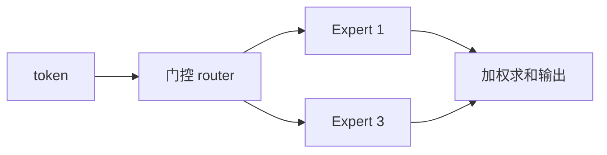

# MoE 是什么

> 从 Bit 到 AGI · 第七章：训练 · 混合专家：大参数量、小激活算力

MoE（Mixture of Experts，混合专家）把 Transformer 的 FFN 层换成**多个并行专家网络**，每 token 只激活其中 **top-k 个**（通常 k=2）。总参数量可达 **数百 B 甚至 T 级**，但每次 forward 只算 **~1/k 的 FFN 参数**——用「稀疏激活」换容量。

Mixtral 8×7B、DeepSeek-V3 / V4、Qwen3-MoE、Kimi K3、Llama 4 等主流大模型都采用 MoE 架构（关于前沿 MoE 架构的细粒度路由与专家并行剖析，另见[《AI 大模型解构》](https://daiw.org/manual/llm-anatomy)、[《DeepSeek V4.1 Flash 深度解析》](https://daiw.org/manual/deepseek-v4-flash)与[《Kimi K3 深度解析》](https://daiw.org/manual/kimi-k3)）。

## 直觉：医院分科，不是每个病人看全部医生

稠密 70B 模型像**每位病人跑遍全院所有科室**——贵但简单。

MoE 像**导诊台**：根据症状把病人分给 2 位专科医生（top-2 experts）。医院有 8 个科室（8 experts），但每人只看 2 个——总「编制」大，实际忙的人少。

## 定义

对 hidden state $h$，router 输出 logits $g(h) \in \mathbb{R}^E$（$E$ 个专家），取 top-k：

$$
\text{MoE}(h) = \sum_{i \in \text{TopK}(g(h))} \text{softmax}(g(h))_i \cdot \text{Expert}_i(h)
$$

| 符号 | Mixtral 8×7B 示例 | DeepSeek-V3 示例 |
| --- | --- | --- |
| 总参数 | ~47B（8×7B 专家 + 共享） | ~671B |
| 激活参数 | ~13B / token | ~37B / token |
| 专家数 E | 8 | 256+ |
| top-k | 2 | 8 |

## 例子 1：训练 token 与算力

MoE **训练**仍要更新全部专家权重（所有专家都会收到 token，只是不同 batch 不同专家忙）。

**Mixtral 8×7B 预训练**（公开量级）：

| 项 | 数值 |
| --- | --- |
| 训练 token | ~6T |
| 激活参数 | ~13B |
| 训练 FLOPs（按激活算 forward） | ≈ 6 × 13×10⁹ × 6×10¹² ≈ 4.7×10²² |
| 对比稠密 47B 全激活 | 省 ~3.6× forward 算力 |
| 512× H100，~2 个月量级 | 与官方训练周期同阶 |

存储：47B × 2 byte（BF16）≈ **94 GB** 权重；8×80GB 卡需 **张量并行 + 专家并行**。

## 例子 2：负载均衡 auxiliary loss

若 router 总选 Expert 0，其余专家**饿死**（training instability）。加负载均衡损失：

$$
\mathcal{L}_{\text{aux}} = \alpha \cdot E \sum_{i=1}^{E} f_i \cdot P_i
$$

$f_i$ = batch 中分给专家 $i$ 的 token 比例，$P_i$ = router 对专家 $i$ 的平均概率。DeepSeek 还用 **aux-loss-free** 路由等改进。

| 无 aux loss | 有 aux loss |
| --- | --- |
| 1–2 专家承担 80% token | 各专家 ~12.5%（8 专家） |
| 验证 loss 震荡 | 更稳定 |

## 量化：MoE vs 稠密

| 模型 | 总参数 | 激活参数 | 1T token 训练 GPU·小时（粗算） |
| --- | --- | --- | --- |
| Llama 2 70B 稠密 | 70B | 70B | ~290k |
| Mixtral 8×7B | 47B | 13B | ~54k（按激活） |
| 7B 稠密 | 7B | 7B | ~29k |

MoE **推理**也按激活参数计费——部署 Mixtral 像部署 **~13B**，不是 47B。

## 深入：路由与部署

Router 通常是一个小线性层：hidden 向量映射到 $E$ 维 logits，再 softmax 取 top-k。DeepSeek-V3 把专家数推到 **256+**，top-k=8，意味着每个 token 同时咨询 8 位「专科医生」，表达能力远超 top-2 的 Mixtral，但 **all-to-all 通信**也更重——256 专家若跨 64 张 GPU，每个 token 的激活要在卡间跳转，网络带宽成为训练瓶颈之一。

推理部署时，常见三种模式：**(1) 全专家加载**——单节点多卡用 Expert Parallel 分片，延迟低但机器数固定；**(2) 动态卸载**——只把热门专家放 GPU，冷门放 CPU/NVMe，适合边缘；**(3) 蒸馏成稠密**——见 [蒸馏](/manual/llm/bit-to-agi/07-training/distillation)，把 MoE 能力压进 7B 稠密，牺牲一点上限换简单运维。若你的 SLA 是「首 token 低于 200ms」，Mixtral 级 MoE 在 8×A100 上 batch=1 时吞吐接近 **13B 稠密的 1.2–1.5×**，而非 47B 的 3×——路由与通信有固定开销。

训练 MoE 时，**token 计数方式不变**：仍按所有 token 累加，只是每个 token 只更新被激活的专家子集。若 8 专家 top-2，每个专家平均收到 **25% token**（理想均衡下），单专家见到的 token 数约为总量的 **1/4**；负载不均时某些专家可能见到 **40%+**，另一些 **低于 5%**，后者几乎不学习，前者过拟合——这就是 aux loss 存在的理由。规划 6T token 的 MoE 预训练时，除 FLOPs 外还要预算 **比稠密多 20–40% 的 wall-clock**，用于 all-to-all 与 checkpoint（47B 权重 + 优化器状态可能 **>200 GB/shard**）。

## 常见误区

1. **「MoE 总参数 = 需要的显存」** — 推理/load 常需加载**全部专家**（除非 EP 分片到多机）。
2. **「MoE 训练一定更便宜」** — 通信（all-to-all）、负载均衡、checkpoint 更大；工程复杂度更高。
3. **「专家越多越强」** — 路由噪声、专家退化；需与 top-k、aux loss 联调。

## 小结

MoE = **多专家 FFN + top-k 路由**；总参数大、激活参数小。Mixtral 8×7B 在 **6T token** 上训练，有效算力接近 **13B 稠密 × 6T**。适合在固定推理预算下追求更高容量。

下一篇：[LoRA 是什么](/manual/llm/bit-to-agi/07-training/what-is-lora)——只训低秩适配器，单卡微调大模型。

## 延伸：MoE 与稠密的选择题

选型口诀：**推理预算固定、要更大容量** → MoE；**训练/运维要简单** → 稠密。7B 稠密训 1T **~29k GPU·h** 已是成熟路径；Mixtral 8×7B 训 6T 激活等价 **~13B×6T**，forward 省但 **总训练 token 更多**、系统更复杂。中小团队 **不要** 从零训 MoE——加载 47B 专家、调试 all-to-all 的门槛远高于 7B 稠密。更现实：用 **开源 MoE 基座**（Mixtral、DeepSeek）做 [LoRA SFT](/manual/llm/bit-to-agi/07-training/what-is-lora) **~10 GPU·小时**。MoE 时代「总参数量」用于 marketing，「激活参数量」用于 **算力与延迟估算**——读论文务必两栏都看。
