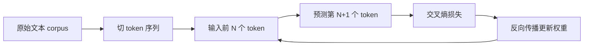

# 预训练是什么

> 从 Bit 到 AGI · 第七章：训练 · 用海量文本预测下一个 token，把随机权重变成语言模型

预训练（Pretraining）是大语言模型的**第一阶段**：在未经标注的互联网文本上，让模型反复做「猜下一个词」的练习，直到权重里编码了语法、事实与推理模式。ChatGPT 能对话之前，它首先是一个只会续写句子的预训练模型。

## 直觉：读完整座图书馆再考试

想象你要培养一个助手：先给他**无标注**的百万本书，规则只有一条——每次遮住最后一个字，让他猜。猜错了就微调记忆，猜对了就强化。不需要老师逐句批改「对错」，因为**正确答案就是原文里下一个字**。

这就是自监督（Self-supervised）学习：标签来自数据本身，不需要人工标注。



## 定义

**预训练**：在大规模无标注语料上，最小化下一 token 预测损失：

$$
\mathcal{L}_{\text{pretrain}} = -\sum_{t=1}^{T} \log P_\theta(x_t \mid x_{<t})
$$

其中 $x_t$ 是第 $t$ 个 token，$x_{<t}$ 是之前的上下文，$\theta$ 是模型全部参数（通常数十亿到数千亿）。

| 概念 | 含义 |
| --- | --- |
| 语料（corpus） | 网页、书籍、代码、论文等混合文本 |
| token | 第 6 章学过的子词单元；训练按 token 计数 |
| epoch | 完整扫一遍语料；现代 LLM 往往不到 1 epoch |
| 计算预算 | 通常用 **总 token 数 × 参数量** 估算 FLOPs |

## 例子 1：7B 模型要多少 token？

Chinchilla 论文（2022）给出经验法则：最优 token 数约为 **20 × 参数量**。

| 模型规模 | 参数量 | Chinchilla 建议 token | 业界常见实际 token |
| --- | --- | --- | --- |
| 小模型 | 7B（70 亿） | ~140B（1400 亿） | 1T–2T（过度训练） |
| 中模型 | 70B | ~1.4T | 2T+ |
| 大模型 | 405B | ~8T | 15T+ |

**例**：Llama 3 8B 在约 **15T token** 上预训练——是 Chinchilla 建议的 100 倍以上。过度训练（over-training）用更多算力换更好推理，在推理成本固定的时代很常见。

## 例子 2：GPU·小时与账单

粗算训练 FLOPs（Forward + Backward ≈ **6 × 参数量 × token 数**）：

$$
\text{FLOPs} \approx 6 \times N_{\text{params}} \times N_{\text{tokens}}
$$

7B 模型、1T token：

$$
6 \times 7 \times 10^9 \times 10^{12} \approx 4.2 \times 10^{22} \text{ FLOPs}
$$

单张 H100（BF16 峰值 ~990 TFLOPS，利用率 ~40%）有效算力约 **400 TFLOPS**：

$$
\frac{4.2 \times 10^{22}}{4 \times 10^{14}} \approx 1.05 \times 10^8 \text{ 秒} \approx 29{,}000 \text{ GPU·小时}
$$

用 **512 张 H100** 并行、效率 50%：约 **57 GPU·天**（约 2 个月）。按 H100 云价 ~\$2/GPU·小时粗算：**~\$58,000** 仅算力（不含存储、网络、人力）。

::: info

真实集群还有通信开销、checkpoint 写入、故障重启；实际账单通常是粗算的 **1.5–3 倍**。

:::

## 量化：数据从哪来、占多少空间

| 数据源 | 占比（典型） | 1T token 约合 |
| --- | --- | --- |
| 网页（Common Crawl 等） | 60–80% | ~2–4 TB 原始文本 |
| 书籍 / 论文 | 5–15% | 需授权，质量高 |
| 代码（GitHub 等） | 5–20% | 提升编程能力 |
| 多语言 | 视目标市场 | 中文 1 token ≈ 1.5–2 汉字 |

1T token 的 **JSONL 训练集**（每行 `{ "text": "..." }`）压缩后约 **500 GB–1 TB**；加上多份副本与 checkpoint，存储预算按 **10–50 TB** 规划更安全。

## 深入：数据清洗与 dedup 的算力杠杆

预训练 bill 里有一大块是 **「扫过垃圾 token」**。Common Crawl 原始网页经 MinHash dedup 可去掉 **30–50% 近重复**；质量分类器（fastText / 小 LM perplexity 过滤）再去掉低质页，最终 **可用率常仅 5–15%**。这意味着：若不洗数据直接训 10T token，等价于把 **85% GPU·小时** 花在重复段落、导航栏、Cookie 提示上——7B 规模 **10T 无效扫盘 ≈ 290k GPU·小时** 里可能有 **24 万小时** 是浪费。

工业管线（FineWeb、DCLM）把 **数据工程** 与 **mix 设计** 并列：洗出 1.5T 高质量 token 再训，往往胜过 3T 未洗。dedup 本身也耗 CPU·小时，但相对 GPU 预训练 **便宜几个数量级**——通常 **低于 1% 预训练算力** 换 **10–20% 有效 token 密度**，ROI 极高。

Scaling law 还提示：**同样 compute budget**，较小模型 + 更多 token 有时更强（Chinchilla）。预训练立项时要同时画两条曲线——参数量 vs token 数 vs 预期 MMLU——而不是只追「参数越大越好」。1T token × 7B 约 **29k GPU·小时** 是 baseline；若预算翻倍到 2T token 而非换 14B，7B 的最终 PPL 可能再降 **0.2–0.3**，MMLU **+2–4 pt**，这是许多开源 7B 选择 **over-train** 的原因。

## 动手试一试：感受 loss 下降

```python
import torch
import torch.nn.functional as F

# 玩具：3 层、 vocab=1000、序列长 128
vocab, dim, seq = 1000, 256, 128
embed = torch.nn.Embedding(vocab, dim)
head = torch.nn.Linear(dim, vocab)
opt = torch.optim.AdamW(list(embed.parameters()) + list(head.parameters()), lr=3e-4)

for step in range(200):
    x = torch.randint(0, vocab, (32, seq))  # batch=32
    h = embed(x[:, :-1])                     # 输入前 seq-1 个
    logits = head(h)
    loss = F.cross_entropy(
        logits.reshape(-1, vocab),
        x[:, 1:].reshape(-1),                # 预测下一个
    )
    opt.zero_grad()
    loss.backward()
    opt.step()
    if step % 50 == 0:
        print(f"step {step:3d}  loss={loss.item():.3f}  perplexity≈{torch.exp(loss).item():.1f}")
```

真实 LLM 的 loss 从 ~10（随机）降到 ~2（强模型），对应 perplexity 从 ~22,000 降到 ~7。

## 常见误区

1. **「预训练 = 已经对齐、能聊天」** — 预训练模型只会续写，可能输出有害或不相关内容；[SFT](/manual/llm/bit-to-agi/07-training/what-is-sft) 和 [对齐](/manual/llm/bit-to-agi/07-training/alignment-overview) 在后头。
2. **「epoch 越多越好」** — 重复同一语料会过拟合；现代做法是一次性喂入足够多**不重复** token。
3. **「参数量越大越好」** — 同样 token 预算下，小模型多训 token 可能更强（Chinchilla 结论）。

## 小结

预训练用 **下一 token 预测** 把随机权重变成「懂语言」的基座；成本主要由 **token 总数 × 参数量** 决定。7B + 1T token 量级约 **3 万 GPU·小时**；工业界往往用更大集群缩短日历时间。

下一篇：[SFT 是什么](/manual/llm/bit-to-agi/07-training/what-is-sft)——如何把「续写机器」教成「听指令的助手」。

## 延伸：Token 与参数的 Chinchilla 表

| 参数量 | Chinchilla 最优 token | 过度训练常见 token |
| --- | --- | --- |
| 1B | ~20B | 200B–500B |
| 7B | ~140B | 1T–2T |
| 70B | ~1.4T | 2T+ |

「过度训练」用 **更多 token 换更低 PPL**，推理成本（参数量）不变。7B 从 140B 训到 1T，多 **860B token**，多 **~25k GPU·小时**——是否值得看产品是否需 **最后一 mile 推理能力**（MATH、代码）。小团队 **不买账训 7B×1T**，直接用 Meta/Llama 等 **已 over-train** 的基座，把 **低于 100 GPU·小时** 全投 SFT+DPO，是理性分工。

把 GPU·小时换成美元便于立项：H100 **\$2/GPU·h**、A100 **\$1.5/GPU·h** 是常见云价量级。7B×1T 预训练 **29k GPU·h × \$2 ≈ \$58k** 仅算力；加存储（**10–50 TB**）、工程师与失败重跑，总预算常 **×2–3**。自建集群 amortize 后可能 **\$0.5–1/GPU·h**，但 CapEx 高。token 单价 = 总美元 / 总 token：上述例 **\$58k / 1T ≈ \$0.000058/token**——这是「造模型」成本；推理单价是另一张账（第八章）。Chinchilla 还指出：同样 **\$58k**，把参数减半、token 加倍，有时 val loss 更低——预训练不是「参数越大越好」，而是 **参数量与 token 在算力约束下联合最优**。
