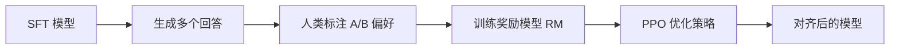

# RLHF 是什么

> 从 Bit 到 AGI · 第七章：训练 · 用人类反馈强化学习，让模型更符合偏好

RLHF（Reinforcement Learning from Human Feedback，基于人类反馈的强化学习）在 SFT 之后，用**人类对两个回答的偏好**（「A 比 B 好」）训练一个奖励模型，再用强化学习让策略模型生成**高奖励**的回答。ChatGPT、Claude 早期版本的对齐流水线，RLHF 是核心环节之一。

## 直觉：从「会答题」到「答得讨喜」

SFT 教模型「标准答案长什么样」，但很多问题**没有唯一标准答案**：

- 解释量子力学：要严谨还是通俗？
- 写邮件：正式还是亲切？

人类评委对同一问题的两个回答投票，系统学到「哪种风格更受欢迎」。然后像训练围棋 AI 一样，**奖励好的续写、惩罚差的**——这就是 RLHF。



## 定义

RLHF 经典三阶段（InstructGPT / Ouyang et al., 2022）：

1. **SFT**：监督微调（上一篇）
2. **RM 训练**：在偏好对 $(x, y_w, y_l)$ 上优化（$y_w$ 胜、$y_l$ 负）：

$$
\mathcal{L}_{\text{RM}} = -\log \sigma\big(r_\phi(x, y_w) - r_\phi(x, y_l)\big)
$$

3. **RL 微调**：用 PPO 最大化奖励，同时用 KL 惩罚防止偏离 SFT 太远：

$$
\max_\theta \; \mathbb{E}\big[r_\phi(x, y) - \beta \cdot D_{\text{KL}}(\pi_\theta \| \pi_{\text{SFT}})\big]
$$

## 例子 1：偏好数据规模

| 项目 | 偏好对数量 | 约合 token | 标注成本粗算 |
| --- | --- | --- | --- |
| InstructGPT | ~33k 对比 | ~500M | 数十万 USD |
| Llama 2 | ~1M+ 对比 | ~2B | 百万 USD 级 |
| 小型开源复现 | 10k–50k | ~50M | 1–5 万 USD |

每条偏好：同一 prompt 下两个回答，标注者选更好者。平均每条 **~500–2000 token**（含 prompt 与双回答）。

## 例子 2：PPO 阶段的 GPU·小时

**场景**：7B SFT 模型，PPO 训练 **200M token** rollout；4× A100；奖励模型 7B（已训好）。

| 阶段 | GPU·小时（粗算） |
| --- | --- |
| RM 训练（100k 对，3 epoch） | ~80–150 |
| PPO（200M token，KL β=0.1） | ~300–600 |
| **合计** | **~400–750 GPU·小时** |

PPO 比 SFT **贵 5–20 倍**：每步要**生成**完整回答（自回归解码）、算 RM 分数、再反向传播；且需维护 reference model、critic 等副本，显存开销大。

对比：同样 7B 的 [DPO](/manual/llm/bit-to-agi/07-training/what-is-dpo) 200M token 往往 **低于 100 GPU·小时**。

## 量化：KL 惩罚为什么重要

无 KL 约束时，模型会**讨好奖励模型**（reward hacking）——输出 RM 喜欢但人类觉得怪的文本（冗长、特定格式刷分）。

| β（KL 系数） | 行为 |
| --- | --- |
| 0 | 极易 hack RM，偏离 SFT |
| 0.01–0.1 | 常用区间，平衡对齐与能力 |
| >0.5 | 几乎不动，对齐效果弱 |

InstructGPT 报告 β≈0.02 时，在 helpful/harmless 上提升明显，**下游任务掉点**控制在几个百分点内。

## 深入：PPO 四模型与标注流水线

RLHF 的工程复杂度大半在 **系统而非公式**：PPO 每 iteration 要 (1) policy 生成 rollout；(2) RM 打分；(3) 算 advantage + KL；(4) PPO clip 更新 policy；(5) 可选更新 critic。7B 规模四模型同驻，即使用 ZeRO 也要 **至少 4–8 张 80GB 卡** 才能 comfortable batch。200M token rollout 在 4×A100 上 **wall-clock 2–4 天** 并不少见——团队日历成本常超过 **600 GPU·小时** 的美元账单。

人类偏好标注是另一大头：33k 对 InstructGPT 级数据，外包标注 **\$1–3/对** 量级，合计 **5–10 万美元**；百万对则 **百万美元**。因此工业界转向 **RLAIF**（AI 标注偏好）与 [DPO](/manual/llm/bit-to-agi/07-training/what-is-dpo) 离线偏好。RLHF 仍适合 **在线探索**——例如需要 model 自己试工具调用、从环境拿反馈，而不仅是静态 A/B 文本。

若你必须 RLHF，**缩小 RM 与 critic**（3B）可省 **30–40% PPO GPU·小时**，代价是 RM pair acc 降 3–5 pt，PPO 更容易 hack。务必保留 **SFT reference** 做 KL：β=0.02 时，policy 与 ref 的 per-token KL 应维持在 **0.01–0.05 nats** 区间；KL 突然跌到 0.001 以下说明策略已偏离 ref 太远，即将出现质量 cliff。

## 动手试一试：Bradley-Terry 偏好损失

```python
import torch
import torch.nn.functional as F

def preference_loss(reward_chosen, reward_rejected):
    """RM 训练核心：chosen 得分应高于 rejected"""
    return -F.logsigmoid(reward_chosen - reward_rejected).mean()

# 模拟 batch=8 的偏好对
chosen = torch.randn(8) * 0.5 + 1.0   # 胜方 reward
rejected = torch.randn(8) * 0.5 + 0.0 # 负方 reward
loss = preference_loss(chosen, rejected)
acc = (chosen > rejected).float().mean()
print(f"RM loss={loss.item():.4f}  pair accuracy={acc.item():.2%}")
```

## 常见误区

1. **「RLHF = 安全对齐的全部」** — 安全还依赖红队、规则过滤、SFT 拒答样本；RLHF 主要优化**偏好**。
2. **「RLHF 一定比 SFT 强」** — 任务型 benchmark（MMLU）可能略降；**人类偏好评测**才升。
3. **「可以跳过 RM 直接 PPO」** — 需要可微标量奖励；纯规则奖励很难覆盖开放对话。

## 小结

RLHF = **SFT → 训奖励模型 → PPO 强化学习**；偏好数据约 **10万–100万对**，PPO 阶段 7B 模型约 **400–750 GPU·小时**。效果好但工程复杂，催生了 DPO 等简化方案。

下一篇：[DPO 是什么](/manual/llm/bit-to-agi/07-training/what-is-dpo)——不用 PPO 也能做偏好对齐。

## 延伸：RM 数据与 PPO clip

RM 质量天花板决定 RLHF 上限：偏好对若 **噪声 >30%**（随机标注），RM pair acc **~60%**，PPO 200M token **~500 GPU·小时** 可能几乎无 MT-Bench 增益。清洗偏好对（consensus 标注、过滤 tie、去 duplicate prompt）ROI 高于盲目加 PPO step。PPO 的 **clip ε=0.2** 限制 policy 单步更新幅度，防止一次 rollout 带偏整个模型——与 KL 互补。调参时若 human eval 无升但 RM reward 狂升，几乎必是 **hack RM**；应回滚 SFT checkpoint 降 β 或换 RM 架构（pairwise → listwise）。工业界 increasingly 用 **DPO/IPO/KTO** 替代 PPO，RLHF 三阶段仍是理解现代对齐的「历史参照系」。
