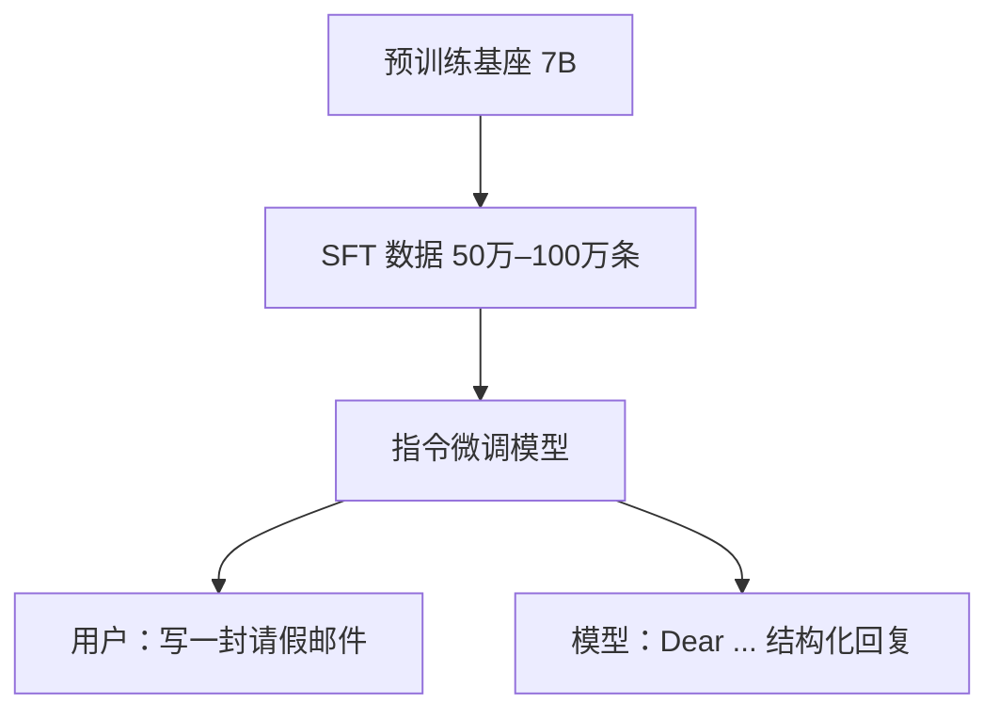

# SFT 是什么

> 从 Bit 到 AGI · 第七章：训练 · 监督微调：用指令-回答对把预训练模型变成助手

SFT（Supervised Fine-Tuning，监督微调）是预训练之后的**第一站**：用人工整理或合成的「指令 → 理想回答」样本，教模型**按用户意图回答**，而不是无脑续写网页段落。你日常用的 ChatGPT「基础版」，核心能力就来自 SFT。

## 直觉：从「自动补全」到「听人话」

预训练模型像读过整座图书馆的学者：你丢一句「法国的首都是」，他可能续写成「法国的首都是巴黎，位于塞纳河畔……」——没错，但不像对话。

SFT 相当于给他 **10 万道带标准答案的口试**：「用户问 X，你应该答 Y」。练多了，见到「请用三句话总结……」就知道该**直接作答**，而非接着编新闻导语。



## 定义

**SFT**：在数据集 $\mathcal{D} = \{(x_i, y_i)\}$ 上最小化条件语言建模损失，通常**只对回答部分 $y$ 计算 loss**（prompt $x$ 部分 mask 掉）：

$$
\mathcal{L}_{\text{SFT}} = -\sum_{(x,y) \in \mathcal{D}} \sum_{t} \log P_\theta(y_t \mid x, y_{<t})
$$

与预训练的区别：

| 维度 | 预训练 | SFT |
| --- | --- | --- |
| 数据 | 无标注 raw text | 指令-回答对、对话 |
| 规模 | T（万亿）token | M（百万–十亿）token |
| 目标 | 通用语言建模 | 遵循格式、语气、任务 |
| 算力 | 集群 × 周–月 | 8 GPU × 小时–天 |

## 例子 1：一条 SFT 样本长什么样

```json
{
  "messages": [
    {"role": "user", "content": "把下面句子改成正式语气：咱明天碰个面？"},
    {"role": "assistant", "content": "我们明天是否方便见面？"}
  ]
}
```

token 统计（Llama 3 tokenizer 量级）：

| 字段 | token 数 |
| --- | --- |
| user 部分 | ~25 |
| assistant 部分 | ~15 |
| **有效训练 token**（仅 assistant） | **~15** |

50 万条类似样本 → 有效训练 token 约 **750 万–1500 万**（远小于预训练的 T 级）。

## 例子 2：GPU·小时估算

**场景**：7B 基座，100 万条对话，平均每条 512 token（prompt+回答），共 **512M token**；8× A100 80GB，全局 batch=128，序列长 4096。

| 项 | 数值 |
| --- | --- |
| 总 token | 5.12 × 10⁸ |
| 训练 FLOPs（≈ 6N×tokens） | 6 × 7×10⁹ × 5.12×10⁸ ≈ 2.15×10¹⁹ |
| 单 A100 有效 ~150 TFLOPS | ~4×10⁵ 秒/GPU ≈ **111 GPU·小时** |
| 8 卡并行 | **~14 GPU·小时**（约 2 小时墙钟） |

全参数 SFT 7B 在 8×A100 上 **2–8 小时** 是常见区间；数据更多或 epoch 更多则线性增加。

LoRA 版（见 [LoRA](/manual/llm/bit-to-agi/07-training/what-is-lora)）同样数据量可在 **单卡 4–12 GPU·小时** 完成。

## 量化：数据质量 vs 数量

| 策略 | 样本量 | 效果 |
| --- | --- | --- |
| 纯人工标注 | 1万–10万 | 质量高，贵（~\$1–5/条） |
| 合成数据（强模型生成） | 100万+ | 便宜，需过滤 |
| 混合（LIMA 论文） | **1000 条精选** | 证明「少而精」也可行 |

LIMA（Less Is More for Alignment）用 **1000 条**精心策划的 SFT 样本，7B 模型已展现不错指令跟随——说明**分布与多样性**比单纯堆量更重要。

## 深入：epoch、packing 与多轮格式

SFT 常被问「训几个 epoch？」——没有 universal 答案，要看 **有效 token 与重复度**。Alpaca 52k × 3 epoch ≈ 40M token，对 7B 往往 **刚好**；同一数据 10 epoch 可能过拟合，loss 低于0.8 但 MT-Bench 反降。更稳的做法是 **大去重数据集 1–2 epoch**（如 OpenHermes 1M 条 1 epoch ≈ 800M token，**~80 GPU·小时** LoRA）。

**Sequence packing** 把多条短对话拼进同一 4096 上下文，用 attention mask 隔离，可让 **GPU 利用率从 40% 提到 75%**，等效 **1.5–2× 吞吐**——同样 100M token，packing 后 wall-clock 从 **25 GPU·小时** 降到 **~15**。FlashAttention 2 + packing 已是 HF SFTTrainer 标配。

Chat template 必须与推理一致：Llama 3 的 special token 若训练时写错，推理时模型 **无视指令**。SFT 前用 `apply_chat_template` 统一格式，并在 100 条 gold 样本上 **decode 肉眼检查**——这类 bug 会浪费整次 **6–10 GPU·小时** LoRA run。多轮对话 SFT 要决定 **是否只对最后一轮 assistant 算 loss**；全轮 loss 强化中间轮格式，适合客服；只最后一轮适合「用户多轮澄清」产品形态。

## 动手试一试：只对 label 算 loss

```python
import torch
import torch.nn.functional as F

def sft_loss(logits, labels, prompt_len=10):
    """
    logits: [batch, seq, vocab]
    labels: [batch, seq]，prompt 位置设为 -100（ignore_index）
    """
    labels = labels.clone()
    labels[:, :prompt_len] = -100  # mask prompt
    return F.cross_entropy(
        logits[:, :-1].reshape(-1, logits.size(-1)),
        labels[:, 1:].reshape(-1),
        ignore_index=-100,
    )

batch, seq, vocab = 4, 32, 1000
logits = torch.randn(batch, seq, vocab)
labels = torch.randint(0, vocab, (batch, seq))
loss = sft_loss(logits, labels, prompt_len=12)
print(f"SFT loss (prompt masked): {loss.item():.3f}")
```

Hugging Face `Trainer` 的 `DataCollatorForCompletionOnlyLM` 做的就是这件事。

## 常见误区

1. **「SFT 数据越多越好」** — 低质重复样本会导致**模式坍塌**（千篇一律的「作为 AI 语言模型……」）。
2. **「SFT 能替代预训练」** — 没有预训练基座，SFT 教不会世界知识与推理。
3. **「SFT 就是对齐终点」** — 有害请求拒绝、偏好排序还需 [RLHF/DPO](/manual/llm/bit-to-agi/07-training/what-is-rlhf)。

## 小结

SFT 用 **百万级 token、个位数 GPU·天** 把预训练模型变成指令助手；关键是高质量指令-回答对与 **只对回答算 loss**。成本通常比预训练低 **3–4 个数量级**。

下一篇：[RLHF 是什么](/manual/llm/bit-to-agi/07-training/what-is-rlhf)——如何用人类偏好进一步打磨回答风格与安全边界。

## 延伸：SFT 与预训练的能力边界

SFT **不能**教会模型预训练没见过的语言（如新造语言）、也没见过的 **大规模事实**（2025 年新闻）——除非把这些写进 SFT 数据。SFT 擅长 **格式、语气、任务模板**；世界知识主要来自 PT。因此领域项目常做 **continue pretrain（CPT）** 200B–500B domain token（法律、医疗），再 SFT 50M——CPT **~6k–15k GPU·小时（7B）**，比从零 PT 1T 便宜，比纯 SFT 更能注入术语。CPT+SFT 总 token 仍远小于 PT，却是企业落地常见路径。评估 CPT 时看 **领域 benchmark** 而非仅 MMLU：法律看 LexGLUE，医疗看 PubMedQA。
