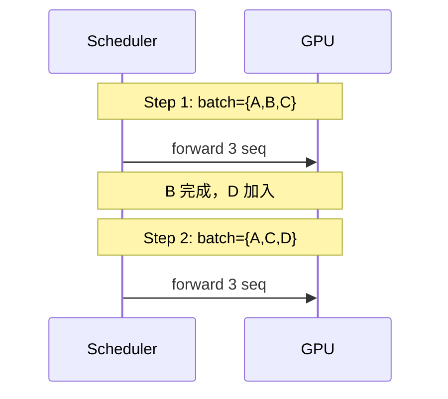

# Continuous Batching

> 从 Bit 到 AGI · 第八章：推理（Inference） · 迭代级动态批处理

静态批处理必须等 batch 里**最长**的请求生成完毕才能释放 slot，短请求白白占着 GPU。Continuous Batching（也叫 iteration-level scheduling）在 **每个 decode 步** 把已结束的序列踢出、把新请求塞进来——GPU 几乎总在算「当前还活着」的那些 token。

## 直觉

传统批处理像一趟公交：必须等最慢的乘客坐满 40 分钟才发车下一班。Continuous Batching 像地铁：**每到一站就上人下人**，车始终满负荷跑。对 LLM 服务，一个 decode 步 ≈ 一站，batch 组成每步都变。



## 定义

- **Static batching**：$N$ 条请求绑定成一个 batch，从 prefill 到全部 eos，**batch 大小固定为 $N$**。
- **Continuous batching**：维护 **最大并发数** $N_{\max}$；每 iteration：
  1. 收集所有 **未结束** 序列的「当前最后一个 token」
  2. 一次 forward（可含不同 prefill/decode 混合，见 chunked prefill）
  3. 采样 → 更新 KV；eos 的序列释放 slot → 新请求入队

关键指标：

| 指标 | 含义 |
| ---- | ---- |
| $N_{\max}$ | `max_num_seqs`，同时活跃序列上限 |
| TTFT | Time To First Token，排队 + prefill |
| ITL | Inter-Token Latency，decode 步间隔 |
| 吞吐 | 全机 **tokens/s**（所有用户合计） |

## 例子

**例 1：三条请求长度不一**

| 请求 | 生成长度 |
| ---- | -------- |
| A | 512 token |
| B | 32 token |
| C | 128 token |

Static batch（$N=3$）：GPU 有效算力浪费 $\approx (512-32)/512 \approx 94\%$ 的时间都在「陪 A 跑完」——对 B 而言延迟被拉长 **16×**。

Continuous：B 在第 32 步退出，slot 立刻给 D；GPU 每步 batch 内 token 数接近 $N_{\max}$，**吞吐 ↑，短请求延迟 ↓**。

### 自己看一下

「浪费 94% 的时间陪最长的跑完」是个时间轴上的形状，静态图只画得出一个时刻。下面并排跑 static 和 continuous，点「播放」看槽位怎么被占用：

<Batching />

灰格是 GPU 槽位在**空转**。左边 static：一批请求得等最长的那个跑完才整批换下一批，短请求早结束、槽位却占着空转（大片灰）。右边 continuous：每一步把空出来的槽位立刻塞新请求，几乎没有灰格。切「长尾负载」看差距最大——这就是 continuous batching 能把吞吐拉到 5~15 倍的来源。

**例 2：量化吞吐**

8B 模型、A100-80G、FP16、vLLM 类栈（PagedAttention + Continuous Batching）：

| 场景 | 近似吞吐 | 单用户 ITL |
| ---- | -------- | ---------- |
| batch=1 | 40～60 tok/s | 17～25 ms/tok |
| $N_{\max}=32$，混合负载 | 800～1500 tok/s | 25～45 ms/tok（随负载升） |
| $N_{\max}=64$，偏短输出 | 1500～2500 tok/s | 可能 > 50 ms/tok |

吞吐随并发 **近线性** 上升，直到 memory/compute 饱和；单用户 ITL 在 heavy load 下 **变差**——典型 **延迟–吞吐权衡**（见[延迟与吞吐](/manual/llm/bit-to-agi/08-inference/latency-vs-throughput)）。

**例 3：Prefill 与 Decode 混跑**

新请求入队需 **prefill**（整段 prompt，算力 $\propto s^2$）。若 decode 步被长 prefill 挡住，ITL 抖动。工程上常用 **chunked prefill**：把长 prompt 切成 256～512 token 块，与 decode 步交错——牺牲一点 TTFT 换 ITL 稳定。

```python
# 概念伪代码：每 decode iteration
active = [seq for seq in pool if not seq.done]
if len(active) < max_num_seqs and queue:
    active.append(queue.pop())  # 新请求 prefill 首块
batch_input = pack_last_tokens(active)  # 每 seq 1 token（或 prefill chunk）
logits = model.forward(batch_input, kv_caches=active)
for seq, logit in zip(active, logits):
    seq.append(sample(logit))
    if seq.is_eos():
        pool.release(seq)  # slot 归还
```

## 量化

- **GPU 利用率**：静态 batch 在线服务常 **10～30%**；Continuous + Paged 常 **60～85%**（视负载形状）。
- **调度开销**：CPU 侧 pack/unpack、块表更新，通常 **低于  1 ms/步**，相对 20 ms/tok 可忽略。
- **公平性**：纯 FCFS 下长请求占 slot 久；可加 **优先级、最大生成长度、抢占**（少见）。

::: warning

Continuous Batching 提高的是 **系统吞吐**，不降低单条序列的数学计算量。 overload 时 TTFT 与 ITL 都会上升——需要限流与 `max_num_seqs`。

:::

## 工程现场：调度器参数与排队论

vLLM / TGI 等服务的 **有效吞吐** 由 scheduler + 块池共同约束。常用旋钮：

| 参数 | 作用 | 调大后果 |
| ---- | ---- | -------- |
| `max_num_seqs` | 最大并发序列 | tok/s ↑，ITL ↑，TTFT 排队 ↑ |
| `max_num_batched_tokens` | 单步 token 上限 | 限制 prefill 峰值，保护 ITL |
| `gpu_memory_utilization` | KV 块池占比 | 并发 ↑，OOM 风险 ↑ |

**排队模型（粗）**：若到达率 $\lambda$ 条/秒，每条约需 $T$ 秒服务（prefill+decode），$N_{\max}$ 槽位。超载时 TTFT 含 **等待** $W$：Little 定律 $L = \lambda W$——并发占满后，新请求 **在队列里等**，用户觉得「首字慢」但监控里 GPU tok/s 仍高。

**Chunked Prefill 数值例**：prompt 2048 token，若一步 prefill 占 **200 ms**，期间所有 decode 步暂停 → ITL 抖动 **+200 ms**。切成 4×512 chunk，每 chunk ~50 ms，与 decode 交错 → ITL P99 更稳，TTFT 仅 **+0～50 ms**。

**与 Static Batch 的 A/B**：同样 16 路、平均输出 64 token、最大 512 token——Static 平均浪费 $(512-64)/512 \approx 87.5\%$ 槽位时间；Continuous 在短请求结束后 **立即补位**，实测 tok/s 常 **5～15×**（视负载形状），但 **单用户 ITL 在满载时升 30～80%** 不罕见。

**Preemption（抢占）**：部分研究栈支持 **长请求让位** 短请求——与 continuous batching **同属调度层**；生产 **少见**，但 **P99 ITL** 优化方向之一。

**Priority queue**：付费 tier **更高 priority** → TTFT **更低**——同一 GPU 池 **逻辑分区**，不是 **物理隔离**。

## 常见误区

1. **「batch 越大单用户越快」**——错；大 batch 提升 **总 tok/s**，单用户 ITL 往往 **增加**。
2. **「Continuous = 动态 batch size 训练」**——训练是梯度同步；这里是 **推理调度**，无 backward。
3. **「有 Continuous 就不需要排队」**——$N_{\max}$ 满后新请求仍排队，TTFT 含 **等待 + prefill**。

## 动手试一试

设：ITL = 30 ms/tok，$N_{\max}=16$，每序列平均 100 token。稳态吞吐 ≈ $16 / 0.03 \approx 533$ tok/s（理想下界）。若 static batch=16 且最短 10 token、最长 500 token，算 wasted slot 比例。

## 回顾与衔接

传统 **static batching** 来自训练思维：一个 batch 一起 forward、一起 backward、**一起结束**。推理没有 backward，且 **各用户生成长度随机**——static 的「等最慢那条」在 **长尾输出** 下浪费极大。[Continuous Batching](https://arxiv.org/abs/2203.15585)（Orca 论文）提出 **iteration-level scheduling**，成为 vLLM、TGI、TensorRT-LLM serving 的标配。

它与 [Paged Attention](/manual/llm/bit-to-agi/08-inference/paged-attention) 是 **孪生** 设计：分页提供 **细粒度 slot**（块级释放），continuous 提供 **细粒度时间调度**（步级进出）。缺一则要么 OOM，要么 GPU 空转。

读 [延迟与吞吐](/manual/llm/bit-to-agi/08-inference/latency-vs-throughput) 时记住：**Continuous 是吞吐杠杆**，不是单用户延迟杠杆——overload 时 TTFT 队列 + ITL 升 **同时发生**，需要 **限流与 autoscaling**（第十一章）。

## 读者问答

**问：Continuous Batching 和 dynamic batching 一样吗？**
训练里的 dynamic batching 指 **变长 padding**；推理 continuous 指 **步级进出序列**——**概念不同**。

**问：为什么满载时我觉得更卡？**
tok/s 高来自 **多路并行**；你的请求 **排队 + 共享 ITL 上升**——**正常权衡**，需 **限流或扩容**。

## 速查卡

|  knob | 拉高 → | 拉低 → |
| ----- | ------ | ------ |
| max_num_seqs | tok/s↑ ITL↑ | tok/s↓ ITL↓ |
| max_model_len | 单请求 ctx↑ OOM↑ | 更安全 |
| chunked prefill | ITL 稳 | TTFT 略↑ |

**一句话**：Continuous Batching 用 **步级调度** 换 **GPU 时间片利用率**，是 online serving 吞吐的 **默认答案**。

**容量规划**：`max_num_seqs` 不是越大越好——过大 **ITL P99 失控**；按 **SLA 反推** 并发上限，再 **水平加副本** 扩总 QPS。

Orca 与 vLLM 论文是本章调度思想的 **主要引用**；读源码时可对照 **Scheduler 类** 的 iteration 入口。建议 **压测时记录 ITL P99**。

## 小结

Continuous Batching 在每个 decode 步重组 batch，让 GPU 持续服务「活着的」序列，是在线 LLM 高吞吐的调度核心，与 PagedAttention 配套使用。下一篇讲单请求太慢时如何用 **Tensor Parallel** 拆层内计算。

→ 下一篇：[Tensor Parallel](/manual/llm/bit-to-agi/08-inference/tensor-parallel)
