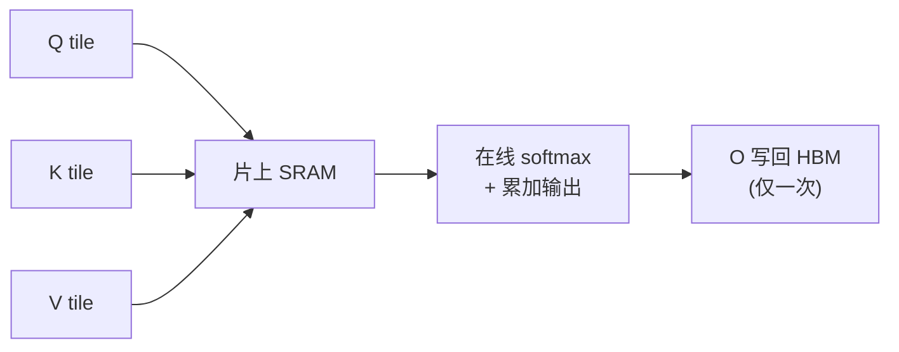

# Flash Attention

> 从 Bit 到 AGI · 第八章：推理（Inference） · IO 感知的 Attention 内核

标准 Attention 实现会把巨大的 $N \times N$ 注意力矩阵 materialize 到 HBM，读写量成为瓶颈。Flash Attention 通过 **分块（tiling）** 在 GPU 片上 SRAM 里完成 softmax，避免把完整矩阵写回显存——训练与 Prefill 阶段收益尤为显著。

## 直觉

你要给 1000 人两两配对打分， naive 做法把 100 万个分数全写在黑板上（HBM），每次算新一行还要反复读黑板。Flash Attention 像把黑板换成 **小白板（SRAM）**：每次只拿 64×64 的一小块人名算子块，算完只把 **必要的汇总统计** 写回，大块中间结果从不落地。

GPU 上 HBM 带宽 ~2 TB/s，SRAM（共享内存）~19 TB/s 量级，但 SRAM 只有 **几十～几百 KiB**。Flash Attention 的核心是 **在 SRAM 能装下的 tile 里完成 attention 流水线**。



## 定义

标准 attention（单头，序列长 $N$，头维 $d$）：

$$
\text{Attention}(Q,K,V) = \text{softmax}\left(\frac{QK^\top}{\sqrt{d}}\right) V
$$

**Naive HBM 访问量**（量级）：读写 $Q,K,V$ 各 $O(Nd)$，中间 $S \in \mathbb{R}^{N \times N}$ 读写 $O(N^2)$——当 $N$ 大时 $N^2$ 主导。

**FlashAttention**（v1/v2）：将 $Q,K,V$ 分成块大小 $B_r \times B_c$，在 SRAM 中：

1. 算局部 $S_{ij} = Q_i K_j^\top$
2. 用 **在线 softmax**（running max + running sum）合并块，无需存完整 $S$
3. 累加对 $V$ 的加权贡献

HBM 访问量降至 **$O(N^2 d^2 / M)$** 量级（$M$ 为 SRAM 容量），且 **无 $N \times N$ 中间矩阵**。

| 变体 | 场景 | 要点 |
| ---- | ---- | ---- |
| FlashAttention-1 | 训练 forward | 减少 HBM 读写 |
| FlashAttention-2 | 训练 forward | 更好的 warp 并行、更少非矩阵 op |
| FlashAttention-3 / 4 | Hopper (H100/H200) / Blackwell (B200) | 利用 TMA、FP8/FP4 与异步流水线 |
| Flash-Decoding | 自回归 decode | 对长 KV 分块并行读 K |

## 例子

**例 1：Prefill 2048 token，单头 $d=128$**

| 实现 | HBM 中间 $N \times N$ | 相对内存 |
| ---- | ----------------------- | -------- |
| Naive | $2048^2 \times 4$ B ≈ **16 MiB/头** | 32 头 ≈ **512 MiB** 一层 |
| Flash | **0**（不 materialize） | 仅 $Q,K,V,O$ 流 |

32 层堆叠时，naive 一层 prefill 就可能 **数 GiB** 临时 buffer；Flash 避免 OOM 并显著提速。

**例 2：Decode 一步（$N=8192$ 历史，1 新 token）**

- 新 Q 形状 $1 \times d$，需与 $8192$ 个 K 做点积 → 带宽 $\propto 8192 \times d$。
- Flash-Decoding：把 K/V **按块拆到多个 SM 并行归约**，提高 memory-bound 阶段的占用率。
- 实测（8B、A100、FP16、8K ctx）：Flash-Decoding 相对 naive decode attention 常有 **1.5～2.5×** 该算子加速（整模型端到端视 bound 而定）。

**例 3：与 Paged Attention 的关系**

| 层次 | 解决的问题 |
| ---- | ---------- |
| Flash Attention | **怎么算** attention（IO 最优 kernel） |
| Paged Attention | **怎么存** KV（块化、碎片） |

vLLM 等服务栈里二者 **叠加使用**：Paged KV 布局 + FlashAttention-2/3 兼容 kernel。

## 量化

- **Prefill FLOPs** 仍为 $O(N^2 d)$（数学没变）；Flash 改的是 **内存墙**，Prefill 在 $N \ge 2048$ 时常 **2～4×** 快于 naive PyTorch attention。
- **Decode**：单 token 时 FLOPs 小，**内存带宽**主导；Flash-Decoding 主要优化 **长上下文** 下的 attention 子步骤。
- **SRAM 需求**：块越大利用率越高，但需低于共享内存上限（通常 per-block 48～228 KiB 可配置）。

::: info

第五章 [Attention 的复杂度](/manual/llm/bit-to-agi/05-transformer/attention-complexity) 讲的是渐近阶数；Flash Attention 讲的是 **常数项：HBM 往返次数**，在 $N=32\text{k}$ 时常数项决定能否跑起来。

:::

## 深入理解：为什么 HBM 成为天花板

A100 80G 的 HBM 带宽约 **2 TB/s**，Tensor Core 峰值 **312 TFLOP/s（FP16）**。看似算力很强，但 **算术强度**（FLOPs / 字节）决定瓶颈在哪。

Attention 对 $N$ 个 token、头维 $d$：矩阵乘 $QK^\top$ 约 $2Nd^2$ FLOPs，但要读 $Q,K$ 各 $Nd$ 元素；若 naive 实现还把 $N×N$ 矩阵写 HBM，**字节/FLOP 比** 在 $N$ 大时偏向 **memory-bound**——算力闲置，内存总线在等数据。

Flash Attention 的 tiling 把 **中间态留在 SRAM**（单 block 几十～二百 KiB），HBM 只进出 $Q,K,V,O$ 的 tile，把 **有效带宽需求** 降下来。Prefill $N=4096$ 时，naive 可能额外读写 **512 MiB/层** 的 $S$ 矩阵；Flash **零** 这块——层数 32 就是 **数 GiB** 差距，直接决定能否 OOM。

**Decode 阶段** 单步 $N$ 大但只算 1 个 Q 向量：瓶颈几乎 **纯读 KV**。Flash-Decoding 把 K/V 按块分到多个 SM 并行做点积归约，提高 occupancy；8K ctx 下 attention 子步骤常有 **1.5～2.5×** 加速，但整步 ITL 还含 FFN、LM head、采样——端到端可能只 **10～20%** 改善，除非 ctx 极长。

| 序列长 $N$ | Prefill 主导问题 | Flash 收益 |
| ---------- | ---------------- | ---------- |
| < 512 | 算力 + 启动 | 中等 |
| 512～4096 | HBM 中间矩阵 | 高 |
| > 8192 | KV 读带宽 | Flash-Decoding 中等 |

**Hopper FP8 FlashAttention-3**：H100 **FP8 Tensor Core** + TMA **异步搬 tile**——Prefill **进一步 1.3～1.8×**（相对 FA2，视 $N$）；需 **Hopper + 新 CUDA**。

**Ring Attention / Sequence Parallel**：超长 ctx **训练** 把序列 **切分到多卡**；推理 **长 ctx prefill** 有 **类似** 思路——与 **单卡 Flash** 不同 **多卡** 路径。

## 常见误区

1. **「Flash Attention 降低 Big-O」**——渐近仍是 $O(N^2)$；省的是 **HBM IO** 和 **峰值显存**。
2. **「推理全靠 Flash」**——短 prompt decode 瓶颈常在 **全连接层、采样、通信**；Flash 对 **长 Prefill / 长 ctx attention** 最明显。
3. **「Flash = Paged」**——名字都带 attention，一个管 **计算**，一个管 **KV 布局**，别混为一谈。

## 动手试一试

```python
# 概念：在线 softmax 合并两个块（数值稳定）
import math

def merge_softmax_stats(m1, l1, m2, l2):
    """m=max, l=sum exp(x-m) 的 running 统计"""
    m_new = max(m1, m2)
    l_new = math.exp(m1 - m_new) * l1 + math.exp(m2 - m_new) * l2
    return m_new, l_new

# 块1: max=2, 块2: max=5 → 全局 max=5，再合并 exp 和
print(merge_softmax_stats(2.0, 3.0, 5.0, 1.0))
```

理解「分块也能得到与全局 softmax 相同结果」，就抓住了 Flash 的数学核心。

## 回顾与衔接

第五章 [Attention 的复杂度](/manual/llm/bit-to-agi/05-transformer/attention-complexity) 给出 $O(N^2 d)$ FLOPs；Flash 解决的是 **同样 FLOPs 下 HBM 往返太多** 的 **roofline 下方** 问题。GPU 有 **compute roof** 与 **bandwidth roof**；attention 在大 $N$ 时常 **顶带宽顶** 而非顶算力——profile 里看到 SM **空闲但 HBM 100%** 就是典型信号。

训练 backward 还要存 $S$ 矩阵或重算；FlashAttention-2 对 forward/backward 都 IO 友好。**推理 decode** 只有 forward，但 **读 KV** 的带宽压力随 ctx 线性增——[Flash-Decoding](https://arxiv.org/abs/2307.08691) 专门拆 long-KV 的 parallel reduction。

若你只用 **PyTorch SDPA**（`scaled_dot_product_attention`），在 CUDA 上常 **自动 dispatch** 到 Flash/Memory-efficient 内核——但 **Paged KV 布局** 仍需 vLLM/SGLang 等专用栈，不能单靠 `nn.functional`。

## 读者问答

**问：PyTorch 2.0 SDPA 等于 Flash 吗？**
CUDA 上 **常 dispatch 到** Flash 或 memory-efficient 内核，但 **仅标准连续 KV**；**Paged KV 布局** 仍需 vLLM 专用 kernel。

**问：Flash 对 512 token prompt 有用吗？**
有 **边际收益**；**>2048** 时收益 **显著**。极短 prompt decode 瓶颈常在 **FFN 与 LM head**。

## 速查卡

| 场景 | 是否优先 Flash |
| ---- | -------------- |
| Prefill > 2K token | 是 |
| Decode ctx > 8K | Flash-Decoding 考虑 |
| Decode ctx < 2K | 边际小 |
| 训练 | FA2 标配 |

**一句话**：Flash 减 **HBM 往返**，不减 **数学 FLOPs**；profile 看 **memory bound** 再决定是否上。

**版本提示**：FlashAttention-2/3 与 **CUDA、显卡架构** 强绑定；升级驱动后 **Prefill 曲线** 可能 **跳变**——固定 **框架+CUDA+驱动** 三元组做 benchmark。

若 Prefill 仍占 TTFT 大半，优先查 **prompt 长度** 与 **是否启用 prefix cache**，再考虑 Flash。**长上下文 decode** 务必 profile **attention 子模块**。

Flash Attention 是 **Prefill 时代极具代表性的内核创新之一**；没有它，**32K context 的 prefill** 在 **显存与时间上** 都可能 **不可行**。但若你的瓶颈是 **8K 以内 decode ITL**，请 **先 profile FFN 与 KV 带宽**，再决定 **是否值得为 Flash 升级整条栈**。

## 小结

Flash Attention 在 SRAM tile 里用在线 softmax 完成 attention，避免 $N \times N$ 矩阵落 HBM；Prefill 与长上下文 decode 受益最大。下一篇讲 **Continuous Batching** 如何在时间维度拼满 GPU。

→ 下一篇：[Continuous Batching](/manual/llm/bit-to-agi/08-inference/continuous-batching)
