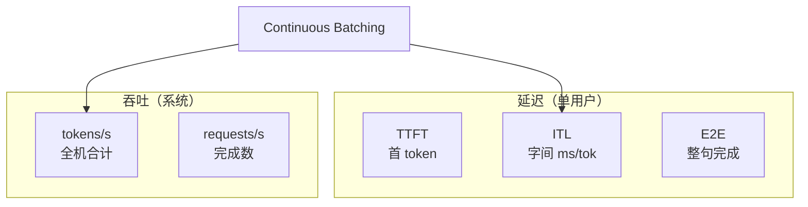

# 延迟与吞吐

> 从 Bit 到 AGI · 第八章：推理（Inference） · ms/tok、TTFT 与 tok/s 怎么读

产品问「快不快」，工程师问「多少 ms/tok」——二者常打架。延迟（latency）是 **一个用户等多久**；吞吐（throughput）是 **整机每秒多少 token**。本章技术栈的不同组合，最终都体现在这两组数字上；本篇用 **可对照的量级表** 把尺子统一。

## 直觉

高速公路：**单车时速**（延迟）与 **收费站总车流量**（吞吐）不是一回事。Continuous Batching 像 **增开收费车道**——总车流量上去，高峰时单车反而 **堵更久**。做 SLA 要先选优化目标：**聊天要首字快**，**离线批处理要总 tok/s 高**。



## 定义

| 指标 | 符号 | 定义 |
| ---- | ---- | ---- |
| Time To First Token | TTFT | 请求进入到 **第一个** 输出 token |
| Inter-Token Latency | ITL | 相邻输出 token 间隔（decode 步） |
| ms/token | — | ITL 的毫秒表示；**越小越跟手** |
| tokens/s | tok/s | 输出 token 数 / 墙钟时间（可 **全机聚合**） |
| Prefill 速度 | — | prompt token/s（常 **非线性** 于长度） |

关系（单用户、无排队）：

$$
\text{E2E} \approx \text{TTFT} + (\text{输出长度} - 1) \times \text{ITL}
$$

系统吞吐（$N$ 路并发、steady state）：

$$
\text{tok/s} \approx \frac{N}{\text{ITL}_{\text{eff}}} \quad (\text{理想 overlap})
$$

## 例子

**例 1：Llama 3 8B，单卡 A100-80G，FP16，vLLM 类栈**

| 场景 | TTFT（512 prompt） | ITL | 系统 tok/s |
| ---- | ------------------ | --- | ---------- |
| 单用户 batch=1 | 120～200 ms | **22～30 ms/tok** | 33～45 |
| 16 并发短回复 | 200～800 ms（含排队） | **28～45 ms/tok** | **600～900** |
| 64 并发 | 1～5 s TTFT | **40～70 ms/tok** | **1200～1800** |

**解读**：ITL 从 25 ms → 50 ms，单用户 **变慢 2×**；整机 tok/s **升 30～40×**——典型 **延迟–吞吐交换**。

**例 2：Prefill vs Decode 拆分**

Prompt 4096 token + 生成 128 token：

| 阶段 | 耗时占比（粗） | 说明 |
| ---- | -------------- | ---- |
| Prefill 4096 | 800～1500 ms | $O(s^2)$ attention 主导 |
| Decode 128× ITL | 128×25 ms = **3200 ms** | 线性步数 |

长输出时 **decode 主导 E2E**；RAG 长文档时 **prefill 主导 TTFT** → [Prefix Caching](/manual/llm/bit-to-agi/08-inference/prefix-caching) 价值大。

**例 3：70B TP=8，A100×8**

| 指标 | 量级 |
| ---- | ---- |
| ITL（batch≈1） | **80～120 ms/tok** |
| ITL（中等负载） | 100～150 ms/tok |
| 8 卡 tok/s | **500～800**（非线性于 8B 单卡） |

Speculative（8B draft）可降到 **40～70 ms/tok** 有效 ITL。

**例 4：量化对 ms/tok**

8B A100，单用户：

| 精度 | ITL |
| ---- | --- |
| FP16 | 25 ms/tok |
| INT8 | 23 ms/tok |
| INT4 AWQ | **19～22 ms/tok** |

INT4 **~15%** ITL 下降 + **4×** 权重显存 → 可开更大 batch → **吞吐再涨**。

## 量化

**瓶颈判定（decode 一步）**：

$$
\text{时间} \approx \max\left(\frac{\text{FLOPs}}{\text{算力}}, \frac{\text{字节读}}{\text{带宽}}\right)
$$

8B FP16 decode：FLOPs ~**几十 GFLOP**/步，A100 算力 312 TFLOP/s → 算力 **~0.1 ms**；读权重+KV **~数十 GB/s 需求** → **20～30 ms** → **memory-bound**。

| 优化 | 主要改善 |
| ---- | -------- |
| KV Cache | 避免 $O(s^2)$ 重算 |
| Flash Attention | Prefill / 长 ctx attention |
| Continuous Batching | **tok/s** |
| INT4/FP8 | ITL + 可并发数 |
| TP | 单请求 ITL（大模型） |
| Speculative | 有效 ITL |
| Prefix cache | **TTFT** |

**SLA 示例**：

| 产品 | TTFT P95 | ITL P95 |
| ---- | -------- | ------- |
| 交互聊天 | < 500 ms | < 50 ms/tok |
| 代码补全 | < 200 ms | < 30 ms/tok |
| 离线摘要 | 不限 | 最大化 tok/\$ |

## 工程现场：如何读 benchmark 与设 SLA

**官方 benchmark 陷阱**：vendor 报 **3000 tok/s** 常是 **短输出、高并发、无 prompt** 或 **batch 内等长**——与你的 **4K RAG + 512 生成** 不可直接比。复现需声明：

1. 模型、精度、并行度、框架版本
2. Prompt 长度分布、输出长度分布
3. 并发数、P50/P95/P99（不只看均值）
4. 是否 Prefix cache、是否 speculative

**SLA 设计例（ToB API）**：

| 等级 | TTFT P95 | ITL P95 | 并发保证 |
| ---- | -------- | ------- | -------- |
| 标准 | 2 s | 80 ms/tok | 共享池 |
| 优先 | 800 ms | 50 ms/tok | 预留 slot |

**成本换算**：A100 80G 云价 **~\$2/h**（量级），8B INT4 **1500 tok/s** → **\$0.000004/token**（粗算，不含人力与冗余）——**latency 优化** 与 **\$/token** 往往 **同向**（更高利用率）。

**Profile 工具链**：`nsys`、`torch.profiler` 看 **kernel 占比**；若 `gemm` < 30%、`memory` > 50% → **量化/带宽** 优先；若 `attention` 在 prefill **> 60%** → Flash / shorter prompt。

**用户感知公式**：流式 UI 下 **首字 300 ms 内** 用户觉「快」；之后 **40 ms/tok**（~25 字/秒）接近 **阅读速度**；**> 100 ms/tok** 明显「卡」。E2E 500 token @ 50 ms/tok → **25 s** 纯生成——产品应 **限制 max_tokens** 或 **分段摘要**。

**与第九章衔接**：ITL 下限 **≈ 权重+KV 字节 / 带宽**；要再降，换 **HBM 更大的卡** 或 **更低比特**——没有免费午餐。

**TTFT vs TBT**：Time Between Tokens = ITL；**Streaming UX** 看 **TBT P95**。**首字** 看 TTFT——RAG **两阶段 SLA** 应 **分开报**。

**Goodput**：有效 tok/s **排除** 重试、error、padding——运营 **\$/有效 token** 用 goodput，不用 **raw counter**。

## 场景对照表

| 场景 | 优先优化 | 目标指标 |
| ---- | -------- | -------- |
| 聊天首字慢 | Prefix cache | TTFT P95 |
| 长文生成慢 | 量化 / Speculative | ITL |
| 多用户卡顿 | Continuous + 扩容 | tok/s + ITL P95 |
| 单用户 70B | TP=8 | ITL batch=1 |

**压测假令**：100 用户、Poisson 到达、输出长度 **均值 128 / P99 512**，比 **固定 128** 更能 **暴露 tail latency**。

## 常见误区

1. **「tok/s 高 = 每个用户都快」**——高 tok/s 常伴随 **排队 + ITL 升**。
2. **「只报 ITL 不报 TTFT」**——长 prompt 用户首字 **卡 prefill**。
3. **「实验室 batch=1 等于线上」**——线上要报 **P95、并发度、prompt 长度分布**。

## 动手试一试

```python
def e2e_ms(ttft_ms: float, itl_ms: float, out_tokens: int) -> float:
    return ttft_ms + max(0, out_tokens - 1) * itl_ms

# 512 prompt 已含在 TTFT 测量里；生成 256 token
for itl in [25, 40, 60]:
    print(f"ITL={itl}ms → E2E={e2e_ms(300, itl, 256):.0f}ms")
```

用你目标 SLA 反推：ITL 50 ms、输出 500 token → E2E 需要多少？能否接受？

## 回顾与衔接

本章所有优化 **最终都投影到两个用户可见指标**：**TTFT**（Prefill + 排队 + [Prefix cache](/manual/llm/bit-to-agi/08-inference/prefix-caching) hit/miss）与 **ITL / ms/tok**（Decode + [Continuous Batching](/manual/llm/bit-to-agi/08-inference/continuous-batching) 负载 + [TP/Speculative](/manual/llm/bit-to-agi/08-inference/tensor-parallel)）。

**Roofline 心智模型**：decode 一步时间 $\approx \max(\text{FLOPs}/\text{TFLOPS},\ \text{Bytes}/\text{BW})$。8B FP16 常 **顶带宽** → [量化](/manual/llm/bit-to-agi/08-inference/quantization-inference) 有效；70B **顶算力+通信** → [TP](/manual/llm/bit-to-agi/08-inference/tensor-parallel) 必要。Prefill 长 prompt **顶 attention FLOPs** → [Flash](/manual/llm/bit-to-agi/08-inference/flash-attention) + prefix cache。

**产品 vs  infra**：产品要 **P95 延迟**；infra 要 **\$/1M tokens**。两者通过 **并发度、量化、副本数** 联动——没有 **只优化一个数字** 的银弹。第九章 [GPU](/manual/llm/bit-to-agi/09-gpu) 讲 **HBM、NVLink 硬顶**；第十一章 [vLLM](/manual/llm/bit-to-agi/11-engineering/vllm) 讲 **本章算法的生产封装**。

## 读者问答

**问：ms/tok 和 tokens/s 怎么换算？**
单用户：**tok/s ≈ 1000 / ms/tok**（如 25 ms/tok → 40 tok/s）。**多用户总 tok/s** 还乘 **并发与利用率**。

**问：优化 ITL 为什么 TTFT 还慢？**
ITL 只衡量 **decode**；长 prompt **prefill** 不受 Continuous Batching 帮助——看 **Prefix cache 与 Flash prefill**。

## 速查卡

| 指标 | 8B A100 粗测 | 70B TP=8 |
| ---- | ------------ | -------- |
| ITL batch=1 | 22～30 ms/tok | 80～120 ms/tok |
| tok/s 高并发 | 1200～1800 | 500～800 |
| TTFT 512 tok | 120～200 ms | 更高 |

**公式**：E2E ≈ TTFT + (out_len−1)×ITL；**overload** 时 **两项都升**。

**报告规范**：对外 SLA 写 **P95 TTFT + P95 ITL + 峰值 tok/s** 三项；只报 **mean tok/s** **掩盖** 排队与长尾，**误导容量规划**。

Load test 时用 **泊松到达 + 指数长度** 比 **等长 synthetic** 更接近 **线上 tail**；别只用 **benchmark Happy Path** 签 SLA。**Autoscaling 应看 TTFT 队列长度**，而不只看 **GPU util%**。

延迟与吞吐的 **矛盾不可消除**，只能 **按产品定位滑动**：交互式 Copilot **牺牲总 tok/s** 换 **低 ITL**；离线批处理 **接受排队** 换 **\$/token**。做架构评审时，用 **E2E 公式** 把 **prompt 长度、输出长度、并发** 三个旋钮 **同时代入**，避免 **只优化实验室 batch=1 数字**。

**本章衔接**：第九章 GPU 将给出 **带宽与算力的硬顶**；第十一章 vLLM 将把这些算法 **打包成可运维服务**。

## 小结

延迟看 **TTFT + ms/tok**（单用户体验）；吞吐看 **全机 tok/s**（成本与容量）。Continuous Batching 抬吞吐、常牺牲 ITL；Prefix cache 砍 TTFT；量化与投机解码压 ms/tok。本章技术拼图至此闭合——请参阅 **本章总结** 串起来。

→ 下一篇：[本章总结](/manual/llm/bit-to-agi/08-inference/chapter-summary)
