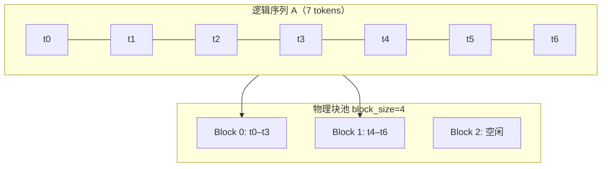

# Paged Attention

> 从 Bit 到 AGI · 第八章：推理（Inference） · 分页管理 KV Cache

KV Cache 随请求长度参差不齐，若在 GPU 上为每个序列预分配「最大长度」的连续块，显存会被大量空洞浪费。Paged Attention 把 KV 切成固定大小的**块（block）**，用块表映射逻辑 token 到物理块——思路来自操作系统的虚拟内存分页。

## 直觉

酒店给每位客人预留「最长可能住 30 天」的连续 30 间房，多数客人只住 2 天，走廊里全是空房锁着。分页做法是：房间按「每晚一块」池化，客人 A 的第 1～3 晚可能在 101、205、302 号房，前台有一张表记录逻辑第几晚 → 哪间房。

vLLM 的 PagedAttention 同理：逻辑序列的第 $i$ 个 token 的 KV 存在 `block_table[seq][i // block_size]` 指向的物理块里。



## 定义

- **block_size** $B$：每个物理块存 $B$ 个 token 的 K/V（常见 16 或 32）。
- **块表** `block_table[seq_id][logical_block_idx] → physical_block_id`。
- **分配**：序列每增长 $B$ 个 token，从空闲块池分配一块；序列结束，块归还池中。
- **Attention 内核**：根据块表 gather K/V，在块内连续、块间可跳跃——对 CUDA kernel 做了专门实现。

显存利用率对比（粗算）：

| 策略 | 预分配长度 $S_{\max}$，平均实际长度 $\bar{s}$ | 利用率上界 |
| ---- | ----------------------------------------------- | ---------- |
| 连续预分配 | 每序列占 $S_{\max}$ | $\bar{s} / S_{\max}$ |
| Paged，块大小 $B$ | 每序列 $\lceil \bar{s}/B \rceil \cdot B$ | 通常 **> 90%**（碎片 ≤ 最后一块） |

## 例子

**例 1：碎片从哪来**

- $S_{\max} = 8192$，batch 64，连续分配：$8192 \times 64 \times 128\text{ KiB/token}$ 量级 → 即使平均生成长度只有 256 token，也按 8192 占坑。
- PagedAttention：256 token 只需 $\lceil 256/16 \rceil = 16$ 块/序列；64 序列共 1024 块，而非 $64 \times 512 = 32768$ 块。

**例 2：块大小权衡**

| block_size | 块数（$s=1000$） | 内部碎片（最坏） | 块表长度 |
| ---------- | ---------------- | ---------------- | -------- |
| 8 | 125 | 7 token/序列 | 125 项 |
| 16 | 63 | 15 token | 63 项 |
| 32 | 32 | 31 token | 32 项 |

块越大，块表越短、kernel 越简单；块越小，碎片越少、共享前缀时更灵活（见[Prefix Caching](/manual/llm/bit-to-agi/08-inference/prefix-caching)）。

**例 3：与 vLLM 参数对应**

```bash
# 常见服务配置片段
python -m vllm.entrypoints.openai.api_server \
  --model meta-llama/Llama-3.1-8B-Instruct \
  --max-model-len 8192 \
  --gpu-memory-utilization 0.90 \
  --block-size 16
```

`gpu-memory-utilization` 决定「块池」总容量；`max-model-len` 与块池一起约束 **同时能服务多少条序列**。

## 量化

- **节省倍数**：在线服务中，平均输出 128 token、上限 8192 时，连续预分配利用率约 $128/8192 \approx 1.6\%$；分页后接近 **100% 块占用**（仅末块浪费），等效 **数十倍** 更多并发。
- **额外开销**：块表（INT32 索引）可忽略；Attention kernel 多一次间接寻址，通常 **低于  5%** 延迟，远小于多跑几条序列的收益。
- **Copy-on-write / 共享**：同一物理块可被多条序列引用（前缀相同），引用计数归零才回收——Prefix Caching 的基础。

::: warning

PagedAttention 解决的是 **显存碎片与过度预分配**；不减少 KV 的理论下界字节数。要减字节数，靠 GQA、量化 KV 或更短上下文。

:::

## 工程现场：vLLM 块池怎么估容量

部署前可以用下面思路 **粗算** 能撑多少并发（非精确，但够排障）：

1. 可用 KV 池 ≈ `gpu_memory_utilization × 卡显存 − 权重 − workspace`
2. 每块字节 ≈ $2 \times L \times B \times h_{kv} \times d_h \times b$（$B$=block_size）
3. 块数上限 = 可用 KV 池 / 每块字节
4. 每序列块数 ≈ $\lceil \text{总长度} / B \rceil$（prompt + 已生成 + 预留 max_tokens）
5. 最大并发 ≈ 块数 / 每序列块数

**数字例**（8B、FP16、block=16、80G 卡、util=0.9）：权重 ~16 GiB，KV 池 ~56 GiB。每块 $2×32×16×8×128×2 ≈ 2$ MiB → 约 **28672 块**。若平均每请求 ctx+output=512 token → $\lceil 512/16 \rceil = 32$ 块/序列 → 并发 **~896 条**（理想上界；实际 prefill 峰值、碎片、前缀共享会改变此数）。

对比 **连续预分配** $S_{\max}=8192$：无论实际是否只用 512 token，每序列都占 512 块 → 同样 28672 块只能 **56 条** 并发——差距 **16×**，这就是 PagedAttention 对在线业务的意义。

**Copy-on-write 与 fork**：某些实现支持从已有序列 **fork** 块链（共享前缀物理块），是 Prefix Caching 的底层机制；引用计数归零块才回收到 free list。

**Watermarking 与块**：某些 **水印检测** 假设 **连续 KV**——Paged **不影响** 生成分布，但 **第三方审计工具** 需 **感知块布局**。

**Defragmentation**：块池 **长期运行** 可能 **外部碎片**——重启 worker **周期性** 回收；K8s **滚动重启** 是 **隐式 defrag**。

## 常见误区

1. **「分页 = 把 KV 换到 CPU 磁盘」**——标准 PagedAttention 块仍在 **GPU HBM**；CPU/disk offload 是另一套机制。
2. **「block_size 越大越好」**——大块增加末块浪费，且多序列共享前缀时粒度变粗。
3. **「有了分页就不需要 Continuous Batching」**——分页管 **空间**；Continuous Batching 管 **时间调度**，二者互补。

## 动手试一试

假设：block_size=16，128 KiB/token，单块 KV 体积 = $16 \times 128\text{ KiB} = 2$ MiB。24 GiB 卡权重占 16 GiB，剩 8 GiB 给块池 → 约 **4096 块** → 若平均每序列 8 块（128 token），可同时 **~512 条** 活跃序列（理想上界，未计 workspace）。

## 回顾与衔接

操作系统 **虚拟内存** 让进程以为有连续地址空间，物理上却是 **页框 + 页表**。PagedAttention 把同一思想搬到 GPU：逻辑上每条序列的 KV 是 **连续 token 序列**，物理上由 **块池 + block_table** 映射。这与 [KV Cache](/manual/llm/bit-to-agi/08-inference/what-is-kv-cache) 的 **字节公式** 正交——分页不减少 $2Lsh_{kv}d_h b$，但让 **同样 8 GiB 块池** 服务 **更多条长短不一的请求**。

vLLM 论文的核心数字：在 ShareGPT  trace 上，PagedAttention 相对 FasterTransformer 的 **连续 KV** 实现 **2～4× 吞吐**——主要来自 **显存利用率** 从 ~20% 提到 ~90%+，而非单条请求算更快。理解这一点，就不会问「分页能不能让 ms/tok 减半」——它首先是个 **容量与并发** 故事。

与 [Flash Attention](/manual/llm/bit-to-agi/08-inference/flash-attention) 联用时：Flash 改 attention **算子**；Paged 改 KV **布局**。内核必须 **感知块表** 才能两者兼得——这也是推理框架 **版本耦合** 紧的原因。

## 读者问答

**问：分页后单条请求会更快吗？**
通常 **不会明显变快**；主要收益是 **同样显存跑更多并发**，系统 tok/s 上升。

**问：block_size 选 16 还是 32？**
16 **碎片更小**、前缀共享更细；32 **块表更短**、kernel 略简。vLLM 默认 **16** 是经验平衡点。

## 速查卡

| 符号 | 含义 |
| ---- | ---- |
| block_size | 每块 token 数，常 16 |
| block_table | 逻辑块 → 物理块 id |
| gpu_memory_utilization | 块池占显存比例 |
| max_num_seqs | Continuous Batching 并发上限 |

**一句话**：分页让 KV **像 malloc 堆一样复用块**，而不是 **malloc 最大长度数组**。

**运维提示**：块池耗尽时 vLLM 会 **拒绝新请求** 而非 OOM 杀进程——监控 **GPU KV cache usage** 比 **GPU util%** 更贴近 **容量天花板**。

与 FlashAttention 组合时，应查阅发行说明确认 **Paged + Flash** 内核是否同时启用。

## 小结

Paged Attention 用 **固定大小块 + 块表** 管理 KV Cache，把在线服务的显存利用率从个位数拉到 90% 以上，是 vLLM 高并发的核心。下一篇讲 Flash Attention 如何从 **算子 IO** 角度加速 attention 本身。

→ 下一篇：[Flash Attention](/manual/llm/bit-to-agi/08-inference/flash-attention)
