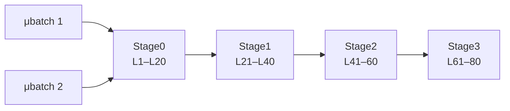

# Pipeline Parallel

> 从 Bit 到 AGI · 第八章：推理（Inference） · 层间流水线多卡

Tensor Parallel 切的是 **一层里的矩阵**；Pipeline Parallel（PP）切的是 **层与层之间**——GPU0 跑第 1～20 层，GPU1 跑第 21～40 层，数据像流水线一样传递。PP 用 **时间换空间**，让每张卡只存 **一部分层** 的权重。

## 直觉

汽车组装线：工位 A 装引擎，工位 B 装车门，工位 C 喷漆。每个工位 **同时处理不同车辆**（micro-batch），而不是一整辆车在一个工位做完所有工序。PP 里每个 **stage** 是一截 Transformer 层，activations（和 KV 按实现）在 stage 间传递。



## 定义

- **PP 度** $p$：stage 数量（通常等于 GPU 数 / TP 度）。
- 总 $L$ 层均分：每 stage **$L/p$** 层（含 embedding / lm_head 的特殊切法）。
- **Micro-batch**：为填满流水线，一次 forward 拆成 $m$ 个 micro-batch 依次注入 stage0。
- **Bubble（气泡）**：流水线填充与排空阶段，部分 stage 空闲。1F1B 等 schedule 把 bubble 比例压到约 **$(p-1)/(m+p-1)$**。

| Schedule | 特点 |
| -------- | ---- |
| GPipe | 简单，bubble 大 |
| 1F1B | 前向反向交错，训练常用 |
| Inference PP | 常 **micro-batch=1**（decode），bubble 更敏感 |

**推理 decode**（每步 1 token）时，PP 的 stage 间 **点对点 send/recv** activation；KV Cache 通常 **按 stage 本地存储** 该段层的 K/V。

## 例子

**例 1：80 层模型，PP=4**

| Stage | GPU | 层 | 权重 FP16（70B 量级粗算） |
| ----- | --- | -- | ------------------------- |
| 0 | 0 | 0–19 + embed | ~35 GiB / 4 ≈ 8.75 GiB + embed |
| 1 | 1 | 20–39 | ~8.75 GiB |
| 2 | 2 | 40–59 | ~8.75 GiB |
| 3 | 3 | 60–79 + head | ~8.75 GiB + head |

单卡 24 GiB 装不下 70B 全量，**PP=4 + TP=2**（8 卡）是常见部署拓扑。

**例 2：Bubble 与 micro-batch**

$p=4$，$m=1$（decode 单 token）：流水线几乎 **串行**——stage0 算完 → stage1 → … → 延迟 ≈ **各 stage 之和**，且中间 stage 大量空闲。

$m=8$（prefill 可把 prompt 分 8 chunk 流水线）：bubble 比例 $\approx (4-1)/(8+4-1) = 3/11 \approx 27\%$。**Prefill 更能吃 PP 红利**；纯 decode 常 PP 效率偏低。

**例 3：TP + PP 组合（8×A100 跑 70B）**

| 方案 | 拓扑 | 特点 |
| ---- | ---- | ---- |
| TP=8 | 8 卡层内切 | 通信多，单 stage，延迟较低 |
| TP=4, PP=2 | 2 stage × 4 TP | 每卡权重减半，stage 间 PCIe/NVLink 传 activation |
| TP=2, PP=4 | 4 stage × 2 TP | 每卡权重 ~1/8 模型，decode bubble 明显 |

工程上 **70B 在线推理** 常见 **TP=4 或 8，PP=1**（全 NVLink）；**PP>1** 更多在 **极大规模或显存极紧** 时。

## 量化

- **Stage 间 activation 大小**（每层 hidden $d$，batch $b$，seq 1 decode）：$\approx b \times d \times 2$ 字节 × 层间次数；$d=8192, b=32$ → **512 KiB/步**，远小于 KV 带宽。
- **延迟**：PP=$p$ 且无 overlap 时，decode 延迟 **下限 ≈ p × 单 stage 时间**；micro-batch 可 overlap 但 decode  batch=1 时难 overlap。
- **吞吐**：高并发 Continuous Batching 可在 **时间维** 填多个 request，部分掩盖 bubble——仍不如 TP 在同机低延迟。

::: warning

推理场景 **PP 不是银弹**：decode 步 token 数少，流水线难填满。优先 **TP + PagedAttention + Continuous Batching**；PP 是「装不下」时的分层方案。

:::

## 深入理解：1F1B 与推理 decode 的错位

训练常用 **1F1B**（One Forward One Backward）schedule：micro-batch 在 pipeline 中交错，bubble 约 **$(p-1)/(m+p-1)$**。推理 decode **没有 backward**，且 **micro-batch 常为 1**（每步 1 token），公式退化为：stage 几乎 **串行**，GPU1 等 GPU0 算完才动——**流水线空转严重**。

**数值例**：4 stage，每 stage decode **25 ms**，理想 overlap 下 ITL **25 ms**；无 overlap 串行 **4×25 = 100 ms/tok**——与 TP=4 同机相比 **4× 慢**。Prefill 若拆 $m=8$ chunk，可部分 overlap：有效时间 $\approx 25 + 3×25/8$ … 依 schedule 而定，仍 **不如纯 TP** 对低延迟友好。

**何时仍用 PP**：

- 单卡 **绝对装不下** $L/p$ 层权重（极深 + 极大 hidden）
- **多节点** 扩展：节点内 TP，节点间 PP（Megatron 经典 3D 并行）
- **吞吐优先** 的 offline batch：同时 hundreds 条序列 prefill，$m$ 大 bubble 小

**与 ZeRO / FSDP 的区别**：ZeRO 是 **训练** 优化器状态分片；推理无 optimizer，讨论的是 **权重分片（TP）** 与 **层分片（PP）**，不要混称。

**Activation 传递大小**：decode batch=$b$、hidden=$d$、FP16，stage 间 tensor **$b × d × 2$ 字节**。$b=64, d=8192$ → **1 MiB/步/stage 边界**——相对 NVLink **可忽略**；PP 瓶颈在 **stage 计算时间不匹配**（early stage embed 轻、late stage lm_head 轻，中间 FFN 重）导致的 **idle**，需 **均衡层分配**（不一定均分 $L/p$）。

**均衡切分**：80 层 PP=4 每 stage 20 层；若 **embed + lm_head** 放 stage0/末 stage，中间 **FFN 重的层** 可 **手动 rebalance** 减 idle——Megatron **virtual pipeline** 进一步 **子切**。

**Multi-node PP**：跨机 stage 间 **100Gbps 网络 ~12 GB/s**——activation **1 MiB/步** 传输 **低于  0.1 ms**，但 **latency jitter** 与 **collective 不同步** 可能 **拖 P99**。

## 常见误区

1. **「PP 和 TP 只能二选一」**——大集群常 **TP × PP × DP（数据并行副本）** 组合。
2. **「PP 减少计算量」**——总 FLOPs 不变，只是 **分到多卡**；bubble 还会 **降低利用率**。
3. **「训练 PP  schedule 直接搬推理」**——推理无 backward，1F1B 优势减弱；要单独 profile decode。

## 动手试一试

```python
def pipeline_bubble_frac(pp: int, micro_batches: int) -> float:
    return (pp - 1) / (micro_batches + pp - 1)

for m in [1, 4, 8, 16]:
    print(f"PP=4, m={m}: bubble={pipeline_bubble_frac(4, m):.1%}")
```

观察 decode（$m \approx 1$）时 bubble 为何接近 100% 的有效串行。

## 回顾与衔接

Pipeline 思想来自 **GPipe**（训练）：把层切 stage、micro-batch 填流水线。推理 decode **micro-batch≈1** 时 bubble 灾难性——故 **在线低延迟** 首选 [Tensor Parallel](/manual/llm/bit-to-agi/08-inference/tensor-parallel) 而非 PP。**Offline bulk prefill**（一次灌 10k prompt）才是 PP 可能发光的场景。

与 **DeepSpeed Inference**、Megatron 文档中的 **3D 并行**（TP×PP×DP）对照：推理集群常 **TP×DP 副本**，PP 仅在 **单层权重超单卡** 的极端出现。读 benchmark 时看到 **PP=2** 要警惕 **decode ITL 是否翻倍**。

Activation 在 stage 间传递的 **延迟** 远小于 **每 stage 计算**——PP 的真正敌人是 **无法 overlap 的 decode bubble**，不是 PCIe 带宽本身。

## 读者问答

**问：推理能用训练那套 PP 吗？**
能跑，但 **decode bubble** 常使 **延迟变差**；除非 **单卡装不下**，否则 **优先 TP 或量化**。

**问：PP 和 TP 哪个通信大？**
TP **每层多次 all-reduce**；PP **stage 间传 activation**（decode 时 **较小**）。**跨机 TP** 通信 **往往最糟**。

## 速查卡

| 场景 | PP 推荐度 |
| ---- | --------- |
| 在线 decode 低延迟 | 低 |
| 单卡装不下层数 | 高 |
| Bulk prefill 离线 | 中～高 |
| 已有 NVLink TP 够装 | 不用 PP |

**Bubble 公式**：$(p-1)/(m+p-1)$；decode $m≈1$ 时 **bubble→100% 串行**。

**部署检查**：若 profile 显示 **stage 间 GPU 交替 idle**，是 PP bubble；**优先减 PP 度** 或 **改 TP/量化**，而非 **盲目加卡**。

GPipe 与 PipeDream 是 PP 的 **经典论文**；推理部署前用 **bubble 公式** 粗算是否 **值得引入 PP**。**Decode 为主** 的 API **慎用 PP**。

Pipeline Parallel 在 **推理** 中的角色应 **理性看待**：它解决 **「装不下」**，不解决 **「不够快」**。若你的 70B **已能 TP=8 装入**，再加 PP **几乎一定伤害 decode ITL**。把 PP 留给 **100B+、单层超宽、或跨节点 权重 sharding 仍不够** 的 **少数场景**。

**本章衔接**：超大模型若 **TP 仍装不下**，才进入 PP 讨论；多数读者 **掌握 TP + 量化即可**。**Decode 延迟敏感** 的服务 **默认 PP=1**。PP 不是 **延迟优化工具**，而是 **显存分片工具之一**。**谨记**以上要点。

## 小结

Pipeline Parallel 按 **层段** 切模型到多 stage，用流水线提高设备占用；训练 prefill 受益大，decode 易受 bubble 拖累。下一篇讲 **Speculative Decoding**：用小模型 **猜**、大模型 **验**，换延迟。

→ 下一篇：[Speculative Decoding](/manual/llm/bit-to-agi/08-inference/speculative-decoding)
