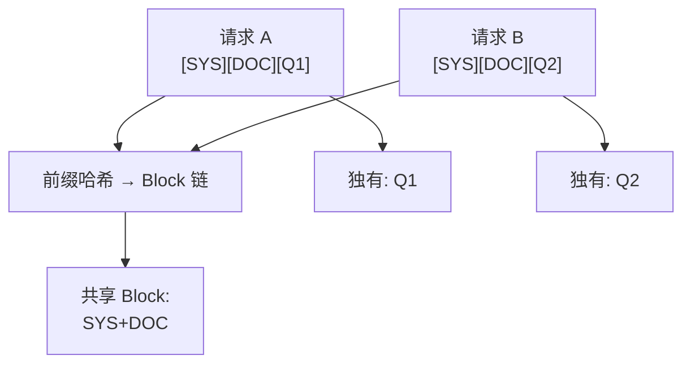

# Prefix Caching

> 从 Bit 到 AGI · 第八章：推理（Inference） · 共享 prompt 前缀的 KV 复用

多用户塞同一段 system prompt、RAG 检索块或 few-shot 示例时，每条请求都在 **重复 prefill 相同前缀**。Prefix Caching（也叫 automatic prefix caching）把已算好的 **前缀 KV Cache 块** 存进哈希表，新请求 **命中则跳过 prefill**，TTFT 从秒级降到毫秒级。

## 直觉

复印店：100 个客户都要在合同 **同一页标准条款** 后面填不同姓名。 naive 做法每人从头印 10 页；聪明做法 **条款页只印一次**，每人只印 **个性化那一页**。

Prefix Caching 的「标准条款」= token 序列完全相同的前缀；PagedAttention 的 **物理块** 可被多序列 **引用计数** 共享。



## 定义

- **前缀**：从 token 0 起连续相同的一段 $t_0 \ldots t_{k-1}$。
- **块级哈希**：对每个 full block（如 16 token）的内容 hash → `block_hash`；链式 `hash(parent_hash, block_tokens)` 形成 **前缀树**。
- **命中**：新请求逐块查表，连续命中则 **attach** 已有物理块（refcount++），只对 **第一个未命中块之后** 做 prefill。
- **失效**：模型权重更新、LoRA 切换、精度变化 → 整表 flush。

| 概念 | 说明 |
| ---- | ---- |
| Hit rate | 命中 token 数 / 总 prefill token 数 |
| TTFT 节省 | 跳过部分的 prefill FLOPs + 内存写 |
| 显存代价 | 缓存块占块池，与活跃 unique 前缀数相关 |

## 例子

**例 1：RAG 场景**

| 组件 | token 数 |
| ---- | -------- |
| System prompt | 512 |
| 检索文档（固定 batch） | 4,096 |
| 用户问题 | 64～256 |

无 prefix cache：每条 **prefill ~4608+** token。
有 cache（文档相同）：每条只 prefill **问题部分** ~200 token → prefill 算力 **~95%↓**。

TTFT（8B，A100，粗测）：

| 阶段 | 无 cache | 有 cache |
| ---- | -------- | -------- |
| 4608 token prefill | 800～1500 ms | — |
| 200 token prefill | — | 40～80 ms |

**例 2：块对齐与部分命中**

block_size=16，共享前缀长度 1000 token → $\lfloor 1000/16 \rfloor = 62$ 块命中，**余 8 token** 需重算或整块重算（实现相关）。余数越长，浪费越大——prompt 长度宜 **对齐 block 倍数**（工程细节）。

**例 3：vLLM 启用**

```bash
python -m vllm.entrypoints.openai.api_server \
  --model meta-llama/Llama-3.1-8B-Instruct \
  --enable-prefix-caching
```

配合 `--block-size 16` 与 PagedAttention；命中率依赖 **业务重复度**。

## 量化

- **Prefill 代价**（无 cache）：$\propto s^2$（attention）+ $s$（线性层）；$s=4096$ 常 **占 TTFT 80%+**。
- **Cache 命中一步 attach**：块表指针更新 **低于  1 ms**，相对 1 s prefill **可忽略**。
- **显存**：缓存 $B$ 个块，每块 $2 \times L \times B \times h_{kv} \times d_h \times 2$ 字节。62 块 × 2 MiB/块 ≈ **124 MiB**（沿用前文 8B 假设）—— **买显存换 TTFT**。
- **命中率公式（粗估）**：若 $N$ 个请求共享前缀 $P$、独有后缀 $U_i$：

$$
\text{saved prefill} \approx N \times |P| - |P| - \sum_i |U_i| \quad (\text{首请求仍算 } |P|)
$$

$N=100$，$|P|=4000$，$|U|=100$ → 节省 $\approx 100 \times 4000 - 4000 - 10000 = 386000$ token·次 prefill。

::: info

Prefix Caching 与 [Paged Attention](/manual/llm/bit-to-agi/08-inference/paged-attention) 天然契合：**共享物理块 + 引用计数**；FlashAttention 只影响 prefill 怎么算，不影响共享逻辑。

:::

## 工程现场：命中率与 Eviction

**Hash 链**：块 $i$ 的 hash 依赖 **父 hash + 本块 token ids**——前缀 **差 1 token** 即 **整条链不同**。System prompt 末尾多一个 `\n`，命中率 **从 100% 变 0%**（对该块边界后）。

**RAG 最佳实践**：

1. **固定 system 字符串**（字节级一致），含标点与空格
2. 检索文档 **按块 hash 缓存**；文档更新 → 新 hash，旧块 **LRU 淘汰**
3. Prompt 长度尽量 **block_size 整数倍**，减少 **半块重算**

**Eviction 数值**：块池 4096 块、每块 2 MiB → **8 GiB** 缓存上限。若 100 个不同 4K 文档前缀各 250 块 → 需 **25000 块**——**远超限**，必须 LRU。热文档 **反复命中**；冷文档 **每次 prefill**，TTFT **波动大**——监控 **cache hit rate** 分位。

**多租户**：租户 A 的 system 与租户 B 不同 → **天然隔离**；同租户 agent 工具定义相同则 **共享块**，agent 并发 **TTFT 线性受益**。

**与 LoRA**：base 权重相同、LoRA adapter 不同 → KV **不可共享**（同一前缀在不同 adapter 下 hidden 不同）。Serving 需 **按 adapter id 分 cache 命名空间**。

**Agent 工具定义缓存**：同一 `tools=[...]` JSON **字节一致** 时，多轮对话 **system+tools** 块 **跨 session 共享**——Agent 平台 **应用层** 应用 **prompt 模板版本号** 管理 cache 失效。

**Security**：共享前缀 cache **不泄漏** 其他用户后缀——块 **只读共享**；但 **side channel** 讨论（timing hit/miss）在 **多租户 ultra-secure** 场景才需考虑，常规模型 **可忽略**。

## 常见误区

1. **「相同自然语言意思就能共享」**——必须 **token id 逐位相同**；多一个空格、不同 BPE 切分都不命中。
2. **「cache 永久有效」**——块池满会 **LRU 驱逐**；冷前缀被踢出后下次仍要 prefill。
3. **「只省算力不省 KV 终态」**——decode 阶段每条序列仍有 **独有后缀** 的 KV；共享的是 **前缀块**。

## 动手试一试

构造 10 条请求：相同 512 token system + 不同 50 token user。估算无 cache 总 prefill token = $10 \times 562$；有 cache = $512 + 10 \times 50 = 1012$，比值 **~5.5×** 减少。

## 回顾与衔接

Prefix Caching 是 [Paged Attention](/manual/llm/bit-to-agi/08-inference/paged-attention) **块引用计数** 的产品化：**相同 token 块 → 相同 physical block**。RAG、Agent system prompt、Few-shot 示例 **字节级重复** 的场景，TTFT 从 **秒级 prefill** 降到 **毫秒级 attach**——已是 **现代 serving 栈标配**（vLLM V1 默认启用 Prefix Caching、SGLang RadixAttention 等）。

它 **不减少 decode ms/tok**——用户问题之后的 token 仍逐步生成；它砍的是 **重复 prefill 的 $O(s_p^2)$** 部分。与 [Flash Attention](/manual/llm/bit-to-agi/08-inference/flash-attention) 叠加：miss 时 prefill 仍受益于 Flash；hit 时 **跳过 prefill** 更彻底。

**Token 级严格相等** 意味着 **模板工程** 重要：多一个空格、不同 Unicode 规范化（NFC/NFD）都会 **miss**——生产环境应对 system prompt **版本化 + 哈希监控**。

## 读者问答

**问：用户改了一个字，前缀 cache 全废吗？**
**从第一个不同 token 所在块起** 失效；之前 **整块仍命中**——不是 **整段重算**。

**问：cache 占满怎么办？**
**LRU 驱逐** 冷块；下次 **miss 再 prefill**——TTFT **波动**，需 **监控命中率**。

## 速查卡

| 条件 | 命中 |
| ---- | ---- |
| token id 逐位相同 | ✓ |
| 多一个空格 | ✗ |
| 不同 LoRA | ✗ |
| 块对齐 prompt | 余数浪费小 |

**监控**：`cache_hit_rate`、**TTFT P95**——命中率掉 **立刻查 prompt 版本**。

**Agent 场景**：工具 schema、system 指令 **稳定不变** 时，prefix cache 让 **每轮 TTFT 接近 decode**——**多轮 agent** 体验 **质变**。

vLLM **Automatic Prefix Caching** 文档列了 **hash 规则**；改 prompt 模板前 **先读 hash 是否含 LoRA id**。**命中率** 应进 **Grafana 大盘**，与 **TTFT 同屏**。

Prefix Caching 的 **业务价值** 在 **Agent 与 RAG** 时代 **被放大**：每轮对话 **重复的工具定义、检索块、system 规约** 都可 **跨请求、跨用户（同模板）共享**。上线后 **hit rate 低于 30%** 往往说明 **prompt 模板未标准化**，而非 **cache 坏了**。

## 小结

Prefix Caching 对相同 token 前缀复用 KV 物理块，巨幅降低 RAG / agent 场景的 TTFT。下一篇 **推理量化** 从 **权重与 KV 精度** 再抠显存与带宽。

→ 下一篇：[推理量化](/manual/llm/bit-to-agi/08-inference/quantization-inference)
