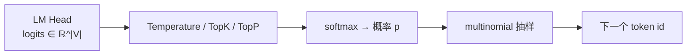

# Sampling 是什么

> 从 Bit 到 AGI · 第八章：推理（Inference） · 从 logits 到下一个 token

模型最后一步输出 **logits**——词表大小 $|V|$ 维的未归一化分数。Sampling（采样）把这些分数变成 **下一个 token 的离散选择**：可以贪心取最大，也可以按概率随机抽。同一 prompt、不同采样策略，输出风格天差地别。

## 直觉

_logits_ 像考试每道题的「把握程度」：语文 92、数学 88、英语 45……Softmax 把它们变成百分比，再 **抽签** 决定下一门复习哪科。Temperature、TopK、TopP 都是 **在抽签前改卷子上的分数或划掉选项**。

推理管线里，forward 算 logits 只占一部分时间；采样在 CPU/GPU 上很轻，但 **决定产品体验**（创意 vs 稳定）。



## 定义

设 logits 向量 $\mathbf{z} \in \mathbb{R}^{|V|}$，词表大小 $|V|$ 常见 **32k～128k**。

1. **Softmax**：$p_i = \dfrac{e^{z_i}}{\sum_j e^{z_j}}$
2. **Greedy**：$x = \arg\max_i p_i$（等价 temperature → 0 的极限）
3. **Multinomial**：按 $p$ 随机抽 1 个 $i$
4. **Beam search**（非典型 chat）：保留 top-$b$ 条前缀（翻译时代常用，开放生成少用）

**解码模式对比**：

| 模式 | 随机性 | 典型场景 |
| ---- | ------ | -------- |
| Greedy | 无 | 调试、确定性测试 |
| Sampling | 有 | 聊天、写作 |
| Beam | 低（搜索） | 结构化输出、旧式 NMT |

OpenAI API 对应：`temperature=0` 近似 greedy；`temperature>0` + `top_p` 为默认聊天栈。

## 例子

**例 1：三 token 玩具词表**

$\mathbf{z} = [2.0,\ 1.0,\ 0.5]$

| 步骤 | 结果 |
| ---- | ---- |
| softmax $p$ | [0.659, 0.242, 0.099] |
| greedy | token 0（66%） |
| 抽样 1000 次 token 0 期望 | ~659 次 |

**例 2：代码路径（PyTorch）**

```python
import torch

logits = model(...)  # shape (batch, vocab), 最后位置
# Greedy
next_id = logits[:, -1, :].argmax(dim=-1)

# Sampling with temperature
temp = 0.8
probs = torch.softmax(logits[:, -1, :] / temp, dim=-1)
next_id = torch.multinomial(probs, num_samples=1).squeeze(-1)
```

**例 3：logits 规模与耗时**

$|V|=128256$，batch=32：softmax 向量 **32 × 128k × 4 B ≈ 16 MiB**；GPU softmax + multinomial **低于  0.1 ms**，相对 20～80 ms 的 forward **可忽略**。

| 组件 | 8B decode 典型耗时 |
| ---- | ------------------ |
| Transformer forward | 18～35 ms |
| LM head + sampling | 0.05～0.3 ms |
| Detokenize（CPU） | 0.1～1 ms |

## 量化

- **信息论**：理想分布 $p$ 下，每 token 熵 $H(p) = -\sum p_i \log p_i$。**高熵** → 采样更「散」；greedy 只取 1 点，**不反映** 模型不确定性。
- **重复循环**：greedy + 无 repetition penalty 易 **degenerate loop**；采样 + 适当 temperature 可缓解（非保证）。
- **可复现**：固定 `seed` 使 multinomial 可复现；**并行 batch、FP16 非确定性** 仍可能使 bit-level 不一致。

::: info

第三章 [概率](/manual/llm/bit-to-agi/02-math/what-is-probability) 与 softmax：logits 差 1 分， odds 比 $e^1 \approx 2.718$——采样对 **相对差距** 指数敏感。

:::

## 深入理解：从 logits 到可复现输出

**Logits 校准**：训练 loss 是 cross-entropy，模型输出 **未校准** 的分数——「50% 概率」不一定等于真实正确率 50%。采样只 **忠实于模型自估**，不保证 **事实正确**。

**重复惩罚（repetition penalty）**：非本章核心，但线上常与 sampling 联用——对已出现 token 的 logit **除以 $\theta > 1$**，降低「啊啊啊」循环。与 temperature 独立，改 **条件分布**。

**Structured output**：JSON / grammar 约束采样（constrained decoding）在 logits 上 **mask 非法 token**（设为 $-\infty$），再 softmax——仍属 sampling 家族，但 **支持集** 每步不同。

**批处理一致性**：batch=32 时 32 组 logits **一次 softmax**；GPU 上高效。若 32 路 **temperature 不同**，需 **broadcast 除法** 再逐行 softmax，开销仍 **低于  1 ms**。

**与 Beam Search 对比**：

| 方法 | 复杂度/步 | 适用 |
| ---- | --------- | ---- |
| Greedy | $O(|V|)$ | 测试 |
| Sampling | $O(|V|)$ 或 $O(K)$ | 开放生成 |
| Beam-$b$ | $O(b|V|)$ | 短输出、评分可加 |

LLM chat **几乎全 sampling**；beam 在 **100 token 内翻译** 时代常见，长文生成 **指数爆炸**。

**Detokenize 延迟**：BPE 每步 **O(1) 均摊** 查表；但 **UTF-8 边界**、emoji 组合在流式输出时要 **缓冲**——用户看到的「字」比 token **略滞后** 1～2 步，体感 ITL 应 **在 token 边界** 测量而非 Unicode 字符边界。

**ChatGPT vs 开源默认**：商业 API **采样细节未公开**；复现「同样 temperature」在 Llama 上 **不可能 bit-identical**。A/B 应比 **任务指标**，不比 **逐 token**。

**多 token 同一步**：Speculative 验证一步出 **多位置 logits**；常规模型 **每步 1 位置**。Sampling 成本仍 **O(V)** per 位置——verify 步 **略贵** 但 **摊到多 token**。

## 与训练采样对比

训练 **teacher forcing** 用 **真实下一 token**，不用 sampling；**RLHF / GRPO** 才在 rollout 里 **采样**。推理 sampling **只影响生成**，**不影响** 已训权重——**别试图用调 T 修复模型不懂的知识**。

## 常见误区

1. **「采样越随机模型越聪明」**——只是 **探索** 更多高概率邻域；错 token 仍会出现。
2. **「logits 就是概率」**——需 softmax；且 logits 可整体加减常数不变 softmax。
3. **「temperature 只影响创意」**——也影响 **事实性**（高温更易 hallucinate 低概率词）。

## 动手试一试

```python
import torch

z = torch.tensor([3.0, 2.0, 1.0, 0.5, 0.1])
for T in [0.5, 1.0, 1.5]:
    p = torch.softmax(z / T, dim=0)
    print(f"T={T}: {p.tolist()}")
```

观察高温如何 **压平** 分布。

## 回顾与衔接

模型 forward 输出 **logits**（实数向量）；[Temperature](/manual/llm/bit-to-agi/08-inference/temperature) 与 [TopK/TopP](/manual/llm/bit-to-agi/08-inference/top-k) 在 softmax **前后** 修饰分布；最后 **multinomial** 或 **argmax** 得到离散 token id——再交给 tokenizer **decode 成 UTF-8**（第六章 token 与字并非 1:1）。

训练时 loss 对 **整个 logits** 做 softmax；推理只对 **最后位置** 采样——中间 prompt token 的 logits **丢弃**，这是 decode **比 prefill 轻** 的原因之一（仍要算全层 forward，只是不需要 **每位置** 采样）。

**Greedy vs Sampling** 的 Perplexity：greedy 不是 **最大似然序列**（那是 beam）；只是 **逐步 argmax**，常 **低于** 训练 loss 暗示的「平均对数似然」——评测 generative 任务要 **声明采样策略**。

## 读者问答

**问：为什么 API 有 temperature 还有 seed？**
temperature 控 **分布形状**；seed 控 **随机数发生器**——两者 **独立**，固定 seed 可 **复现采样路径**（同框架同精度下）。

**问：logprobs 和 sampling 什么关系？**
`logprobs=true` 返回 **softmax 后对数概率**，不改变 **选 token 规则**；用于 **评估与调试**。

## 速查卡

| 步骤 | 操作 |
| ---- | ---- |
| 1 | LM head → logits |
| 2 | ÷ temperature |
| 3 | TopK / TopP mask |
| 4 | softmax |
| 5 | argmax 或 multinomial |

**耗时**：相对 forward **低于 1%**；**体验**：100%——采样参数 **产品可见**。

**产品提示**：同一 **temperature** 下，**greedy 与 sampling** 的 **用户满意度** 可差一个量级——默认 **不要 greedy** 做 chat，除非 **JSON 模式**。

Holtzman 2019 **The Curious Case of Neural Text Degeneration** 同时提出 **TopP** 与 **重复问题分析**——值得通读 **Related Work** 一节。**JSON mode** 常 **禁用采样** 或 **极低 T**。

Sampling 是 **用户可见质量的最后一道门**；同一 forward 算力下，**greedy 与 top_p=0.9** 可能 **满意度差一个星级**。工程上应 **把采样参数纳入模型版本管理**（model card），与 **权重 hash** 一起 **发布与回滚**。

**本章衔接**：下一篇 [Temperature](/manual/llm/bit-to-agi/08-inference/temperature) 开始 **细拆采样三旋钮**。读完三章采样文，应能 **独立调 chat 默认参数**。

## 小结

Sampling = softmax（及修饰）+ 随机或贪心选取下一 token；算力开销极小但塑造输出个性。下一篇细讲 **Temperature** 如何缩放 logits。

→ 下一篇：[Temperature](/manual/llm/bit-to-agi/08-inference/temperature)
