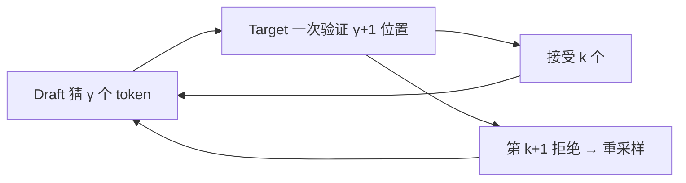

# Speculative Decoding

> 从 Bit 到 AGI · 第八章：推理（Inference） · 草稿模型投机解码

自回归 decode 每步只产 1 个 token，大模型每步 forward 很贵。Speculative Decoding 用 **小草稿模型** 连续猜 $\gamma$ 个 token，再用 **目标大模型一次 forward** 并行验证——猜对的 token 「白赚」，猜错的从第一个错误处回滚重采样。

## 直觉

你写论文，导师改稿。 naive 方式：写 1 个字给导师看 1 次。投机方式：你 **先猜着写 5 个字**，导师 **一眼看 5 个字** 批注「前 3 个 OK，第 4 个不对」——保留 3 个，从第 4 个重写。只要猜对率高，总往返次数就少。

数学上可证明：**输出分布与逐步大模型采样一致**（无偏），只要验证步用正确的 rejection sampling。



## 定义

**参与方**：

- **Target** $M_t$：高质量大模型（70B）
- **Draft** $M_d$：小模型（7B）或 **n-gram / Medusa 头**

**一步算法**（简化）：

1. $M_d$ 自回归生成 $\gamma$ 个 draft token：$\hat{x}_{t+1}, \ldots, \hat{x}_{t+\gamma}$
2. $M_t$ **一次 forward** 得到位置 $t+1 \ldots t+\gamma$ 的 logits（用 draft 作为输入前缀）
3. 从左到右比较：若 $M_t$ 以足够概率「同意」$\hat{x}_{t+i}$，则接受；否则在第 $i$ 个处 **按修正分布重采样 1 个**，丢弃其后 draft
4. 平均 **每轮接受 $\tau$ 个 token**（$\tau \in [1, \gamma]$）

**加速比**（粗估）：

$$
\text{speedup} \approx \frac{\mathbb{E}[\text{接受数}]}{1 + \frac{T_d \gamma + T_t}{T_t}}
$$

$T_d$：draft 一步耗时；$T_t$：target 一步耗时。当 $M_d$ 很快且接受率 $\alpha$ 高时，接近 **$\gamma$ 倍**（上限）。

## 例子

**例 1：数字沙盘**

- Target：70B，单步 **100 ms**
- Draft：7B，单步 **8 ms**
- $\gamma = 4$，平均接受 **3** 个 token/轮

Naive target：4 token → $4 \times 100 = 400$ ms → **100 ms/tok**（这就是基线）

Speculative：draft $4 \times 8 = 32$ ms + verify 1 次 100 ms = **132 ms**，接受 3 个 → $132 / 3 =$ **44 ms/tok**（≈ **2.3×**）

注意这一轮的账：**draft 的 32 ms 是白花的**——它没产出任何 token，只是在猜。赚头全在「verify 一次 100 ms 就收了 3 个 token」上。所以接受数每多一个，这 132 ms 就被摊薄一分：

若接受 **3.5** 有效 token/轮（132 ms）：**38 ms/tok**（≈ **2.6×**）

若 $\gamma=8$，接受 6，draft 64 + verify 100 = 164 ms / 6 ≈ **27 ms/tok**（≈ **3.7×**）

**例 2：接受率 $\alpha$ 从哪来**

| 任务 | 典型 $\alpha$ | 效果 |
| ---- | ------------- | ---- |
| 代码补全（局部确定） | 0.7～0.9 | 很赚 |
| 开放闲聊 | 0.3～0.5 | 一般 |
| 多语言混写 | 低 | 可能负优化 |

Draft 与 Target **同族、同 tokenizer** 时接受率最高（如 Llama-8B draft + Llama-70B target）。

**例 3：变体**

| 方法 | Draft 来源 |
| ---- | ---------- |
| Classic speculative | 小 LM |
| Medusa | 多个解码头并行猜 |
| EAGLE / EAGLE-2 / EAGLE-3 / MTP | 特征层 draft 或原生多 Token 预测头（DeepSeek-V3 等） |
| Lookahead / n-gram | 无神经网络 |

```python
# 概念：接受概率（简化 rejection）
import random

def accept_token(p_target, p_draft):
    """若 p_target >= p_draft，接受；否则以 p_target/p_draft 概率接受"""
    if p_draft <= 0:
        return False
    r = min(1.0, p_target / p_draft)
    return random.random() < r
```

## 量化

- **Target forward 次数**：从 **每 token 1 次** 降到 **每 $\tau$ 个 token ~1 次**；verify 需 **特殊 attention**（一次看 $\gamma+1$ 位置），仍比 $\gamma$ 次独立 forward 省。
- **显存**：同时驻留 $M_t + M_d$ → 7B+70B 可能 **> 80 GiB**；可 draft 量化 INT4、或 Medusa 只加小头。
- **端到端**：Llama-70B 上常见 **1.5～2.5×** tok/s 提升（视 workload）；**TTFT 不变**（prefill 仍 target 主导）。

::: info

Speculative Decoding **不改变输出分布**（在正确实现下）；与「蒸馏到小模型」不同——后者改分布换永久加速。

:::

## 工程现场：接受率与 ROI 估算

上线 Speculative 前应用 **离线测 accept rate** $\alpha$（同分布验证集），再算是否值得 **多占一份 draft 显存**。

**ROI 粗公式**：设 target 单步 $T_t$，draft 单步 $T_d$，猜 $\gamma$ 个，平均接受 $a$ 个 token（含修正采样那 1 个）。一轮耗时 $\approx \gamma T_d + T_t$，产出 $\approx a$ token：

$$
\text{有效 ITL} \approx \frac{\gamma T_d + T_t}{a}, \quad
\text{speedup} \approx \frac{T_t}{\text{有效 ITL}}
$$

**填数**：$T_t=80$ ms，$T_d=7$ ms，$\gamma=6$，$a=3.5$ → 有效 ITL $= (42+80)/3.5 \approx 34.9$ ms，speedup **2.29×**。若 $a=1.5$（开放域闲聊）→ **81 ms**，**略慢于** 纯 target（80 ms）——**负优化**。

### 自己拖一下

上面这些手算正是本页开头翻车的地方（那个 25 ms/tok 的笔误）。与其再算一遍，不如拖：

<SpecDecodeRoi />

**看那条曲线的峰。** γ 越大，一轮能收的 token 越多，但 draft 的开销 $\gamma T_d$ 线性涨、而接受数按 $\alpha^\gamma$ 衰减——两股力量交叉出一个最优 γ，它随 α 移动。

**一个容易搞反的结论**：接受率低不会让投机解码「必亏」。拖到 $\alpha = 0.2$，$\gamma=1$ 时仍有 **1.11×**——因为 target 那步保底产出一个 token，而 draft 很便宜。真正亏钱的是**猜太多**（同样 $\alpha=0.2$，$\gamma=16$ 只剩 0.55×），或者 **draft 太贵**（把 draft 单步拖到 40 ms 以上，整条曲线就沉到 1× 以下了）。所以 draft 模型的第一要求不是准，是**小**。

**Draft 选型**：

| Draft | 显存增量 | 典型 $\alpha$ |
| ----- | -------- | ------------- |
| 同族 7B FP16 | +16 GiB | 0.55～0.75 |
| 7B INT4 | +4 GiB | 略降 |
| Medusa 头 | +数百 MiB | 0.4～0.6 |
| N-gram | 几乎 0 | 代码补全高、 prose 低 |

**与 Continuous Batching 叠加**：verify 步 batch 内各序列 $\gamma$ 可不同；实现复杂。工业界常 **per-request speculative** 或 **统一 $\gamma$**。

**质量**：正确 rejection sampling 下 **分布等价** target 逐步采样——但 **相同 seed** 不会得到相同 token 序列（路径不同），回归测试要用 **分布级** 指标而非逐 token diff。

**Medusa / EAGLE**：不另跑完整 draft 模型，在 **target 中间层** 加 **轻量头** 猜多 token——显存 **+数百 MiB** 而非 **+16 GiB**，accept rate **略低于** 7B draft，但 **ROI** 在 **单卡 70B** 场景常更好。

**Batch speculative**：batch 内各序列 **$\gamma$ 不同**、accept 长度不同——实现 **复杂**；vLLM 等 **逐步完善** 中，读 release note 确认 **是否支持**。

## 常见误区

1. **「draft 错就全废」**——只回滚 **第一个 disagree** 之后；之前接受的仍有效。
2. **「$\gamma$ 越大越好」**——$\gamma$ 大 → draft 时间长 + verify 变长 + 尾部 token 更易拒 → 存在最优 $\gamma$（常 4～8）。
3. **「任何模型都能配」**——tokenizer、词表、特殊 token 必须一致；架构差异过大接受率崩盘。

## 动手试一试

设 $T_t=80$ ms，$T_d=6$ ms，$\gamma=5$，平均接受 $\tau=3.5$：

- Naive：$80$ ms/tok
- Spec：$(5 \times 6 + 80) / 3.5 \approx 34.3$ ms/tok → speedup **2.3×**

改接受率到 2.0，重算是否仍划算。

## 回顾与衔接

Speculative Decoding（[Leviathan et al., 2023](https://arxiv.org/abs/2211.17192)；[Chen et al., 2023](https://arxiv.org/abs/2302.01318)）证明：在 **draft 与 target 同分布可采** 的前提下，**并行验证 + rejection sampling** 可保持 **精确 target 分布**——不是「蒸馏近似」，而是 **等价采样路径不同**。

它改的是 **有效 ms/tok**，不改 [Sampling](/manual/llm/bit-to-agi/08-inference/sampling) 语义。与 [Continuous Batching](/manual/llm/bit-to-agi/08-inference/continuous-batching) 联调时，verify 步的 **batch 形状** 更复杂——工业界常 **代码补全**（高 $\alpha$）先上 speculative，开放 chat 后上。

显存 **target + draft** 叠加；若已 [TP=8 跑 70B](/manual/llm/bit-to-agi/08-inference/tensor-parallel)，draft 7B INT4 **+4 GiB** 可能是 **ROI 极高** 的边际投资之一——accept rate 0.6、2× speedup 即 **等效多一倍 QPS**。

## 读者问答

**问：投机解码会改变输出吗？**
正确实现下 **分布等价** 逐步 target 采样；**同一 seed 不会 bit 相同**，但 **统计性质一致**。

**问：draft 可以用 GPT-2 吗？**
**词表与 tokenizer 必须一致**；跨架构 draft **accept rate 极低**，可能 **比不用更慢**。

## 速查卡

| 变量 | 典型值 |
| ---- | ------ |
| $\gamma$ | 4～8 |
| draft | 同族小模型或 Medusa |
| accept rate | >0.5 才值得上 |
| speedup | 1.5～2.5×（好场景） |

**验算**：$\text{ITL}_\text{eff} \approx (\gamma T_d + T_t) / \bar{a}$；$\bar{a} \lt 1.5$ 时 **慎上**。

**落地顺序**：先 **离线测 accept rate** → 再 **灰度 5% 流量** → 看 **ITL 与 error rate**；accept **低于 0.4** 时 **关闭 speculative** 反可 **降延迟**。

Leviathan 2022 与 Chen 2023 **并行验证** 两篇论文建议 **都读 abstract**；实现细节看 **vLLM speculative 模块**。**accept rate** 应 **按业务分桶** 监控。

Speculative Decoding 的 **工程复杂度** 高于 **纯 TP**：要维护 **双模型、verify kernel、与 continuous batch 的交互**。团队 **小于一定规模** 时，**优先 INT4 + 好 scheduler** 的 ROI **常高于** speculative——**accept rate 不够高时尤甚**。

**本章衔接**：Speculative 不改变采样语义；与 [Continuous Batching](/manual/llm/bit-to-agi/08-inference/continuous-batching) **联调** 时 profile **verify 步 batch 形状**。**accept rate 监控** 应成为 **上线必选项**。

## 小结

Speculative Decoding 用小模型批量提议、大模型批量验证，在保持分布的前提下减少 target forward 次数。下一篇进入 **Sampling**：logits 如何变成下一个 token。

→ 下一篇：[Sampling 是什么](/manual/llm/bit-to-agi/08-inference/sampling)
